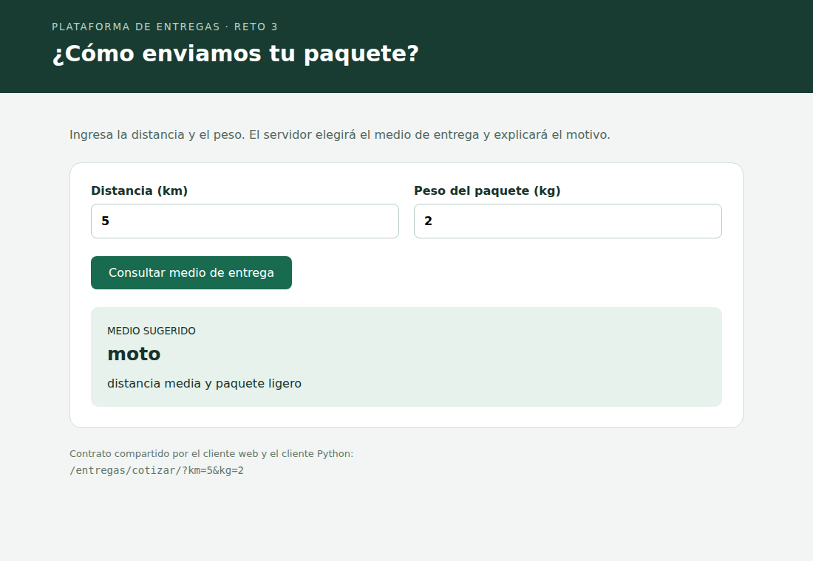

# EXTRA — Retos sobre la ruta de Django

## Integrantes

1. Eduardo Osvaldo Rodriguez Gutierrez
2. Rodrigo Vega Espinoza
3. Diego Rivera Cisneros
4. Diego Soria Magos
5. Gonzalo Garcia Chavez

## Estado de la entrega

| Reto | Estado comprobado en esta preparación | Pendiente del equipo |
| --- | --- | --- |
| 1 | Entorno y comandos preparados | Evidencias de los cinco integrantes en sus propias computadoras |
| 2 | Implementado; peticiones HTTP reales y validación 400 | Revisar y poder explicar la regla |
| 3 | Implementado; capturas web y salida Python antes/después | Poder repetir la demostración |
| 4 | Código y configuración Docker preparados; fallo/arreglo probados con procesos locales | Ejecutar Docker con tres y cinco contenedores y guardar las salidas |
| 5 | Cinco casos respondidos | Revisar el razonamiento entre todos |

Las evidencias que siguen se capturaron al ejecutar el código. La prueba local del reto 4 usa procesos independientes en una sola máquina, SQLite compartido y peticiones por turnos a puertos distintos; **no es evidencia Docker**. No se afirma que los cinco integrantes ya hayan ejecutado el reto 1. No se presenta una calificación obtenida: el docente la determina con las evidencias.

## Reto 1 — La ruta en todas las computadoras

### Procedimiento individual

Cada integrante debe clonar el repositorio, crear y activar su propio entorno, instalar `requirements.txt`, ejecutar `python manage.py migrate` y abrir `/entregas/estado/`. Los pasos completos están en [GUIA_EQUIPO.md](GUIA_EQUIPO.md). Registrar aquí la salida de `python -c "import sys; print(sys.prefix)"` y enlazar su captura.

### Eduardo Osvaldo Rodriguez Gutierrez

- Sistema operativo: **pendiente de confirmar**.
- Salida real de `python -c "import sys; print(sys.prefix)"`: **pendiente de ejecutar en su computadora**.
- Captura real de `/entregas/estado/`: **pendiente**. Guardar como `evidencias/reto1/eduardo_estado.png` y agregar aquí su enlace.
- Error y solución, si los hubo: **pendiente de registrar; no se inventó un intento**.

### Rodrigo Vega Espinoza

- Sistema operativo: **pendiente de confirmar**.
- Salida real de `python -c "import sys; print(sys.prefix)"`: **pendiente de ejecutar en su computadora**.
- Captura real de `/entregas/estado/`: **pendiente**. Guardar como `evidencias/reto1/rodrigo_estado.png` y agregar aquí su enlace.
- Error y solución, si los hubo: **pendiente de registrar; no se inventó un intento**.

### Diego Rivera Cisneros

- Sistema operativo: **pendiente de confirmar**.
- Salida real de `python -c "import sys; print(sys.prefix)"`: **pendiente de ejecutar en su computadora**.
- Captura real de `/entregas/estado/`: **pendiente**. Guardar como `evidencias/reto1/diego_rivera_estado.png` y agregar aquí su enlace.
- Error y solución, si los hubo: **pendiente de registrar; no se inventó un intento**.

### Diego Soria Magos

- Sistema operativo: **pendiente de confirmar**.
- Salida real de `python -c "import sys; print(sys.prefix)"`: **pendiente de ejecutar en su computadora**.
- Captura real de `/entregas/estado/`: **pendiente**. Guardar como `evidencias/reto1/diego_soria_estado.png` y agregar aquí su enlace.
- Error y solución, si los hubo: **pendiente de registrar; no se inventó un intento**.

### Gonzalo Garcia Chavez

- Sistema operativo: **pendiente de confirmar**.
- Salida real de `python -c "import sys; print(sys.prefix)"`: **pendiente de ejecutar en su computadora**.
- Captura real de `/entregas/estado/`: **pendiente**. Guardar como `evidencias/reto1/gonzalo_estado.png` y agregar aquí su enlace.
- Error y solución, si los hubo: **pendiente de registrar; no se inventó un intento**.

### Diferencias de comandos entre sistemas

En Windows se puede usar `py -3 -m venv .venv` y activar con `.\.venv\Scripts\Activate.ps1` en PowerShell. En Linux/macOS se usa `python3 -m venv .venv` y `source .venv/bin/activate`; la carpeta interna del entorno es `bin` en lugar de `Scripts`. Con el entorno activo, los comandos `python manage.py ...` y `python -m pip install -r requirements.txt` son iguales. **El equipo aún debe confirmar si efectivamente trabajó en distintos sistemas.**

## Reto 2 — Una cotización que entrega datos

### Regla elegida

Evaluamos primero el peso: más de 20 kg requiere camioneta. También usamos camioneta si la distancia supera 15 km. Para paquetes de hasta 5 kg y distancias de hasta 6 km usamos bicicleta; los casos restantes usan moto. El límite de bicicleta fue inicialmente 3 km y se cambió a 6 km para el reto 3; esta es la versión final. Son límites propuestos para la práctica, no capacidades operativas verificadas de vehículos reales.

La regla no depende de `request`, del navegador ni del cliente Python. La cotización es un ejercicio separado del planificador del registro de pedidos que ya existía en el proyecto del día 4.

### Código de `entregas/reglas.py`

```python
"""Reglas de cotización independientes de HTTP y de los clientes."""
LIMITE_BICICLETA_KM = 6.0
LIMITE_BICICLETA_KG = 5.0
LIMITE_MOTO_KM = 15.0
LIMITE_MOTO_KG = 20.0


def elegir_medio(km: float, kg: float) -> tuple[str, str]:
    if kg > LIMITE_MOTO_KG:
        return 'camioneta', 'paquete de más de 20 kg'
    if km > LIMITE_MOTO_KM:
        return 'camioneta', 'distancia de más de 15 km'
    if km <= LIMITE_BICICLETA_KM and kg <= LIMITE_BICICLETA_KG:
        return 'bicicleta', 'distancia corta y paquete de hasta 5 kg'
    return 'moto', 'distancia media y paquete ligero'
```

### Código de la vista `cotizar` (`entregas/retos_views.py`)

```python
from django.http import JsonResponse
from django.views.decorators.http import require_GET
from entregas.reglas import elegir_medio
from entregas.validacion import leer_numero

@require_GET
def cotizar(request):
    try:
        km = leer_numero(request.GET, 'km')
        kg = leer_numero(request.GET, 'kg')
    except ValueError as error:
        return JsonResponse({'error': str(error)}, status=400)
    medio, motivo = elegir_medio(km, kg)
    return JsonResponse({'km': km, 'kg': kg, 'medio': medio, 'motivo': motivo})
```

La validación se ejecuta en el backend antes de invocar la regla. Los valores llegan como texto; faltantes, vacíos, texto no numérico, negativos, `NaN` e infinito producen JSON 400.

### Código de `entregas/validacion.py`

```python
import math


def leer_numero(parametros, nombre):
    texto = parametros.get(nombre)
    if texto is None or not texto.strip():
        raise ValueError(f'Falta el parámetro {nombre}.')
    try:
        valor = float(texto)
    except (ValueError, OverflowError):
        raise ValueError(f'{nombre} debe ser un número válido.') from None
    if not math.isfinite(valor):
        raise ValueError(f'{nombre} debe ser un número finito.')
    if valor < 0:
        raise ValueError(f'{nombre} no puede ser negativo.')
    return valor
```

### Evidencias: peticiones HTTP reales

Las primeras tres consultas son las exigidas; se agregaron casos de negativos y `NaN` para comprobar que no entren datos inválidos.

```text
GET http://127.0.0.1:8000/entregas/cotizar/?km=5&kg=2
HTTP 200
{"km": 5.0, "kg": 2.0, "medio": "bicicleta", "motivo": "distancia corta y paquete de hasta 5 kg"}

GET http://127.0.0.1:8000/entregas/cotizar/?kg=2
HTTP 400
{"error": "Falta el parámetro km."}

GET http://127.0.0.1:8000/entregas/cotizar/?km=abc&kg=2
HTTP 400
{"error": "km debe ser un número válido."}

GET http://127.0.0.1:8000/entregas/cotizar/?km=-1&kg=2
HTTP 400
{"error": "km no puede ser negativo."}

GET http://127.0.0.1:8000/entregas/cotizar/?km=NaN&kg=2
HTTP 400
{"error": "km debe ser un número finito."}

GET http://127.0.0.1:8000/entregas/cotizar/?km=5&kg=-2
HTTP 400
{"error": "kg no puede ser negativo."}
```

### Respuesta 1: ¿por qué validar en el backend?

Porque el backend es la autoridad que recibe datos de todos los clientes. Una persona puede omitir el formulario y llamar directamente a la URL con un navegador, `curl` o un programa; además, una app antigua puede tener una validación distinta. La validación móvil ayuda a la experiencia del usuario, pero no protege el servidor. Validar también en Django evita ejecutar reglas con valores inválidos y devuelve un contrato de error claro con HTTP 400.

### Respuesta 2: ¿qué patrón sustituiría la cadena de `if`?

Usaríamos **Strategy** cuando los medios tengan algoritmos y condiciones que cambien de forma independiente: cada estrategia implementaría el mismo contrato para evaluar o planear una entrega, y un servicio seleccionaría la estrategia correspondiente. Así podríamos agregar y probar el dron o un quinto medio sin meter toda su lógica en la vista ni modificar los clientes. Un registro o una tabla de prioridades puede organizar la selección; una fábrica se encargaría de construir los objetos si hace falta. Strategy separa comportamientos, pero no elimina mágicamente la necesidad de decidir cuál usar. Para estas cuatro reglas cortas conservamos una función simple.

## Reto 3 — Dos clientes, un solo backend

### Implementación

El cliente web está en `entregas/templates/entregas/cotizador.html`, servido por `/entregas/cotizador/`. Intercepta el envío con `preventDefault()`, llama con `fetch` a `/entregas/cotizar/`, comprueba el estado HTTP y muestra `medio` y `motivo` con `textContent`. El cliente simulado es `cliente_movil.py`, utiliza `urllib.request` y consume exactamente el mismo contrato JSON. Ninguno decide qué vehículo corresponde.

### Cambio realizado exclusivamente en el backend

```diff
-LIMITE_BICICLETA_KM = 3.0
+LIMITE_BICICLETA_KM = 6.0
```

Se reinició Django para cargar el nuevo código Python. En ambos casos la consulta fue `km=5&kg=2`. El código final conserva 6 km. Las huellas SHA-256 de ambos archivos cliente fueron iguales antes y después.

### Antes: límite de bicicleta de 3 km



```text
LIMITE_BICICLETA_KM = 3.0
WEB fetch -> HTTP 200 {"km": 5.0, "kg": 2.0, "medio": "moto", "motivo": "distancia media y paquete ligero"}
Navegaciones al consultar: 0

GET http://127.0.0.1:8000/entregas/cotizar/?km=5&kg=2
Medio sugerido: moto
Motivo: distancia media y paquete ligero
```

### Después: límite de bicicleta de 6 km


```text
LIMITE_BICICLETA_KM = 6.0
WEB fetch -> HTTP 200 {"km": 5.0, "kg": 2.0, "medio": "bicicleta", "motivo": "distancia corta y paquete de hasta 5 kg"}
Navegaciones al consultar: 0

GET http://127.0.0.1:8000/entregas/cotizar/?km=5&kg=2
Medio sugerido: bicicleta
Motivo: distancia corta y paquete de hasta 5 kg
```

### Comprobación de que los clientes no cambiaron

```text
SHA-256 antes = después.
{
  "cliente_movil.py": "cab0315ceaebabd771334953c0fab74e6d08d9662e73f3bdf8911a33174189e6",
  "entregas/templates/entregas/cotizador.html": "5999aedf583f1508d30f425f28452b520e814e6179ecf733a118ecfebe23e627"
}
```

La automatización comprobó que el formulario no recargó la página y que un error 400 se mostró en el cliente web sin dejar visible una cotización anterior. Para repetir las capturas se incluye `scripts/capturar_reto3.py`; Playwright es una dependencia opcional para generar evidencia, no para usar la app.

### Respuesta: si la regla estuviera en JavaScript

Al cambiarla solo en el JavaScript, el cliente Python no recibiría automáticamente la nueva decisión. Habría que duplicar y actualizar la regla también en Python o hacer que el backend la implementara. Mientras alguna versión quedara sin actualizar, los dos clientes podrían recomendar medios diferentes para el mismo paquete. Al ubicarla en el backend compartido, el cambio se refleja en ambos sin editar sus programas.

## Reto 4 — Réplicas: hacerlo fallar y arreglarlo

### Hasta dónde se llegó y limitación real

Se prepararon `Dockerfile`, `.dockerignore`, `docker-compose.yml`, `nginx/default.conf`, configuración por variables de entorno y migraciones. Compose declara PostgreSQL con volumen, un servicio de migración única, tres copias de Django con dos workers cada una y nginx como entrada. **Docker no está instalado en el entorno donde se preparó este paquete**, por lo que no se ejecutaron aquí las etapas 4 y 5 con contenedores, ni se verificó el despliegue con PostgreSQL/nginx.

```text
$ docker --version
/bin/bash: docker: command not found
Estado: no se ejecutaron Docker Compose, nginx ni PostgreSQL.
```

Para avanzar se ejecutó el mismo código en procesos Django independientes, compartiendo SQLite. Esto permitió observar el fallo global y verificar la corrección, pero deja pendiente la evidencia obligatoria Docker. El equipo puede completar el reto con `python scripts/reto4_docker.py` en una computadora con Docker; ese script incorpora las salidas reales al apartado siguiente. Si falla, conserva el error en archivos `evidencias/docker_*.txt` para explicar el intento.

### Evidencias Docker obligatorias — pendientes

<!-- DOCKER_EVIDENCIAS_INICIO -->

**Sin ejecutar todavía.** Pendientes de evidencia real:

1. Construcción/ejecución de la imagen y arranque de tres copias; seis consultas a `/entregas/visitas/` y seis a `/entregas/visitas-mal/`.
2. Escritura en `/entregas/ultimo/?folio=ABC123` y lecturas sucesivas de `/entregas/ultimo/ver/` con el modo global, observando el error.
3. Las mismas rutas con el arreglo de sesión y tres copias distintas.
4. Salida de `docker compose up -d --scale web=5`, estado de contenedores y comprobación del arreglo con cinco copias distintas.

<!-- DOCKER_EVIDENCIAS_FIN -->

### 1. Contadores: evidencia complementaria local

En las seis peticiones de sesión el valor fue `1, 2, 3, 4, 5, 6`. En las seis peticiones globales fue `1, 1, 1, 2, 2, 2`: cada proceso lleva su propia cuenta. Como todos están en la misma máquina, `atendido_por` coincide; los puertos y el campo `proceso` muestran que son procesos independientes.

### 2. Folio global: fallo observado

Se guardó `ABC123` en el primer proceso. Al alternar las lecturas, ese proceso devolvió `ABC123` y los otros dos devolvieron `null`. La variable global está en la memoria del proceso que atendió la escritura; no se comparte con los demás. También puede mezclar usuarios cuando sí llegan al mismo proceso.

### 3. Arreglo: folio por sesión

La versión final usa `request.session['ultimo_folio']`. La sesión está en la base común y se identifica con una cookie que el cliente reenvía. Las seis lecturas en tres procesos conservaron `ABC123`. Dos usuarios distintos mantienen folios distintos, comprobado por una prueba automatizada. No se usa una variable global para el estado de usuario en las vistas corregidas.

### 4. Comprobación complementaria con cinco procesos

Se iniciaron cinco procesos y se hicieron diez lecturas, cubriendo cada proceso dos veces. Todas devolvieron `ABC123`. Esta comprobación sigue siendo local; la prueba con `--scale web=5` está pendiente.

### Salida completa de la prueba local

```text
PRUEBA LOCAL COMPLEMENTARIA: procesos independientes, SQLite compartido, sin Docker/nginx/PostgreSQL.

ETAPA: 3 procesos; almacenamiento=global
puerto=8101 GET /entregas/visitas/ -> HTTP 200 {"atendido_por": "e5d45539081f", "proceso": 6, "visitas": 1}
puerto=8102 GET /entregas/visitas/ -> HTTP 200 {"atendido_por": "e5d45539081f", "proceso": 7, "visitas": 2}
puerto=8103 GET /entregas/visitas/ -> HTTP 200 {"atendido_por": "e5d45539081f", "proceso": 8, "visitas": 3}
puerto=8101 GET /entregas/visitas/ -> HTTP 200 {"atendido_por": "e5d45539081f", "proceso": 6, "visitas": 4}
puerto=8102 GET /entregas/visitas/ -> HTTP 200 {"atendido_por": "e5d45539081f", "proceso": 7, "visitas": 5}
puerto=8103 GET /entregas/visitas/ -> HTTP 200 {"atendido_por": "e5d45539081f", "proceso": 8, "visitas": 6}
puerto=8101 GET /entregas/visitas-mal/ -> HTTP 200 {"atendido_por": "e5d45539081f", "proceso": 6, "visitas": 1}
puerto=8102 GET /entregas/visitas-mal/ -> HTTP 200 {"atendido_por": "e5d45539081f", "proceso": 7, "visitas": 1}
puerto=8103 GET /entregas/visitas-mal/ -> HTTP 200 {"atendido_por": "e5d45539081f", "proceso": 8, "visitas": 1}
puerto=8101 GET /entregas/visitas-mal/ -> HTTP 200 {"atendido_por": "e5d45539081f", "proceso": 6, "visitas": 2}
puerto=8102 GET /entregas/visitas-mal/ -> HTTP 200 {"atendido_por": "e5d45539081f", "proceso": 7, "visitas": 2}
puerto=8103 GET /entregas/visitas-mal/ -> HTTP 200 {"atendido_por": "e5d45539081f", "proceso": 8, "visitas": 2}
puerto=8101 GET /entregas/ultimo/?folio=ABC123 -> HTTP 200 {"atendido_por": "e5d45539081f", "proceso": 6, "folio": "ABC123", "almacenamiento": "global"}
puerto=8101 GET /entregas/ultimo/ver/ -> HTTP 200 {"atendido_por": "e5d45539081f", "proceso": 6, "folio": "ABC123", "almacenamiento": "global"}
puerto=8102 GET /entregas/ultimo/ver/ -> HTTP 200 {"atendido_por": "e5d45539081f", "proceso": 7, "folio": null, "almacenamiento": "global"}
puerto=8103 GET /entregas/ultimo/ver/ -> HTTP 200 {"atendido_por": "e5d45539081f", "proceso": 8, "folio": null, "almacenamiento": "global"}
puerto=8101 GET /entregas/ultimo/ver/ -> HTTP 200 {"atendido_por": "e5d45539081f", "proceso": 6, "folio": "ABC123", "almacenamiento": "global"}
puerto=8102 GET /entregas/ultimo/ver/ -> HTTP 200 {"atendido_por": "e5d45539081f", "proceso": 7, "folio": null, "almacenamiento": "global"}
puerto=8103 GET /entregas/ultimo/ver/ -> HTTP 200 {"atendido_por": "e5d45539081f", "proceso": 8, "folio": null, "almacenamiento": "global"}
FALLO OBSERVADO: solo el proceso que escribió recuerda ABC123.

ETAPA: 3 procesos; almacenamiento=sesion-db
puerto=8101 GET /entregas/ultimo/?folio=ABC123 -> HTTP 200 {"atendido_por": "e5d45539081f", "proceso": 9, "folio": "ABC123", "almacenamiento": "sesion-db"}
puerto=8101 GET /entregas/ultimo/ver/ -> HTTP 200 {"atendido_por": "e5d45539081f", "proceso": 9, "folio": "ABC123", "almacenamiento": "sesion-db"}
puerto=8102 GET /entregas/ultimo/ver/ -> HTTP 200 {"atendido_por": "e5d45539081f", "proceso": 10, "folio": "ABC123", "almacenamiento": "sesion-db"}
puerto=8103 GET /entregas/ultimo/ver/ -> HTTP 200 {"atendido_por": "e5d45539081f", "proceso": 11, "folio": "ABC123", "almacenamiento": "sesion-db"}
puerto=8101 GET /entregas/ultimo/ver/ -> HTTP 200 {"atendido_por": "e5d45539081f", "proceso": 9, "folio": "ABC123", "almacenamiento": "sesion-db"}
puerto=8102 GET /entregas/ultimo/ver/ -> HTTP 200 {"atendido_por": "e5d45539081f", "proceso": 10, "folio": "ABC123", "almacenamiento": "sesion-db"}
puerto=8103 GET /entregas/ultimo/ver/ -> HTTP 200 {"atendido_por": "e5d45539081f", "proceso": 11, "folio": "ABC123", "almacenamiento": "sesion-db"}
OK: 3 procesos devolvieron ABC123 con la misma cookie.

ETAPA: 5 procesos; almacenamiento=sesion-db
puerto=8101 GET /entregas/ultimo/?folio=ABC123 -> HTTP 200 {"atendido_por": "e5d45539081f", "proceso": 12, "folio": "ABC123", "almacenamiento": "sesion-db"}
puerto=8101 GET /entregas/ultimo/ver/ -> HTTP 200 {"atendido_por": "e5d45539081f", "proceso": 12, "folio": "ABC123", "almacenamiento": "sesion-db"}
puerto=8102 GET /entregas/ultimo/ver/ -> HTTP 200 {"atendido_por": "e5d45539081f", "proceso": 13, "folio": "ABC123", "almacenamiento": "sesion-db"}
puerto=8103 GET /entregas/ultimo/ver/ -> HTTP 200 {"atendido_por": "e5d45539081f", "proceso": 14, "folio": "ABC123", "almacenamiento": "sesion-db"}
puerto=8104 GET /entregas/ultimo/ver/ -> HTTP 200 {"atendido_por": "e5d45539081f", "proceso": 15, "folio": "ABC123", "almacenamiento": "sesion-db"}
puerto=8105 GET /entregas/ultimo/ver/ -> HTTP 200 {"atendido_por": "e5d45539081f", "proceso": 16, "folio": "ABC123", "almacenamiento": "sesion-db"}
puerto=8101 GET /entregas/ultimo/ver/ -> HTTP 200 {"atendido_por": "e5d45539081f", "proceso": 12, "folio": "ABC123", "almacenamiento": "sesion-db"}
puerto=8102 GET /entregas/ultimo/ver/ -> HTTP 200 {"atendido_por": "e5d45539081f", "proceso": 13, "folio": "ABC123", "almacenamiento": "sesion-db"}
puerto=8103 GET /entregas/ultimo/ver/ -> HTTP 200 {"atendido_por": "e5d45539081f", "proceso": 14, "folio": "ABC123", "almacenamiento": "sesion-db"}
puerto=8104 GET /entregas/ultimo/ver/ -> HTTP 200 {"atendido_por": "e5d45539081f", "proceso": 15, "folio": "ABC123", "almacenamiento": "sesion-db"}
puerto=8105 GET /entregas/ultimo/ver/ -> HTTP 200 {"atendido_por": "e5d45539081f", "proceso": 16, "folio": "ABC123", "almacenamiento": "sesion-db"}
OK: 5 procesos devolvieron ABC123 con la misma cookie.
```

### Código de la versión arreglada

Estas funciones están en `entregas/retos_views.py`. El selector de demostración solo permite reproducir deliberadamente la versión mala; el valor normal de `DEMO_ULTIMO_GLOBAL` es `False`.

```python
def _leer_folio(request):
    folio = request.GET.get('folio', '').strip()
    if not folio or len(folio) > 64:
        raise ValueError('folio es obligatorio y debe tener hasta 64 caracteres.')
    return folio

@require_GET
def ultimo(request):
    if settings.DEMO_ULTIMO_GLOBAL:
        return ultimo_mal(request)
    try:
        folio = _leer_folio(request)
    except ValueError as error:
        return JsonResponse({'error': str(error)}, status=400)
    request.session['ultimo_folio'] = folio
    return JsonResponse({**_copia(), 'folio': folio, 'almacenamiento': 'sesion-db'})

@require_GET
def ver_ultimo(request):
    if settings.DEMO_ULTIMO_GLOBAL:
        return ver_ultimo_mal(request)
    return JsonResponse({**_copia(), 'folio': request.session.get('ultimo_folio'), 'almacenamiento': 'sesion-db'})

```

Configuración necesaria (`config/settings.py`):

```python
# Dentro de INSTALLED_APPS:
'django.contrib.sessions'

# Dentro de MIDDLEWARE, antes de CommonMiddleware:
'django.contrib.sessions.middleware.SessionMiddleware'

SESSION_ENGINE = 'django.contrib.sessions.backends.db'
```

Se ejecuta `python manage.py migrate` para crear `django_session`. Con Compose, todas las copias usan el mismo PostgreSQL y la misma `DJANGO_SECRET_KEY`; nginx debe recargarse al cambiar las réplicas. El cliente conserva la cookie entre escritura y lectura. La solución satisface consultas secuenciales; una sesión no debe usarse como contador global atómico de peticiones simultáneas. Si se necesitara el último folio de toda la empresa en lugar del último por usuario, correspondería un modelo común, no una sesión individual.

### Respuesta: ¿por qué parecía funcionar con una copia y `runserver`?

Porque las escrituras y lecturas solían atenderse en el mismo proceso, que conservaba su propia variable en memoria. Al replicar, cada proceso tiene una memoria independiente; incluso dos workers del mismo contenedor ya tienen dos variables diferentes. La apariencia de funcionamiento desaparece al llegar a otro proceso o reiniciar el servidor, y el dato global además puede ser sobrescrito por otro usuario. Tener una sola copia no vuelve correcto ese almacenamiento.

## Reto 5 — Casos para pensar, sin código

### 1. Cambiar `medios_disponibles` por `medios`

No renombraríamos directamente el campo, porque los teléfonos instalados dependen del contrato actual y podrían fallar al buscar `medios_disponibles`. Haríamos un cambio compatible agregando `medios` y conservando el campo anterior durante la migración, o publicaríamos una versión nueva de la API manteniendo la anterior. Documentaríamos la transición, actualizaríamos los clientes y retiraríamos el nombre antiguo solo después de comprobar que las versiones que lo usan dejaron de necesitarlo; si hay clientes que no se actualizan, la compatibilidad tendría que durar más tiempo.

### 2. Mensajes a repartidores a las 7:00 con cinco copias

Si cada copia arranca el mismo programador, las cinco podrían programar o enviar el mensaje, produciendo duplicados. Ese trabajo debe salir del ciclo de las peticiones y ejecutarse mediante un programador único y una cola de tareas para workers, por ejemplo un servicio de scheduler separado más workers. Definiríamos la zona horaria y una clave única por repartidor y fecha para evitar duplicados en reintentos. Tener un scheduler único reduce ejecuciones repetidas, pero la tarea también debe ser idempotente ante fallos y reentregas.

### 3. Foto guardada en `fotos/` del contenedor

La foto quedó en el sistema de archivos local de una copia. Cuando otra petición llega a un contenedor distinto, ese archivo no está allí; además puede perderse cuando se recrea el contenedor. Usaríamos almacenamiento compartido y persistente, preferiblemente un servicio de objetos, y guardaríamos su clave o URL en la base de datos. Un volumen compartido bien configurado también puede servir en un entorno de un solo host; un volumen local separado por copia no resuelve el problema. La misma foto debe estar disponible desde cualquier réplica.

### 4. Borrar el entorno virtual porque ya hay Docker

Podemos desarrollar exclusivamente en contenedores si configuramos montaje del código, recarga y herramientas, pero `docker compose up` por sí solo no garantiza ese flujo: este Dockerfile copia el código en la imagen y usa Gunicorn sin recarga. En la ruta del curso conviene conservar el entorno virtual para instalar bibliotecas Python aisladas y ejecutar rápido `runserver`, pruebas y herramientas del editor. Docker reproduce además sistema base, servidor, base de datos y balanceador para integrar y comprobar réplicas. Son herramientas con alcances distintos; no es obligatorio usar ambas siempre, pero este equipo gana un flujo local sencillo y una prueba reproducible de infraestructura.

### 5. Tocar dos veces «Pagar» detrás del balanceador

Las dos peticiones podrían atenderse en réplicas diferentes y crear dos cobros, aunque el botón se desactive después del primer toque; también puede ocurrir por reintentos de red. El tema que lo resuelve es **idempotencia**: el cliente envía la misma clave para el mismo intento de pago y el backend conserva el resultado en almacenamiento compartido, con una restricción única y manejo transaccional de la concurrencia. Se devuelve el resultado previo ante la repetición y se usa la misma clave con el proveedor de pagos si la admite. Una variable global, PRG o una transacción aislada por petición no bastan para deduplicar efectos externos.

## Validación automatizada

Se ejecutó `python manage.py test --verbosity 2`: nueve pruebas pasaron. Cubren validación, límites, método HTTP, sesión por usuario, modo de demostración y continuidad de la consulta HTML/JSON del pedido anterior.

```text
Creating test database for alias 'default' ('file:memorydb_default?mode=memory&cache=shared')...
Found 9 test(s).
Operations to perform:
  Synchronize unmigrated apps: staticfiles
  Apply all migrations: contenttypes, entregas, sessions
Synchronizing apps without migrations:
  Creating tables...
    Running deferred SQL...
Running migrations:
  Applying contenttypes.0001_initial... OK
  Applying contenttypes.0002_remove_content_type_name... OK
  Applying entregas.0001_initial... OK
  Applying sessions.0001_initial...test_datos_invalidos_son_400_json (entregas.tests.CotizacionTests.test_datos_invalidos_son_400_json) ... ok
test_limites_y_prioridad (entregas.tests.CotizacionTests.test_limites_y_prioridad) ... ok
test_post_no_admitido (entregas.tests.CotizacionTests.test_post_no_admitido) ... ok
test_respuesta_correcta (entregas.tests.CotizacionTests.test_respuesta_correcta) ... ok
test_pedido_existente_disponible_en_html_y_json (entregas.tests.ProyectoAnteriorTests.test_pedido_existente_disponible_en_html_y_json) ... ok
test_folio_aislado_por_usuario (entregas.tests.SesionTests.test_folio_aislado_por_usuario) ... ok
test_folio_vacio_es_400 (entregas.tests.SesionTests.test_folio_vacio_es_400) ... ok
test_modo_global_demostrativo (entregas.tests.SesionTests.test_modo_global_demostrativo) ... ok
test_visitas_con_cookie (entregas.tests.SesionTests.test_visitas_con_cookie) ... ok

----------------------------------------------------------------------
Ran 9 tests in 0.019s

OK
Destroying test database for alias 'default' ('file:memorydb_default?mode=memory&cache=shared')...
 OK
System check identified no issues (0 silenced).
```

## Fuentes consultadas

- [Apuntes del curso: ruta Django y retos](https://ealcaraz85.github.io/topicoswebmobil/#orga008ac4), consultados el 5 de octubre de 2026. La implementación amplía el proyecto del día 4 que ya tenía el equipo.
- [Django 5.2: sesiones](https://docs.djangoproject.com/en/5.2/topics/http/sessions/): configuración del middleware y backend de base de datos.
- [Docker Compose: `up` y `--scale`](https://docs.docker.com/reference/cli/docker/compose/up/): comandos de arranque y escalado.
