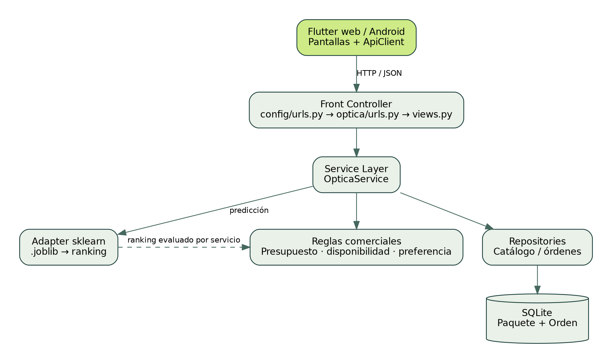
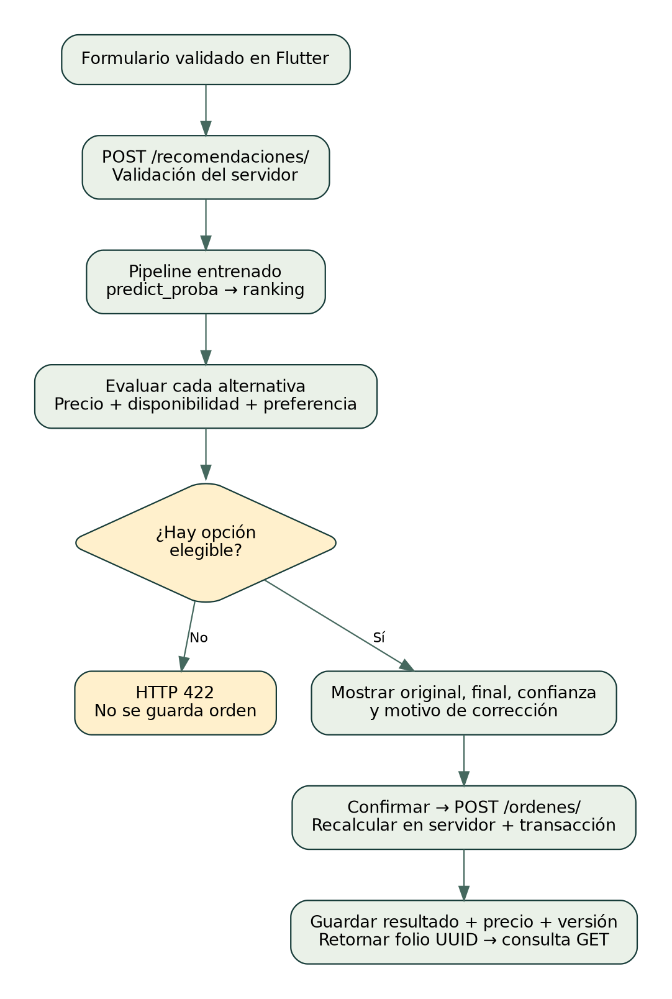
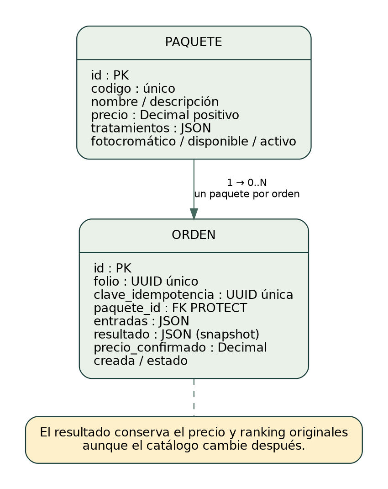
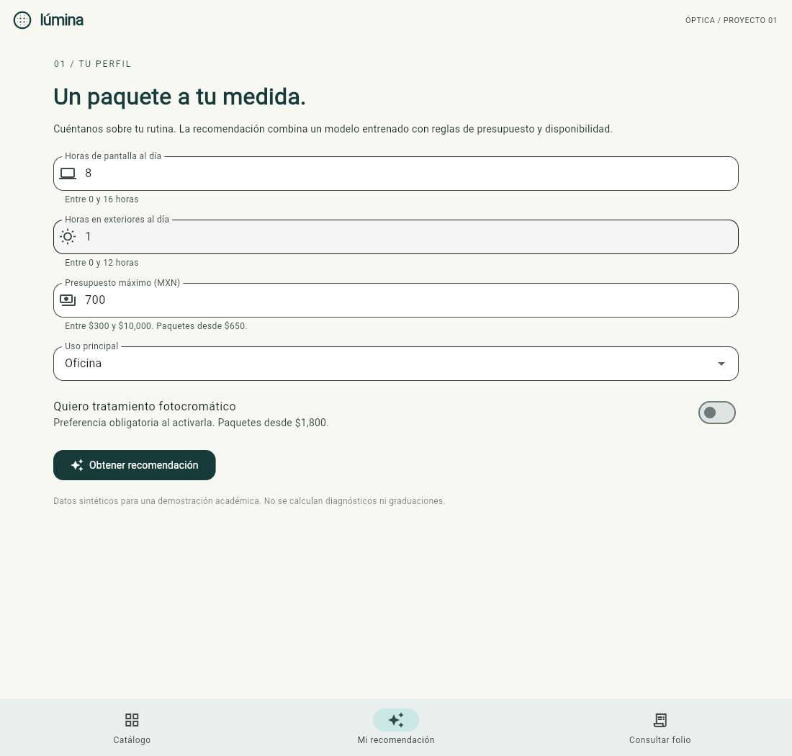
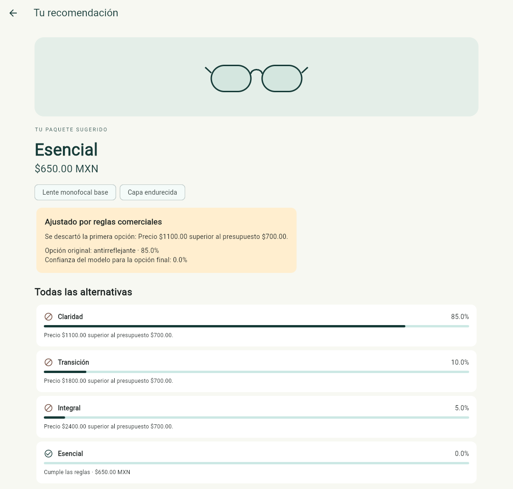
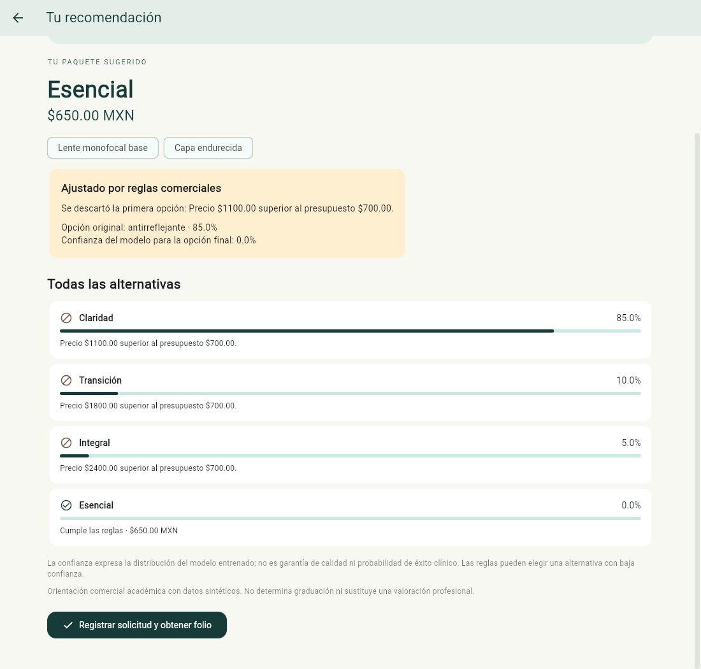
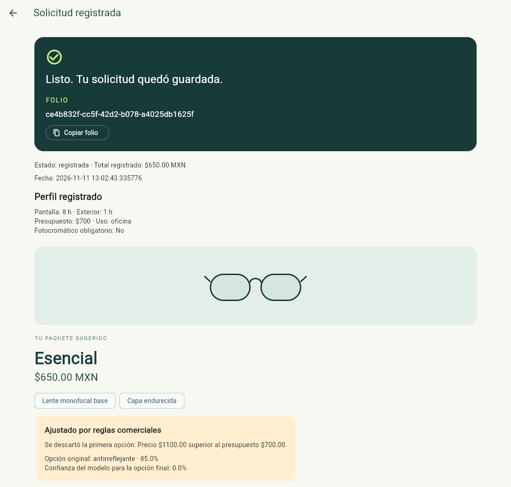

# Avance de análisis y diseño · Lúmina Óptica

Entrega: 12 de noviembre de 2026 · Control 22121280

Fuente editable del informe PDF. Generada con scripts/generar_informes.py.

AVANCE DE ANÁLISIS Y DISEÑO / ENTREGA INDIVIDUAL

## Lúmina Óptica

Eduardo Osvaldo Rodríguez Gutiérrez · Número de control: 22121280 · Ingeniería en Sistemas Computacionales · Instituto Tecnológico de Morelia · Materia: Tópicos Selectos de Tecnologías Web y Móvil · Entrega de análisis: 12 de noviembre de 2026

### Problema, objetivo y alcance

Un usuario necesita comparar paquetes comerciales de una óptica según su rutina y presupuesto. La propuesta es integrar un recomendador entrenado con reglas explícitas, mostrar su decisión en Flutter y registrar una solicitud consultable por folio. La asignación del dominio corresponde a la fila 23 de los proyectos progresivos de los apuntes.

Se desarrolla el Proyecto 1: Django, SQLite, catálogo, recomendador .joblib + reglas y cliente Flutter. El asistente entrenado corresponde al Proyecto 2; la integración de equipo y demostración web/móvil, al Proyecto 3. Los paquetes y precios se definen como supuestos propios de una óptica ficticia.

### Requisitos verificables

| (Paragraph(
'caseSensitive': 1
'encoding': 'utf8'
'text': 'ID'
'frags': [ParaFrag(__tag__='para', bold=0, fontName='DV', fontSize=8, greek=0, italic=1, link=[], rise=0, text='ID', textColor=Color(.14902,.231373,.215686,1), us_lines=[])]
'style': <ParagraphStyle 'SmallDV'>
'bulletText': None
'debug': 0
'width': 37
'_wrapWidths': [37, 37]
'_width_max': 8.0
'height': 11
'_splitLongWordCount': 0
'_hyphenations': 0
'blPara': ParaFrag(__tag__='para', ascent=5.82421875, bold=0, descent=-1.68359375, fontName='DV', fontSize=8, greek=0, italic=1, kind=0, lines=[(29.0, ['ID'])], link=[], rise=0, text='ID', textColor=Color(.14902,.231373,.215686,1), us_lines=[])
) #Paragraph,) | (Paragraph(
'caseSensitive': 1
'encoding': 'utf8'
'text': 'Requisito / evidencia'
'frags': [ParaFrag(__tag__='para', bold=0, fontName='DV', fontSize=8, greek=0, italic=1, link=[], rise=0, text='Requisito / evidencia', textColor=Color(.14902,.231373,.215686,1), us_lines=[])]
'style': <ParagraphStyle 'SmallDV'>
'bulletText': None
'debug': 0
'width': 426
'_wrapWidths': [426, 426]
'_width_max': 73.8203125
'height': 11
'_splitLongWordCount': 0
'_hyphenations': 0
'blPara': ParaFrag(__tag__='para', ascent=5.82421875, bold=0, descent=-1.68359375, fontName='DV', fontSize=8, greek=0, italic=1, kind=0, lines=[(352.1796875, ['Requisito', '/', 'evidencia'])], link=[], rise=0, text='Requisito / evidencia', textColor=Color(.14902,.231373,.215686,1), us_lines=[])
) #Paragraph,) |
| --- | --- |
| (Paragraph(
'caseSensitive': 1
'encoding': 'utf8'
'text': 'RF01'
'frags': [ParaFrag(__tag__='para', bold=0, fontName='DV', fontSize=8, greek=0, italic=1, link=[], rise=0, text='RF01', textColor=Color(.14902,.231373,.215686,1), us_lines=[])]
'style': <ParagraphStyle 'SmallDV'>
'bulletText': None
'debug': 0
'width': 37
'_wrapWidths': [37, 37]
'_width_max': 19.5625
'height': 11
'_splitLongWordCount': 0
'_hyphenations': 0
'blPara': ParaFrag(__tag__='para', ascent=5.82421875, bold=0, descent=-1.68359375, fontName='DV', fontSize=8, greek=0, italic=1, kind=0, lines=[(17.4375, ['RF01'])], link=[], rise=0, text='RF01', textColor=Color(.14902,.231373,.215686,1), us_lines=[])
) #Paragraph,) | (Paragraph(
'caseSensitive': 1
'encoding': 'utf8'
'text': 'Listar, buscar y consultar detalle de los paquetes mediante JSON.'
'frags': [ParaFrag(__tag__='para', bold=0, fontName='DV', fontSize=8, greek=0, italic=1, link=[], rise=0, text='Listar, buscar y consultar detalle de los paquetes mediante JSON.', textColor=Color(.14902,.231373,.215686,1), us_lines=[])]
'style': <ParagraphStyle 'SmallDV'>
'bulletText': None
'debug': 0
'width': 426
'_wrapWidths': [426, 426]
'_width_max': 234.34765625
'height': 11
'_splitLongWordCount': 0
'_hyphenations': 0
'blPara': ParaFrag(__tag__='para', ascent=5.82421875, bold=0, descent=-1.68359375, fontName='DV', fontSize=8, greek=0, italic=1, kind=0, lines=[(191.65234375, ['Listar,', 'buscar', 'y', 'consultar', 'detalle', 'de', 'los', 'paquetes', 'mediante', 'JSON.'])], link=[], rise=0, text='Listar, buscar y consultar detalle de los paquetes mediante JSON.', textColor=Color(.14902,.231373,.215686,1), us_lines=[])
) #Paragraph,) |
| (Paragraph(
'caseSensitive': 1
'encoding': 'utf8'
'text': 'RF02'
'frags': [ParaFrag(__tag__='para', bold=0, fontName='DV', fontSize=8, greek=0, italic=1, link=[], rise=0, text='RF02', textColor=Color(.14902,.231373,.215686,1), us_lines=[])]
'style': <ParagraphStyle 'SmallDV'>
'bulletText': None
'debug': 0
'width': 37
'_wrapWidths': [37, 37]
'_width_max': 19.5625
'height': 11
'_splitLongWordCount': 0
'_hyphenations': 0
'blPara': ParaFrag(__tag__='para', ascent=5.82421875, bold=0, descent=-1.68359375, fontName='DV', fontSize=8, greek=0, italic=1, kind=0, lines=[(17.4375, ['RF02'])], link=[], rise=0, text='RF02', textColor=Color(.14902,.231373,.215686,1), us_lines=[])
) #Paragraph,) | (Paragraph(
'caseSensitive': 1
'encoding': 'utf8'
'text': 'Recibir cinco características, ejecutar modelo + reglas y mostrar confianza, corrección y ranking.'
'frags': [ParaFrag(__tag__='para', bold=0, fontName='DV', fontSize=8, greek=0, italic=1, link=[], rise=0, text='Recibir cinco características, ejecutar modelo + reglas y mostrar confianza, corrección y ranking.', textColor=Color(.14902,.231373,.215686,1), us_lines=[])]
'style': <ParagraphStyle 'SmallDV'>
'bulletText': None
'debug': 0
'width': 426
'_wrapWidths': [426, 426]
'_width_max': 342.140625
'height': 11
'_splitLongWordCount': 0
'_hyphenations': 0
'blPara': ParaFrag(__tag__='para', ascent=5.82421875, bold=0, descent=-1.68359375, fontName='DV', fontSize=8, greek=0, italic=1, kind=0, lines=[(83.859375, ['Recibir', 'cinco', 'características,', 'ejecutar', 'modelo', '+', 'reglas', 'y', 'mostrar', 'confianza,', 'corrección', 'y', 'ranking.'])], link=[], rise=0, text='Recibir cinco características, ejecutar modelo + reglas y mostrar confianza, corrección y ranking.', textColor=Color(.14902,.231373,.215686,1), us_lines=[])
) #Paragraph,) |
| (Paragraph(
'caseSensitive': 1
'encoding': 'utf8'
'text': 'RF03'
'frags': [ParaFrag(__tag__='para', bold=0, fontName='DV', fontSize=8, greek=0, italic=1, link=[], rise=0, text='RF03', textColor=Color(.14902,.231373,.215686,1), us_lines=[])]
'style': <ParagraphStyle 'SmallDV'>
'bulletText': None
'debug': 0
'width': 37
'_wrapWidths': [37, 37]
'_width_max': 19.5625
'height': 11
'_splitLongWordCount': 0
'_hyphenations': 0
'blPara': ParaFrag(__tag__='para', ascent=5.82421875, bold=0, descent=-1.68359375, fontName='DV', fontSize=8, greek=0, italic=1, kind=0, lines=[(17.4375, ['RF03'])], link=[], rise=0, text='RF03', textColor=Color(.14902,.231373,.215686,1), us_lines=[])
) #Paragraph,) | (Paragraph(
'caseSensitive': 1
'encoding': 'utf8'
'text': 'Confirmar una solicitud con resultado calculado en servidor y folio único.'
'frags': [ParaFrag(__tag__='para', bold=0, fontName='DV', fontSize=8, greek=0, italic=1, link=[], rise=0, text='Confirmar una solicitud con resultado calculado en servidor y folio único.', textColor=Color(.14902,.231373,.215686,1), us_lines=[])]
'style': <ParagraphStyle 'SmallDV'>
'bulletText': None
'debug': 0
'width': 426
'_wrapWidths': [426, 426]
'_width_max': 256.578125
'height': 11
'_splitLongWordCount': 0
'_hyphenations': 0
'blPara': ParaFrag(__tag__='para', ascent=5.82421875, bold=0, descent=-1.68359375, fontName='DV', fontSize=8, greek=0, italic=1, kind=0, lines=[(169.421875, ['Confirmar', 'una', 'solicitud', 'con', 'resultado', 'calculado', 'en', 'servidor', 'y', 'folio', 'único.'])], link=[], rise=0, text='Confirmar una solicitud con resultado calculado en servidor y folio único.', textColor=Color(.14902,.231373,.215686,1), us_lines=[])
) #Paragraph,) |
| (Paragraph(
'caseSensitive': 1
'encoding': 'utf8'
'text': 'RF04'
'frags': [ParaFrag(__tag__='para', bold=0, fontName='DV', fontSize=8, greek=0, italic=1, link=[], rise=0, text='RF04', textColor=Color(.14902,.231373,.215686,1), us_lines=[])]
'style': <ParagraphStyle 'SmallDV'>
'bulletText': None
'debug': 0
'width': 37
'_wrapWidths': [37, 37]
'_width_max': 19.5625
'height': 11
'_splitLongWordCount': 0
'_hyphenations': 0
'blPara': ParaFrag(__tag__='para', ascent=5.82421875, bold=0, descent=-1.68359375, fontName='DV', fontSize=8, greek=0, italic=1, kind=0, lines=[(17.4375, ['RF04'])], link=[], rise=0, text='RF04', textColor=Color(.14902,.231373,.215686,1), us_lines=[])
) #Paragraph,) | (Paragraph(
'caseSensitive': 1
'encoding': 'utf8'
'text': 'Consultar por folio el resultado, perfil y precio registrados.'
'frags': [ParaFrag(__tag__='para', bold=0, fontName='DV', fontSize=8, greek=0, italic=1, link=[], rise=0, text='Consultar por folio el resultado, perfil y precio registrados.', textColor=Color(.14902,.231373,.215686,1), us_lines=[])]
'style': <ParagraphStyle 'SmallDV'>
'bulletText': None
'debug': 0
'width': 426
'_wrapWidths': [426, 426]
'_width_max': 204.54296875
'height': 11
'_splitLongWordCount': 0
'_hyphenations': 0
'blPara': ParaFrag(__tag__='para', ascent=5.82421875, bold=0, descent=-1.68359375, fontName='DV', fontSize=8, greek=0, italic=1, kind=0, lines=[(221.45703125, ['Consultar', 'por', 'folio', 'el', 'resultado,', 'perfil', 'y', 'precio', 'registrados.'])], link=[], rise=0, text='Consultar por folio el resultado, perfil y precio registrados.', textColor=Color(.14902,.231373,.215686,1), us_lines=[])
) #Paragraph,) |
| (Paragraph(
'caseSensitive': 1
'encoding': 'utf8'
'text': 'RNF01'
'frags': [ParaFrag(__tag__='para', bold=0, fontName='DV', fontSize=8, greek=0, italic=1, link=[], rise=0, text='RNF01', textColor=Color(.14902,.231373,.215686,1), us_lines=[])]
'style': <ParagraphStyle 'SmallDV'>
'bulletText': None
'debug': 0
'width': 37
'_wrapWidths': [37, 37]
'_width_max': 25.33984375
'height': 11
'_splitLongWordCount': 0
'_hyphenations': 0
'blPara': ParaFrag(__tag__='para', ascent=5.82421875, bold=0, descent=-1.68359375, fontName='DV', fontSize=8, greek=0, italic=1, kind=0, lines=[(11.66015625, ['RNF01'])], link=[], rise=0, text='RNF01', textColor=Color(.14902,.231373,.215686,1), us_lines=[])
) #Paragraph,) | (Paragraph(
'caseSensitive': 1
'encoding': 'utf8'
'text': 'URL configurable, estados de carga, errores y validación independiente en servidor.'
'frags': [ParaFrag(__tag__='para', bold=0, fontName='DV', fontSize=8, greek=0, italic=1, link=[], rise=0, text='URL configurable, estados de carga, errores y validación independiente en servidor.', textColor=Color(.14902,.231373,.215686,1), us_lines=[])]
'style': <ParagraphStyle 'SmallDV'>
'bulletText': None
'debug': 0
'width': 426
'_wrapWidths': [426, 426]
'_width_max': 297.953125
'height': 11
'_splitLongWordCount': 0
'_hyphenations': 0
'blPara': ParaFrag(__tag__='para', ascent=5.82421875, bold=0, descent=-1.68359375, fontName='DV', fontSize=8, greek=0, italic=1, kind=0, lines=[(128.046875, ['URL', 'configurable,', 'estados', 'de', 'carga,', 'errores', 'y', 'validación', 'independiente', 'en', 'servidor.'])], link=[], rise=0, text='URL configurable, estados de carga, errores y validación independiente en servidor.', textColor=Color(.14902,.231373,.215686,1), us_lines=[])
) #Paragraph,) |
| (Paragraph(
'caseSensitive': 1
'encoding': 'utf8'
'text': 'RNF02'
'frags': [ParaFrag(__tag__='para', bold=0, fontName='DV', fontSize=8, greek=0, italic=1, link=[], rise=0, text='RNF02', textColor=Color(.14902,.231373,.215686,1), us_lines=[])]
'style': <ParagraphStyle 'SmallDV'>
'bulletText': None
'debug': 0
'width': 37
'_wrapWidths': [37, 37]
'_width_max': 25.33984375
'height': 11
'_splitLongWordCount': 0
'_hyphenations': 0
'blPara': ParaFrag(__tag__='para', ascent=5.82421875, bold=0, descent=-1.68359375, fontName='DV', fontSize=8, greek=0, italic=1, kind=0, lines=[(11.66015625, ['RNF02'])], link=[], rise=0, text='RNF02', textColor=Color(.14902,.231373,.215686,1), us_lines=[])
) #Paragraph,) | (Paragraph(
'caseSensitive': 1
'encoding': 'utf8'
'text': 'Instalación reproducible, datos de prueba, caso corregido y análisis de patrones web/móvil.'
'frags': [ParaFrag(__tag__='para', bold=0, fontName='DV', fontSize=8, greek=0, italic=1, link=[], rise=0, text='Instalación reproducible, datos de prueba, caso corregido y análisis de patrones web/móvil.', textColor=Color(.14902,.231373,.215686,1), us_lines=[])]
'style': <ParagraphStyle 'SmallDV'>
'bulletText': None
'debug': 0
'width': 426
'_wrapWidths': [426, 426]
'_width_max': 323.296875
'height': 11
'_splitLongWordCount': 0
'_hyphenations': 0
'blPara': ParaFrag(__tag__='para', ascent=5.82421875, bold=0, descent=-1.68359375, fontName='DV', fontSize=8, greek=0, italic=1, kind=0, lines=[(102.703125, ['Instalación', 'reproducible,', 'datos', 'de', 'prueba,', 'caso', 'corregido', 'y', 'análisis', 'de', 'patrones', 'web/móvil.'])], link=[], rise=0, text='Instalación reproducible, datos de prueba, caso corregido y análisis de patrones web/móvil.', textColor=Color(.14902,.231373,.215686,1), us_lines=[])
) #Paragraph,) |

### Usuarios y casos de uso

El comprador explora catálogo, solicita recomendación, confirma y consulta folio. El administrador mantiene paquetes en Django Admin. El comprador no captura información personal en este prototipo. No hay pagos, prescripción ni inventario por unidad.

ESPECIFICACIÓN DEL DOMINIO

## Entradas, catálogo y reglas

| (Paragraph(
'caseSensitive': 1
'encoding': 'utf8'
'text': 'Variable'
'frags': [ParaFrag(__tag__='para', bold=0, fontName='DV', fontSize=8, greek=0, italic=1, link=[], rise=0, text='Variable', textColor=Color(.14902,.231373,.215686,1), us_lines=[])]
'style': <ParagraphStyle 'SmallDV'>
'bulletText': None
'debug': 0
'width': 124
'_wrapWidths': [124, 124]
'_width_max': 29.3515625
'height': 11
'_splitLongWordCount': 0
'_hyphenations': 0
'blPara': ParaFrag(__tag__='para', ascent=5.82421875, bold=0, descent=-1.68359375, fontName='DV', fontSize=8, greek=0, italic=1, kind=0, lines=[(94.6484375, ['Variable'])], link=[], rise=0, text='Variable', textColor=Color(.14902,.231373,.215686,1), us_lines=[])
) #Paragraph,) | (Paragraph(
'caseSensitive': 1
'encoding': 'utf8'
'text': 'Tipo / rango'
'frags': [ParaFrag(__tag__='para', bold=0, fontName='DV', fontSize=8, greek=0, italic=1, link=[], rise=0, text='Tipo / rango', textColor=Color(.14902,.231373,.215686,1), us_lines=[])]
'style': <ParagraphStyle 'SmallDV'>
'bulletText': None
'debug': 0
'width': 108
'_wrapWidths': [108, 108]
'_width_max': 42.69140625
'height': 11
'_splitLongWordCount': 0
'_hyphenations': 0
'blPara': ParaFrag(__tag__='para', ascent=5.82421875, bold=0, descent=-1.68359375, fontName='DV', fontSize=8, greek=0, italic=1, kind=0, lines=[(65.30859375, ['Tipo', '/', 'rango'])], link=[], rise=0, text='Tipo / rango', textColor=Color(.14902,.231373,.215686,1), us_lines=[])
) #Paragraph,) | (Paragraph(
'caseSensitive': 1
'encoding': 'utf8'
'text': 'Interpretación'
'frags': [ParaFrag(__tag__='para', bold=0, fontName='DV', fontSize=8, greek=0, italic=1, link=[], rise=0, text='Interpretación', textColor=Color(.14902,.231373,.215686,1), us_lines=[])]
'style': <ParagraphStyle 'SmallDV'>
'bulletText': None
'debug': 0
'width': 213
'_wrapWidths': [213, 213]
'_width_max': 48.91796875
'height': 11
'_splitLongWordCount': 0
'_hyphenations': 0
'blPara': ParaFrag(__tag__='para', ascent=5.82421875, bold=0, descent=-1.68359375, fontName='DV', fontSize=8, greek=0, italic=1, kind=0, lines=[(164.08203125, ['Interpretación'])], link=[], rise=0, text='Interpretación', textColor=Color(.14902,.231373,.215686,1), us_lines=[])
) #Paragraph,) |
| --- | --- | --- |
| (Paragraph(
'caseSensitive': 1
'encoding': 'utf8'
'text': 'horas_pantalla'
'frags': [ParaFrag(__tag__='para', bold=0, fontName='DV', fontSize=8, greek=0, italic=1, link=[], rise=0, text='horas_pantalla', textColor=Color(.14902,.231373,.215686,1), us_lines=[])]
'style': <ParagraphStyle 'SmallDV'>
'bulletText': None
'debug': 0
'width': 124
'_wrapWidths': [124, 124]
'_width_max': 52.484375
'height': 11
'_splitLongWordCount': 0
'_hyphenations': 0
'blPara': ParaFrag(__tag__='para', ascent=5.82421875, bold=0, descent=-1.68359375, fontName='DV', fontSize=8, greek=0, italic=1, kind=0, lines=[(71.515625, ['horas_pantalla'])], link=[], rise=0, text='horas_pantalla', textColor=Color(.14902,.231373,.215686,1), us_lines=[])
) #Paragraph,) | (Paragraph(
'caseSensitive': 1
'encoding': 'utf8'
'text': 'Número 0-16'
'frags': [ParaFrag(__tag__='para', bold=0, fontName='DV', fontSize=8, greek=0, italic=1, link=[], rise=0, text='Número 0-16', textColor=Color(.14902,.231373,.215686,1), us_lines=[])]
'style': <ParagraphStyle 'SmallDV'>
'bulletText': None
'debug': 0
'width': 108
'_wrapWidths': [108, 108]
'_width_max': 46.6875
'height': 11
'_splitLongWordCount': 0
'_hyphenations': 0
'blPara': ParaFrag(__tag__='para', ascent=5.82421875, bold=0, descent=-1.68359375, fontName='DV', fontSize=8, greek=0, italic=1, kind=0, lines=[(61.3125, ['Número', '0-16'])], link=[], rise=0, text='Número 0-16', textColor=Color(.14902,.231373,.215686,1), us_lines=[])
) #Paragraph,) | (Paragraph(
'caseSensitive': 1
'encoding': 'utf8'
'text': 'Contexto de uso diario'
'frags': [ParaFrag(__tag__='para', bold=0, fontName='DV', fontSize=8, greek=0, italic=1, link=[], rise=0, text='Contexto de uso diario', textColor=Color(.14902,.231373,.215686,1), us_lines=[])]
'style': <ParagraphStyle 'SmallDV'>
'bulletText': None
'debug': 0
'width': 213
'_wrapWidths': [213, 213]
'_width_max': 80.05078125
'height': 11
'_splitLongWordCount': 0
'_hyphenations': 0
'blPara': ParaFrag(__tag__='para', ascent=5.82421875, bold=0, descent=-1.68359375, fontName='DV', fontSize=8, greek=0, italic=1, kind=0, lines=[(132.94921875, ['Contexto', 'de', 'uso', 'diario'])], link=[], rise=0, text='Contexto de uso diario', textColor=Color(.14902,.231373,.215686,1), us_lines=[])
) #Paragraph,) |
| (Paragraph(
'caseSensitive': 1
'encoding': 'utf8'
'text': 'horas_exterior'
'frags': [ParaFrag(__tag__='para', bold=0, fontName='DV', fontSize=8, greek=0, italic=1, link=[], rise=0, text='horas_exterior', textColor=Color(.14902,.231373,.215686,1), us_lines=[])]
'style': <ParagraphStyle 'SmallDV'>
'bulletText': None
'debug': 0
'width': 124
'_wrapWidths': [124, 124]
'_width_max': 51.13671875
'height': 11
'_splitLongWordCount': 0
'_hyphenations': 0
'blPara': ParaFrag(__tag__='para', ascent=5.82421875, bold=0, descent=-1.68359375, fontName='DV', fontSize=8, greek=0, italic=1, kind=0, lines=[(72.86328125, ['horas_exterior'])], link=[], rise=0, text='horas_exterior', textColor=Color(.14902,.231373,.215686,1), us_lines=[])
) #Paragraph,) | (Paragraph(
'caseSensitive': 1
'encoding': 'utf8'
'text': 'Número 0-12'
'frags': [ParaFrag(__tag__='para', bold=0, fontName='DV', fontSize=8, greek=0, italic=1, link=[], rise=0, text='Número 0-12', textColor=Color(.14902,.231373,.215686,1), us_lines=[])]
'style': <ParagraphStyle 'SmallDV'>
'bulletText': None
'debug': 0
'width': 108
'_wrapWidths': [108, 108]
'_width_max': 46.6875
'height': 11
'_splitLongWordCount': 0
'_hyphenations': 0
'blPara': ParaFrag(__tag__='para', ascent=5.82421875, bold=0, descent=-1.68359375, fontName='DV', fontSize=8, greek=0, italic=1, kind=0, lines=[(61.3125, ['Número', '0-12'])], link=[], rise=0, text='Número 0-12', textColor=Color(.14902,.231373,.215686,1), us_lines=[])
) #Paragraph,) | (Paragraph(
'caseSensitive': 1
'encoding': 'utf8'
'text': 'Contexto exterior diario'
'frags': [ParaFrag(__tag__='para', bold=0, fontName='DV', fontSize=8, greek=0, italic=1, link=[], rise=0, text='Contexto exterior diario', textColor=Color(.14902,.231373,.215686,1), us_lines=[])]
'style': <ParagraphStyle 'SmallDV'>
'bulletText': None
'debug': 0
'width': 213
'_wrapWidths': [213, 213]
'_width_max': 82.70703125
'height': 11
'_splitLongWordCount': 0
'_hyphenations': 0
'blPara': ParaFrag(__tag__='para', ascent=5.82421875, bold=0, descent=-1.68359375, fontName='DV', fontSize=8, greek=0, italic=1, kind=0, lines=[(130.29296875, ['Contexto', 'exterior', 'diario'])], link=[], rise=0, text='Contexto exterior diario', textColor=Color(.14902,.231373,.215686,1), us_lines=[])
) #Paragraph,) |
| (Paragraph(
'caseSensitive': 1
'encoding': 'utf8'
'text': 'presupuesto'
'frags': [ParaFrag(__tag__='para', bold=0, fontName='DV', fontSize=8, greek=0, italic=1, link=[], rise=0, text='presupuesto', textColor=Color(.14902,.231373,.215686,1), us_lines=[])]
'style': <ParagraphStyle 'SmallDV'>
'bulletText': None
'debug': 0
'width': 124
'_wrapWidths': [124, 124]
'_width_max': 44.03125
'height': 11
'_splitLongWordCount': 0
'_hyphenations': 0
'blPara': ParaFrag(__tag__='para', ascent=5.82421875, bold=0, descent=-1.68359375, fontName='DV', fontSize=8, greek=0, italic=1, kind=0, lines=[(79.96875, ['presupuesto'])], link=[], rise=0, text='presupuesto', textColor=Color(.14902,.231373,.215686,1), us_lines=[])
) #Paragraph,) | (Paragraph(
'caseSensitive': 1
'encoding': 'utf8'
'text': 'Número 300-10000'
'frags': [ParaFrag(__tag__='para', bold=0, fontName='DV', fontSize=8, greek=0, italic=1, link=[], rise=0, text='Número 300-10000', textColor=Color(.14902,.231373,.215686,1), us_lines=[])]
'style': <ParagraphStyle 'SmallDV'>
'bulletText': None
'debug': 0
'width': 108
'_wrapWidths': [108, 108]
'_width_max': 68.93359375
'height': 11
'_splitLongWordCount': 0
'_hyphenations': 0
'blPara': ParaFrag(__tag__='para', ascent=5.82421875, bold=0, descent=-1.68359375, fontName='DV', fontSize=8, greek=0, italic=1, kind=0, lines=[(39.06640625, ['Número', '300-10000'])], link=[], rise=0, text='Número 300-10000', textColor=Color(.14902,.231373,.215686,1), us_lines=[])
) #Paragraph,) | (Paragraph(
'caseSensitive': 1
'encoding': 'utf8'
'text': 'MXN; máximo 2 decimales'
'frags': [ParaFrag(__tag__='para', bold=0, fontName='DV', fontSize=8, greek=0, italic=1, link=[], rise=0, text='MXN; máximo 2 decimales', textColor=Color(.14902,.231373,.215686,1), us_lines=[])]
'style': <ParagraphStyle 'SmallDV'>
'bulletText': None
'debug': 0
'width': 213
'_wrapWidths': [213, 213]
'_width_max': 95.13671875
'height': 11
'_splitLongWordCount': 0
'_hyphenations': 0
'blPara': ParaFrag(__tag__='para', ascent=5.82421875, bold=0, descent=-1.68359375, fontName='DV', fontSize=8, greek=0, italic=1, kind=0, lines=[(117.86328125, ['MXN;', 'máximo', '2', 'decimales'])], link=[], rise=0, text='MXN; máximo 2 decimales', textColor=Color(.14902,.231373,.215686,1), us_lines=[])
) #Paragraph,) |
| (Paragraph(
'caseSensitive': 1
'encoding': 'utf8'
'text': 'uso_principal'
'frags': [ParaFrag(__tag__='para', bold=0, fontName='DV', fontSize=8, greek=0, italic=1, link=[], rise=0, text='uso_principal', textColor=Color(.14902,.231373,.215686,1), us_lines=[])]
'style': <ParagraphStyle 'SmallDV'>
'bulletText': None
'debug': 0
'width': 124
'_wrapWidths': [124, 124]
'_width_max': 47.140625
'height': 11
'_splitLongWordCount': 0
'_hyphenations': 0
'blPara': ParaFrag(__tag__='para', ascent=5.82421875, bold=0, descent=-1.68359375, fontName='DV', fontSize=8, greek=0, italic=1, kind=0, lines=[(76.859375, ['uso_principal'])], link=[], rise=0, text='uso_principal', textColor=Color(.14902,.231373,.215686,1), us_lines=[])
) #Paragraph,) | (Paragraph(
'caseSensitive': 1
'encoding': 'utf8'
'text': 'Categoría'
'frags': [ParaFrag(__tag__='para', bold=0, fontName='DV', fontSize=8, greek=0, italic=1, link=[], rise=0, text='Categoría', textColor=Color(.14902,.231373,.215686,1), us_lines=[])]
'style': <ParagraphStyle 'SmallDV'>
'bulletText': None
'debug': 0
'width': 108
'_wrapWidths': [108, 108]
'_width_max': 35.1328125
'height': 11
'_splitLongWordCount': 0
'_hyphenations': 0
'blPara': ParaFrag(__tag__='para', ascent=5.82421875, bold=0, descent=-1.68359375, fontName='DV', fontSize=8, greek=0, italic=1, kind=0, lines=[(72.8671875, ['Categoría'])], link=[], rise=0, text='Categoría', textColor=Color(.14902,.231373,.215686,1), us_lines=[])
) #Paragraph,) | (Paragraph(
'caseSensitive': 1
'encoding': 'utf8'
'text': 'general / estudio / oficina / exterior'
'frags': [ParaFrag(__tag__='para', bold=0, fontName='DV', fontSize=8, greek=0, italic=1, link=[], rise=0, text='general / estudio / oficina / exterior', textColor=Color(.14902,.231373,.215686,1), us_lines=[])]
'style': <ParagraphStyle 'SmallDV'>
'bulletText': None
'debug': 0
'width': 213
'_wrapWidths': [213, 213]
'_width_max': 122.2890625
'height': 11
'_splitLongWordCount': 0
'_hyphenations': 0
'blPara': ParaFrag(__tag__='para', ascent=5.82421875, bold=0, descent=-1.68359375, fontName='DV', fontSize=8, greek=0, italic=1, kind=0, lines=[(90.7109375, ['general', '/', 'estudio', '/', 'oficina', '/', 'exterior'])], link=[], rise=0, text='general / estudio / oficina / exterior', textColor=Color(.14902,.231373,.215686,1), us_lines=[])
) #Paragraph,) |
| (Paragraph(
'caseSensitive': 1
'encoding': 'utf8'
'text': 'prefiere_fotocromatico'
'frags': [ParaFrag(__tag__='para', bold=0, fontName='DV', fontSize=8, greek=0, italic=1, link=[], rise=0, text='prefiere_fotocromatico', textColor=Color(.14902,.231373,.215686,1), us_lines=[])]
'style': <ParagraphStyle 'SmallDV'>
'bulletText': None
'debug': 0
'width': 124
'_wrapWidths': [124, 124]
'_width_max': 79.59375
'height': 11
'_splitLongWordCount': 0
'_hyphenations': 0
'blPara': ParaFrag(__tag__='para', ascent=5.82421875, bold=0, descent=-1.68359375, fontName='DV', fontSize=8, greek=0, italic=1, kind=0, lines=[(44.40625, ['prefiere_fotocromatico'])], link=[], rise=0, text='prefiere_fotocromatico', textColor=Color(.14902,.231373,.215686,1), us_lines=[])
) #Paragraph,) | (Paragraph(
'caseSensitive': 1
'encoding': 'utf8'
'text': 'Booleano'
'frags': [ParaFrag(__tag__='para', bold=0, fontName='DV', fontSize=8, greek=0, italic=1, link=[], rise=0, text='Booleano', textColor=Color(.14902,.231373,.215686,1), us_lines=[])]
'style': <ParagraphStyle 'SmallDV'>
'bulletText': None
'debug': 0
'width': 108
'_wrapWidths': [108, 108]
'_width_max': 33.80859375
'height': 11
'_splitLongWordCount': 0
'_hyphenations': 0
'blPara': ParaFrag(__tag__='para', ascent=5.82421875, bold=0, descent=-1.68359375, fontName='DV', fontSize=8, greek=0, italic=1, kind=0, lines=[(74.19140625, ['Booleano'])], link=[], rise=0, text='Booleano', textColor=Color(.14902,.231373,.215686,1), us_lines=[])
) #Paragraph,) | (Paragraph(
'caseSensitive': 1
'encoding': 'utf8'
'text': 'Preferencia obligatoria si es true'
'frags': [ParaFrag(__tag__='para', bold=0, fontName='DV', fontSize=8, greek=0, italic=1, link=[], rise=0, text='Preferencia obligatoria si es true', textColor=Color(.14902,.231373,.215686,1), us_lines=[])]
'style': <ParagraphStyle 'SmallDV'>
'bulletText': None
'debug': 0
'width': 213
'_wrapWidths': [213, 213]
'_width_max': 114.7265625
'height': 11
'_splitLongWordCount': 0
'_hyphenations': 0
'blPara': ParaFrag(__tag__='para', ascent=5.82421875, bold=0, descent=-1.68359375, fontName='DV', fontSize=8, greek=0, italic=1, kind=0, lines=[(98.2734375, ['Preferencia', 'obligatoria', 'si', 'es', 'true'])], link=[], rise=0, text='Preferencia obligatoria si es true', textColor=Color(.14902,.231373,.215686,1), us_lines=[])
) #Paragraph,) |

### Clases objetivo y catálogo ficticio

| (Paragraph(
'caseSensitive': 1
'encoding': 'utf8'
'text': 'Código / nombre'
'frags': [ParaFrag(__tag__='para', bold=0, fontName='DV', fontSize=8, greek=0, italic=1, link=[], rise=0, text='Código / nombre', textColor=Color(.14902,.231373,.215686,1), us_lines=[])]
'style': <ParagraphStyle 'SmallDV'>
'bulletText': None
'debug': 0
'width': 159
'_wrapWidths': [159, 159]
'_width_max': 59.14453125
'height': 11
'_splitLongWordCount': 0
'_hyphenations': 0
'blPara': ParaFrag(__tag__='para', ascent=5.82421875, bold=0, descent=-1.68359375, fontName='DV', fontSize=8, greek=0, italic=1, kind=0, lines=[(99.85546875, ['Código', '/', 'nombre'])], link=[], rise=0, text='Código / nombre', textColor=Color(.14902,.231373,.215686,1), us_lines=[])
) #Paragraph,) | (Paragraph(
'caseSensitive': 1
'encoding': 'utf8'
'text': 'Precio MXN'
'frags': [ParaFrag(__tag__='para', bold=0, fontName='DV', fontSize=8, greek=0, italic=1, link=[], rise=0, text='Precio MXN', textColor=Color(.14902,.231373,.215686,1), us_lines=[])]
'style': <ParagraphStyle 'SmallDV'>
'bulletText': None
'debug': 0
'width': 62
'_wrapWidths': [62, 62]
'_width_max': 42.67578125
'height': 11
'_splitLongWordCount': 0
'_hyphenations': 0
'blPara': ParaFrag(__tag__='para', ascent=5.82421875, bold=0, descent=-1.68359375, fontName='DV', fontSize=8, greek=0, italic=1, kind=0, lines=[(19.32421875, ['Precio', 'MXN'])], link=[], rise=0, text='Precio MXN', textColor=Color(.14902,.231373,.215686,1), us_lines=[])
) #Paragraph,) | (Paragraph(
'caseSensitive': 1
'encoding': 'utf8'
'text': 'Tratamientos'
'frags': [ParaFrag(__tag__='para', bold=0, fontName='DV', fontSize=8, greek=0, italic=1, link=[], rise=0, text='Tratamientos', textColor=Color(.14902,.231373,.215686,1), us_lines=[])]
'style': <ParagraphStyle 'SmallDV'>
'bulletText': None
'debug': 0
'width': 224
'_wrapWidths': [224, 224]
'_width_max': 46.68359375
'height': 11
'_splitLongWordCount': 0
'_hyphenations': 0
'blPara': ParaFrag(__tag__='para', ascent=5.82421875, bold=0, descent=-1.68359375, fontName='DV', fontSize=8, greek=0, italic=1, kind=0, lines=[(177.31640625, ['Tratamientos'])], link=[], rise=0, text='Tratamientos', textColor=Color(.14902,.231373,.215686,1), us_lines=[])
) #Paragraph,) |
| --- | --- | --- |
| (Paragraph(
'caseSensitive': 1
'encoding': 'utf8'
'text': 'esencial / Esencial'
'frags': [ParaFrag(__tag__='para', bold=0, fontName='DV', fontSize=8, greek=0, italic=1, link=[], rise=0, text='esencial / Esencial', textColor=Color(.14902,.231373,.215686,1), us_lines=[])]
'style': <ParagraphStyle 'SmallDV'>
'bulletText': None
'debug': 0
'width': 159
'_wrapWidths': [159, 159]
'_width_max': 66.2578125
'height': 11
'_splitLongWordCount': 0
'_hyphenations': 0
'blPara': ParaFrag(__tag__='para', ascent=5.82421875, bold=0, descent=-1.68359375, fontName='DV', fontSize=8, greek=0, italic=1, kind=0, lines=[(92.7421875, ['esencial', '/', 'Esencial'])], link=[], rise=0, text='esencial / Esencial', textColor=Color(.14902,.231373,.215686,1), us_lines=[])
) #Paragraph,) | (Paragraph(
'caseSensitive': 1
'encoding': 'utf8'
'text': '$650'
'frags': [ParaFrag(__tag__='para', bold=0, fontName='DV', fontSize=8, greek=0, italic=1, link=[], rise=0, text='$650', textColor=Color(.14902,.231373,.215686,1), us_lines=[])]
'style': <ParagraphStyle 'SmallDV'>
'bulletText': None
'debug': 0
'width': 62
'_wrapWidths': [62, 62]
'_width_max': 17.796875
'height': 11
'_splitLongWordCount': 0
'_hyphenations': 0
'blPara': ParaFrag(__tag__='para', ascent=5.82421875, bold=0, descent=-1.68359375, fontName='DV', fontSize=8, greek=0, italic=1, kind=0, lines=[(44.203125, ['$650'])], link=[], rise=0, text='$650', textColor=Color(.14902,.231373,.215686,1), us_lines=[])
) #Paragraph,) | (Paragraph(
'caseSensitive': 1
'encoding': 'utf8'
'text': 'Monofocal base, capa endurecida'
'frags': [ParaFrag(__tag__='para', bold=0, fontName='DV', fontSize=8, greek=0, italic=1, link=[], rise=0, text='Monofocal base, capa endurecida', textColor=Color(.14902,.231373,.215686,1), us_lines=[])]
'style': <ParagraphStyle 'SmallDV'>
'bulletText': None
'debug': 0
'width': 224
'_wrapWidths': [224, 224]
'_width_max': 120.08203125
'height': 11
'_splitLongWordCount': 0
'_hyphenations': 0
'blPara': ParaFrag(__tag__='para', ascent=5.82421875, bold=0, descent=-1.68359375, fontName='DV', fontSize=8, greek=0, italic=1, kind=0, lines=[(103.91796875, ['Monofocal', 'base,', 'capa', 'endurecida'])], link=[], rise=0, text='Monofocal base, capa endurecida', textColor=Color(.14902,.231373,.215686,1), us_lines=[])
) #Paragraph,) |
| (Paragraph(
'caseSensitive': 1
'encoding': 'utf8'
'text': 'antirreflejante / Claridad'
'frags': [ParaFrag(__tag__='para', bold=0, fontName='DV', fontSize=8, greek=0, italic=1, link=[], rise=0, text='antirreflejante / Claridad', textColor=Color(.14902,.231373,.215686,1), us_lines=[])]
'style': <ParagraphStyle 'SmallDV'>
'bulletText': None
'debug': 0
'width': 159
'_wrapWidths': [159, 159]
'_width_max': 84.93359375
'height': 11
'_splitLongWordCount': 0
'_hyphenations': 0
'blPara': ParaFrag(__tag__='para', ascent=5.82421875, bold=0, descent=-1.68359375, fontName='DV', fontSize=8, greek=0, italic=1, kind=0, lines=[(74.06640625, ['antirreflejante', '/', 'Claridad'])], link=[], rise=0, text='antirreflejante / Claridad', textColor=Color(.14902,.231373,.215686,1), us_lines=[])
) #Paragraph,) | (Paragraph(
'caseSensitive': 1
'encoding': 'utf8'
'text': '$1,100'
'frags': [ParaFrag(__tag__='para', bold=0, fontName='DV', fontSize=8, greek=0, italic=1, link=[], rise=0, text='$1,100', textColor=Color(.14902,.231373,.215686,1), us_lines=[])]
'style': <ParagraphStyle 'SmallDV'>
'bulletText': None
'debug': 0
'width': 62
'_wrapWidths': [62, 62]
'_width_max': 24.46875
'height': 11
'_splitLongWordCount': 0
'_hyphenations': 0
'blPara': ParaFrag(__tag__='para', ascent=5.82421875, bold=0, descent=-1.68359375, fontName='DV', fontSize=8, greek=0, italic=1, kind=0, lines=[(37.53125, ['$1,100'])], link=[], rise=0, text='$1,100', textColor=Color(.14902,.231373,.215686,1), us_lines=[])
) #Paragraph,) | (Paragraph(
'caseSensitive': 1
'encoding': 'utf8'
'text': 'Base, antirreflejante, capa endurecida'
'frags': [ParaFrag(__tag__='para', bold=0, fontName='DV', fontSize=8, greek=0, italic=1, link=[], rise=0, text='Base, antirreflejante, capa endurecida', textColor=Color(.14902,.231373,.215686,1), us_lines=[])]
'style': <ParagraphStyle 'SmallDV'>
'bulletText': None
'debug': 0
'width': 224
'_wrapWidths': [224, 224]
'_width_max': 134.75390625
'height': 11
'_splitLongWordCount': 0
'_hyphenations': 0
'blPara': ParaFrag(__tag__='para', ascent=5.82421875, bold=0, descent=-1.68359375, fontName='DV', fontSize=8, greek=0, italic=1, kind=0, lines=[(89.24609375, ['Base,', 'antirreflejante,', 'capa', 'endurecida'])], link=[], rise=0, text='Base, antirreflejante, capa endurecida', textColor=Color(.14902,.231373,.215686,1), us_lines=[])
) #Paragraph,) |
| (Paragraph(
'caseSensitive': 1
'encoding': 'utf8'
'text': 'fotocromatico / Transición'
'frags': [ParaFrag(__tag__='para', bold=0, fontName='DV', fontSize=8, greek=0, italic=1, link=[], rise=0, text='fotocromatico / Transición', textColor=Color(.14902,.231373,.215686,1), us_lines=[])]
'style': <ParagraphStyle 'SmallDV'>
'bulletText': None
'debug': 0
'width': 159
'_wrapWidths': [159, 159]
'_width_max': 91.58984375
'height': 11
'_splitLongWordCount': 0
'_hyphenations': 0
'blPara': ParaFrag(__tag__='para', ascent=5.82421875, bold=0, descent=-1.68359375, fontName='DV', fontSize=8, greek=0, italic=1, kind=0, lines=[(67.41015625, ['fotocromatico', '/', 'Transición'])], link=[], rise=0, text='fotocromatico / Transición', textColor=Color(.14902,.231373,.215686,1), us_lines=[])
) #Paragraph,) | (Paragraph(
'caseSensitive': 1
'encoding': 'utf8'
'text': '$1,800'
'frags': [ParaFrag(__tag__='para', bold=0, fontName='DV', fontSize=8, greek=0, italic=1, link=[], rise=0, text='$1,800', textColor=Color(.14902,.231373,.215686,1), us_lines=[])]
'style': <ParagraphStyle 'SmallDV'>
'bulletText': None
'debug': 0
'width': 62
'_wrapWidths': [62, 62]
'_width_max': 24.46875
'height': 11
'_splitLongWordCount': 0
'_hyphenations': 0
'blPara': ParaFrag(__tag__='para', ascent=5.82421875, bold=0, descent=-1.68359375, fontName='DV', fontSize=8, greek=0, italic=1, kind=0, lines=[(37.53125, ['$1,800'])], link=[], rise=0, text='$1,800', textColor=Color(.14902,.231373,.215686,1), us_lines=[])
) #Paragraph,) | (Paragraph(
'caseSensitive': 1
'encoding': 'utf8'
'text': 'Base, fotocromático, capa endurecida'
'frags': [ParaFrag(__tag__='para', bold=0, fontName='DV', fontSize=8, greek=0, italic=1, link=[], rise=0, text='Base, fotocromático, capa endurecida', textColor=Color(.14902,.231373,.215686,1), us_lines=[])]
'style': <ParagraphStyle 'SmallDV'>
'bulletText': None
'debug': 0
'width': 224
'_wrapWidths': [224, 224]
'_width_max': 134.30078125
'height': 11
'_splitLongWordCount': 0
'_hyphenations': 0
'blPara': ParaFrag(__tag__='para', ascent=5.82421875, bold=0, descent=-1.68359375, fontName='DV', fontSize=8, greek=0, italic=1, kind=0, lines=[(89.69921875, ['Base,', 'fotocromático,', 'capa', 'endurecida'])], link=[], rise=0, text='Base, fotocromático, capa endurecida', textColor=Color(.14902,.231373,.215686,1), us_lines=[])
) #Paragraph,) |
| (Paragraph(
'caseSensitive': 1
'encoding': 'utf8'
'text': 'premium / Integral'
'frags': [ParaFrag(__tag__='para', bold=0, fontName='DV', fontSize=8, greek=0, italic=1, link=[], rise=0, text='premium / Integral', textColor=Color(.14902,.231373,.215686,1), us_lines=[])]
'style': <ParagraphStyle 'SmallDV'>
'bulletText': None
'debug': 0
'width': 159
'_wrapWidths': [159, 159]
'_width_max': 64.46875
'height': 11
'_splitLongWordCount': 0
'_hyphenations': 0
'blPara': ParaFrag(__tag__='para', ascent=5.82421875, bold=0, descent=-1.68359375, fontName='DV', fontSize=8, greek=0, italic=1, kind=0, lines=[(94.53125, ['premium', '/', 'Integral'])], link=[], rise=0, text='premium / Integral', textColor=Color(.14902,.231373,.215686,1), us_lines=[])
) #Paragraph,) | (Paragraph(
'caseSensitive': 1
'encoding': 'utf8'
'text': '$2,400'
'frags': [ParaFrag(__tag__='para', bold=0, fontName='DV', fontSize=8, greek=0, italic=1, link=[], rise=0, text='$2,400', textColor=Color(.14902,.231373,.215686,1), us_lines=[])]
'style': <ParagraphStyle 'SmallDV'>
'bulletText': None
'debug': 0
'width': 62
'_wrapWidths': [62, 62]
'_width_max': 24.46875
'height': 11
'_splitLongWordCount': 0
'_hyphenations': 0
'blPara': ParaFrag(__tag__='para', ascent=5.82421875, bold=0, descent=-1.68359375, fontName='DV', fontSize=8, greek=0, italic=1, kind=0, lines=[(37.53125, ['$2,400'])], link=[], rise=0, text='$2,400', textColor=Color(.14902,.231373,.215686,1), us_lines=[])
) #Paragraph,) | (Paragraph(
'caseSensitive': 1
'encoding': 'utf8'
'text': 'Base, antirreflejante, fotocromático, capa endurecida'
'frags': [ParaFrag(__tag__='para', bold=0, fontName='DV', fontSize=8, greek=0, italic=1, link=[], rise=0, text='Base, antirreflejante, fotocromático, capa endurecida', textColor=Color(.14902,.231373,.215686,1), us_lines=[])]
'style': <ParagraphStyle 'SmallDV'>
'bulletText': None
'debug': 0
'width': 224
'_wrapWidths': [224, 224]
'_width_max': 187.21875
'height': 11
'_splitLongWordCount': 0
'_hyphenations': 0
'blPara': ParaFrag(__tag__='para', ascent=5.82421875, bold=0, descent=-1.68359375, fontName='DV', fontSize=8, greek=0, italic=1, kind=0, lines=[(36.78125, ['Base,', 'antirreflejante,', 'fotocromático,', 'capa', 'endurecida'])], link=[], rise=0, text='Base, antirreflejante, fotocromático, capa endurecida', textColor=Color(.14902,.231373,.215686,1), us_lines=[])
) #Paragraph,) |

### Reglas posteriores al modelo

R1 Presupuesto: descarta cualquier paquete cuyo precio actual supere el máximo indicado. R2 Disponibilidad: descarta paquetes no disponibles; clases no activas en catálogo tampoco son elegibles. R3 Preferencia: cuando el usuario exige fotocromático, descarta los paquetes que no lo incluyen.

Se conserva el ranking estadístico y se elige la primera alternativa elegible; los empates se resuelven por código. Si no existe una opción válida, la API devuelve 422 y no registra una orden. Las reglas no modifican ni renormalizan las probabilidades.

### Límite de interpretación

Son reglas comerciales académicas. Las horas de pantalla no determinan una enfermedad; el sistema no calcula graduación ni eficacia de tratamientos. El presupuesto y los precios son supuestos del proyecto, no información clínica ni precios de un establecimiento real.

DISEÑO DE SOLUCIÓN

## Arquitectura y responsabilidades

### Un monolito con un cliente separado

Flutter consume HTTP/JSON; Django concentra reglas, inferencia y persistencia. Hay un solo backend desplegable y una base SQLite. Separar interfaz y servidor no equivale a microservicios. Esta elección coincide con el alcance explícito del Proyecto 1 y reduce infraestructura para una entrega individual.

| (Paragraph(
'caseSensitive': 1
'encoding': 'utf8'
'text': 'Capa'
'frags': [ParaFrag(__tag__='para', bold=0, fontName='DV', fontSize=8, greek=0, italic=1, link=[], rise=0, text='Capa', textColor=Color(.14902,.231373,.215686,1), us_lines=[])]
'style': <ParagraphStyle 'SmallDV'>
'bulletText': None
'debug': 0
'width': 112
'_wrapWidths': [112, 112]
'_width_max': 19.125
'height': 11
'_splitLongWordCount': 0
'_hyphenations': 0
'blPara': ParaFrag(__tag__='para', ascent=5.82421875, bold=0, descent=-1.68359375, fontName='DV', fontSize=8, greek=0, italic=1, kind=0, lines=[(92.875, ['Capa'])], link=[], rise=0, text='Capa', textColor=Color(.14902,.231373,.215686,1), us_lines=[])
) #Paragraph,) | (Paragraph(
'caseSensitive': 1
'encoding': 'utf8'
'text': 'Responsabilidad estable'
'frags': [ParaFrag(__tag__='para', bold=0, fontName='DV', fontSize=8, greek=0, italic=1, link=[], rise=0, text='Responsabilidad estable', textColor=Color(.14902,.231373,.215686,1), us_lines=[])]
'style': <ParagraphStyle 'SmallDV'>
'bulletText': None
'debug': 0
'width': 351
'_wrapWidths': [351, 351]
'_width_max': 87.171875
'height': 11
'_splitLongWordCount': 0
'_hyphenations': 0
'blPara': ParaFrag(__tag__='para', ascent=5.82421875, bold=0, descent=-1.68359375, fontName='DV', fontSize=8, greek=0, italic=1, kind=0, lines=[(263.828125, ['Responsabilidad', 'estable'])], link=[], rise=0, text='Responsabilidad estable', textColor=Color(.14902,.231373,.215686,1), us_lines=[])
) #Paragraph,) |
| --- | --- |
| (Paragraph(
'caseSensitive': 1
'encoding': 'utf8'
'text': 'Flutter'
'frags': [ParaFrag(__tag__='para', bold=0, fontName='DV', fontSize=8, greek=0, italic=1, link=[], rise=0, text='Flutter', textColor=Color(.14902,.231373,.215686,1), us_lines=[])]
'style': <ParagraphStyle 'SmallDV'>
'bulletText': None
'debug': 0
'width': 112
'_wrapWidths': [112, 112]
'_width_max': 22.671875
'height': 11
'_splitLongWordCount': 0
'_hyphenations': 0
'blPara': ParaFrag(__tag__='para', ascent=5.82421875, bold=0, descent=-1.68359375, fontName='DV', fontSize=8, greek=0, italic=1, kind=0, lines=[(89.328125, ['Flutter'])], link=[], rise=0, text='Flutter', textColor=Color(.14902,.231373,.215686,1), us_lines=[])
) #Paragraph,) | (Paragraph(
'caseSensitive': 1
'encoding': 'utf8'
'text': 'Capturar datos, navegar, mostrar estados y resultados.'
'frags': [ParaFrag(__tag__='para', bold=0, fontName='DV', fontSize=8, greek=0, italic=1, link=[], rise=0, text='Capturar datos, navegar, mostrar estados y resultados.', textColor=Color(.14902,.231373,.215686,1), us_lines=[])]
'style': <ParagraphStyle 'SmallDV'>
'bulletText': None
'debug': 0
'width': 351
'_wrapWidths': [351, 351]
'_width_max': 195.65234375
'height': 11
'_splitLongWordCount': 0
'_hyphenations': 0
'blPara': ParaFrag(__tag__='para', ascent=5.82421875, bold=0, descent=-1.68359375, fontName='DV', fontSize=8, greek=0, italic=1, kind=0, lines=[(155.34765625, ['Capturar', 'datos,', 'navegar,', 'mostrar', 'estados', 'y', 'resultados.'])], link=[], rise=0, text='Capturar datos, navegar, mostrar estados y resultados.', textColor=Color(.14902,.231373,.215686,1), us_lines=[])
) #Paragraph,) |
| (Paragraph(
'caseSensitive': 1
'encoding': 'utf8'
'text': 'Vistas y rutas'
'frags': [ParaFrag(__tag__='para', bold=0, fontName='DV', fontSize=8, greek=0, italic=1, link=[], rise=0, text='Vistas y rutas', textColor=Color(.14902,.231373,.215686,1), us_lines=[])]
'style': <ParagraphStyle 'SmallDV'>
'bulletText': None
'debug': 0
'width': 112
'_wrapWidths': [112, 112]
'_width_max': 48.015625
'height': 11
'_splitLongWordCount': 0
'_hyphenations': 0
'blPara': ParaFrag(__tag__='para', ascent=5.82421875, bold=0, descent=-1.68359375, fontName='DV', fontSize=8, greek=0, italic=1, kind=0, lines=[(63.984375, ['Vistas', 'y', 'rutas'])], link=[], rise=0, text='Vistas y rutas', textColor=Color(.14902,.231373,.215686,1), us_lines=[])
) #Paragraph,) | (Paragraph(
'caseSensitive': 1
'encoding': 'utf8'
'text': 'Traducir HTTP, comprobar formato, responder JSON.'
'frags': [ParaFrag(__tag__='para', bold=0, fontName='DV', fontSize=8, greek=0, italic=1, link=[], rise=0, text='Traducir HTTP, comprobar formato, responder JSON.', textColor=Color(.14902,.231373,.215686,1), us_lines=[])]
'style': <ParagraphStyle 'SmallDV'>
'bulletText': None
'debug': 0
'width': 351
'_wrapWidths': [351, 351]
'_width_max': 190.7265625
'height': 11
'_splitLongWordCount': 0
'_hyphenations': 0
'blPara': ParaFrag(__tag__='para', ascent=5.82421875, bold=0, descent=-1.68359375, fontName='DV', fontSize=8, greek=0, italic=1, kind=0, lines=[(160.2734375, ['Traducir', 'HTTP,', 'comprobar', 'formato,', 'responder', 'JSON.'])], link=[], rise=0, text='Traducir HTTP, comprobar formato, responder JSON.', textColor=Color(.14902,.231373,.215686,1), us_lines=[])
) #Paragraph,) |
| (Paragraph(
'caseSensitive': 1
'encoding': 'utf8'
'text': 'Servicio'
'frags': [ParaFrag(__tag__='para', bold=0, fontName='DV', fontSize=8, greek=0, italic=1, link=[], rise=0, text='Servicio', textColor=Color(.14902,.231373,.215686,1), us_lines=[])]
'style': <ParagraphStyle 'SmallDV'>
'bulletText': None
'debug': 0
'width': 112
'_wrapWidths': [112, 112]
'_width_max': 28.453125
'height': 11
'_splitLongWordCount': 0
'_hyphenations': 0
'blPara': ParaFrag(__tag__='para', ascent=5.82421875, bold=0, descent=-1.68359375, fontName='DV', fontSize=8, greek=0, italic=1, kind=0, lines=[(83.546875, ['Servicio'])], link=[], rise=0, text='Servicio', textColor=Color(.14902,.231373,.215686,1), us_lines=[])
) #Paragraph,) | (Paragraph(
'caseSensitive': 1
'encoding': 'utf8'
'text': 'Orquestar recomendación y confirmación.'
'frags': [ParaFrag(__tag__='para', bold=0, fontName='DV', fontSize=8, greek=0, italic=1, link=[], rise=0, text='Orquestar recomendación y confirmación.', textColor=Color(.14902,.231373,.215686,1), us_lines=[])]
'style': <ParagraphStyle 'SmallDV'>
'bulletText': None
'debug': 0
'width': 351
'_wrapWidths': [351, 351]
'_width_max': 148.51171875
'height': 11
'_splitLongWordCount': 0
'_hyphenations': 0
'blPara': ParaFrag(__tag__='para', ascent=5.82421875, bold=0, descent=-1.68359375, fontName='DV', fontSize=8, greek=0, italic=1, kind=0, lines=[(202.48828125, ['Orquestar', 'recomendación', 'y', 'confirmación.'])], link=[], rise=0, text='Orquestar recomendación y confirmación.', textColor=Color(.14902,.231373,.215686,1), us_lines=[])
) #Paragraph,) |
| (Paragraph(
'caseSensitive': 1
'encoding': 'utf8'
'text': 'Adaptador / reglas'
'frags': [ParaFrag(__tag__='para', bold=0, fontName='DV', fontSize=8, greek=0, italic=1, link=[], rise=0, text='Adaptador / reglas', textColor=Color(.14902,.231373,.215686,1), us_lines=[])]
'style': <ParagraphStyle 'SmallDV'>
'bulletText': None
'debug': 0
'width': 112
'_wrapWidths': [112, 112]
'_width_max': 65.375
'height': 11
'_splitLongWordCount': 0
'_hyphenations': 0
'blPara': ParaFrag(__tag__='para', ascent=5.82421875, bold=0, descent=-1.68359375, fontName='DV', fontSize=8, greek=0, italic=1, kind=0, lines=[(46.625, ['Adaptador', '/', 'reglas'])], link=[], rise=0, text='Adaptador / reglas', textColor=Color(.14902,.231373,.215686,1), us_lines=[])
) #Paragraph,) | (Paragraph(
'caseSensitive': 1
'encoding': 'utf8'
'text': 'Inferencia estadística / políticas comerciales separadas.'
'frags': [ParaFrag(__tag__='para', bold=0, fontName='DV', fontSize=8, greek=0, italic=1, link=[], rise=0, text='Inferencia estadística / políticas comerciales separadas.', textColor=Color(.14902,.231373,.215686,1), us_lines=[])]
'style': <ParagraphStyle 'SmallDV'>
'bulletText': None
'debug': 0
'width': 351
'_wrapWidths': [351, 351]
'_width_max': 198.3203125
'height': 11
'_splitLongWordCount': 0
'_hyphenations': 0
'blPara': ParaFrag(__tag__='para', ascent=5.82421875, bold=0, descent=-1.68359375, fontName='DV', fontSize=8, greek=0, italic=1, kind=0, lines=[(152.6796875, ['Inferencia', 'estadística', '/', 'políticas', 'comerciales', 'separadas.'])], link=[], rise=0, text='Inferencia estadística / políticas comerciales separadas.', textColor=Color(.14902,.231373,.215686,1), us_lines=[])
) #Paragraph,) |
| (Paragraph(
'caseSensitive': 1
'encoding': 'utf8'
'text': 'Repositorios / ORM'
'frags': [ParaFrag(__tag__='para', bold=0, fontName='DV', fontSize=8, greek=0, italic=1, link=[], rise=0, text='Repositorios / ORM', textColor=Color(.14902,.231373,.215686,1), us_lines=[])]
'style': <ParagraphStyle 'SmallDV'>
'bulletText': None
'debug': 0
'width': 112
'_wrapWidths': [112, 112]
'_width_max': 69.796875
'height': 11
'_splitLongWordCount': 0
'_hyphenations': 0
'blPara': ParaFrag(__tag__='para', ascent=5.82421875, bold=0, descent=-1.68359375, fontName='DV', fontSize=8, greek=0, italic=1, kind=0, lines=[(42.203125, ['Repositorios', '/', 'ORM'])], link=[], rise=0, text='Repositorios / ORM', textColor=Color(.14902,.231373,.215686,1), us_lines=[])
) #Paragraph,) | (Paragraph(
'caseSensitive': 1
'encoding': 'utf8'
'text': 'Leer catálogo y guardar o recuperar órdenes.'
'frags': [ParaFrag(__tag__='para', bold=0, fontName='DV', fontSize=8, greek=0, italic=1, link=[], rise=0, text='Leer catálogo y guardar o recuperar órdenes.', textColor=Color(.14902,.231373,.215686,1), us_lines=[])]
'style': <ParagraphStyle 'SmallDV'>
'bulletText': None
'debug': 0
'width': 351
'_wrapWidths': [351, 351]
'_width_max': 160.98828125
'height': 11
'_splitLongWordCount': 0
'_hyphenations': 0
'blPara': ParaFrag(__tag__='para', ascent=5.82421875, bold=0, descent=-1.68359375, fontName='DV', fontSize=8, greek=0, italic=1, kind=0, lines=[(190.01171875, ['Leer', 'catálogo', 'y', 'guardar', 'o', 'recuperar', 'órdenes.'])], link=[], rise=0, text='Leer catálogo y guardar o recuperar órdenes.', textColor=Color(.14902,.231373,.215686,1), us_lines=[])
) #Paragraph,) |

La URL base varía entre navegador, emulador y dispositivo; el contrato JSON permanece igual. El artefacto del modelo nunca se envía al cliente.

COMPONENTE DE INTELIGENCIA ARTIFICIAL

## Datos, entrenamiento y evaluación

Se adapta la tubería de los apuntes: CSV propio → X/y → partición estratificada → ColumnTransformer + OneHotEncoder → árbol → evaluación → joblib → carga en Django. No se entrena dentro de una petición.

| (Paragraph(
'caseSensitive': 1
'encoding': 'utf8'
'text': 'Elemento'
'frags': [ParaFrag(__tag__='para', bold=0, fontName='DV', fontSize=8, greek=0, italic=1, link=[], rise=0, text='Elemento', textColor=Color(.14902,.231373,.215686,1), us_lines=[])]
'style': <ParagraphStyle 'SmallDV'>
'bulletText': None
'debug': 0
'width': 110
'_wrapWidths': [110, 110]
'_width_max': 33.796875
'height': 11
'_splitLongWordCount': 0
'_hyphenations': 0
'blPara': ParaFrag(__tag__='para', ascent=5.82421875, bold=0, descent=-1.68359375, fontName='DV', fontSize=8, greek=0, italic=1, kind=0, lines=[(76.203125, ['Elemento'])], link=[], rise=0, text='Elemento', textColor=Color(.14902,.231373,.215686,1), us_lines=[])
) #Paragraph,) | (Paragraph(
'caseSensitive': 1
'encoding': 'utf8'
'text': 'Definición'
'frags': [ParaFrag(__tag__='para', bold=0, fontName='DV', fontSize=8, greek=0, italic=1, link=[], rise=0, text='Definición', textColor=Color(.14902,.231373,.215686,1), us_lines=[])]
'style': <ParagraphStyle 'SmallDV'>
'bulletText': None
'debug': 0
'width': 353
'_wrapWidths': [353, 353]
'_width_max': 35.12890625
'height': 11
'_splitLongWordCount': 0
'_hyphenations': 0
'blPara': ParaFrag(__tag__='para', ascent=5.82421875, bold=0, descent=-1.68359375, fontName='DV', fontSize=8, greek=0, italic=1, kind=0, lines=[(317.87109375, ['Definición'])], link=[], rise=0, text='Definición', textColor=Color(.14902,.231373,.215686,1), us_lines=[])
) #Paragraph,) |
| --- | --- |
| (Paragraph(
'caseSensitive': 1
'encoding': 'utf8'
'text': 'Datos'
'frags': [ParaFrag(__tag__='para', bold=0, fontName='DV', fontSize=8, greek=0, italic=1, link=[], rise=0, text='Datos', textColor=Color(.14902,.231373,.215686,1), us_lines=[])]
'style': <ParagraphStyle 'SmallDV'>
'bulletText': None
'debug': 0
'width': 110
'_wrapWidths': [110, 110]
'_width_max': 20.8984375
'height': 11
'_splitLongWordCount': 0
'_hyphenations': 0
'blPara': ParaFrag(__tag__='para', ascent=5.82421875, bold=0, descent=-1.68359375, fontName='DV', fontSize=8, greek=0, italic=1, kind=0, lines=[(89.1015625, ['Datos'])], link=[], rise=0, text='Datos', textColor=Color(.14902,.231373,.215686,1), us_lines=[])
) #Paragraph,) | (Paragraph(
'caseSensitive': 1
'encoding': 'utf8'
'text': '1,200 perfiles sintéticos; semilla de generación 22121280.'
'frags': [ParaFrag(__tag__='para', bold=0, fontName='DV', fontSize=8, greek=0, italic=1, link=[], rise=0, text='1,200 perfiles sintéticos; semilla de generación 22121280.', textColor=Color(.14902,.231373,.215686,1), us_lines=[])]
'style': <ParagraphStyle 'SmallDV'>
'bulletText': None
'debug': 0
'width': 353
'_wrapWidths': [353, 353]
'_width_max': 205.91015625
'height': 11
'_splitLongWordCount': 0
'_hyphenations': 0
'blPara': ParaFrag(__tag__='para', ascent=5.82421875, bold=0, descent=-1.68359375, fontName='DV', fontSize=8, greek=0, italic=1, kind=0, lines=[(147.08984375, ['1,200', 'perfiles', 'sintéticos;', 'semilla', 'de', 'generación', '22121280.'])], link=[], rise=0, text='1,200 perfiles sintéticos; semilla de generación 22121280.', textColor=Color(.14902,.231373,.215686,1), us_lines=[])
) #Paragraph,) |
| (Paragraph(
'caseSensitive': 1
'encoding': 'utf8'
'text': 'Partición'
'frags': [ParaFrag(__tag__='para', bold=0, fontName='DV', fontSize=8, greek=0, italic=1, link=[], rise=0, text='Partición', textColor=Color(.14902,.231373,.215686,1), us_lines=[])]
'style': <ParagraphStyle 'SmallDV'>
'bulletText': None
'debug': 0
'width': 110
'_wrapWidths': [110, 110]
'_width_max': 31.125
'height': 11
'_splitLongWordCount': 0
'_hyphenations': 0
'blPara': ParaFrag(__tag__='para', ascent=5.82421875, bold=0, descent=-1.68359375, fontName='DV', fontSize=8, greek=0, italic=1, kind=0, lines=[(78.875, ['Partición'])], link=[], rise=0, text='Partición', textColor=Color(.14902,.231373,.215686,1), us_lines=[])
) #Paragraph,) | (Paragraph(
'caseSensitive': 1
'encoding': 'utf8'
'text': '960 entrenamiento / 240 prueba; estratificación por clase; semilla 42.'
'frags': [ParaFrag(__tag__='para', bold=0, fontName='DV', fontSize=8, greek=0, italic=1, link=[], rise=0, text='960 entrenamiento / 240 prueba; estratificación por clase; semilla 42.', textColor=Color(.14902,.231373,.215686,1), us_lines=[])]
'style': <ParagraphStyle 'SmallDV'>
'bulletText': None
'debug': 0
'width': 353
'_wrapWidths': [353, 353]
'_width_max': 244.5859375
'height': 11
'_splitLongWordCount': 0
'_hyphenations': 0
'blPara': ParaFrag(__tag__='para', ascent=5.82421875, bold=0, descent=-1.68359375, fontName='DV', fontSize=8, greek=0, italic=1, kind=0, lines=[(108.4140625, ['960', 'entrenamiento', '/', '240', 'prueba;', 'estratificación', 'por', 'clase;', 'semilla', '42.'])], link=[], rise=0, text='960 entrenamiento / 240 prueba; estratificación por clase; semilla 42.', textColor=Color(.14902,.231373,.215686,1), us_lines=[])
) #Paragraph,) |
| (Paragraph(
'caseSensitive': 1
'encoding': 'utf8'
'text': 'Modelo'
'frags': [ParaFrag(__tag__='para', bold=0, fontName='DV', fontSize=8, greek=0, italic=1, link=[], rise=0, text='Modelo', textColor=Color(.14902,.231373,.215686,1), us_lines=[])]
'style': <ParagraphStyle 'SmallDV'>
'bulletText': None
'debug': 0
'width': 110
'_wrapWidths': [110, 110]
'_width_max': 26.23828125
'height': 11
'_splitLongWordCount': 0
'_hyphenations': 0
'blPara': ParaFrag(__tag__='para', ascent=5.82421875, bold=0, descent=-1.68359375, fontName='DV', fontSize=8, greek=0, italic=1, kind=0, lines=[(83.76171875, ['Modelo'])], link=[], rise=0, text='Modelo', textColor=Color(.14902,.231373,.215686,1), us_lines=[])
) #Paragraph,) | (Paragraph(
'caseSensitive': 1
'encoding': 'utf8'
'text': 'DecisionTreeClassifier: profundidad 6, hoja mínima 12.'
'frags': [ParaFrag(__tag__='para', bold=0, fontName='DV', fontSize=8, greek=0, italic=1, link=[], rise=0, text='DecisionTreeClassifier: profundidad 6, hoja mínima 12.', textColor=Color(.14902,.231373,.215686,1), us_lines=[])]
'style': <ParagraphStyle 'SmallDV'>
'bulletText': None
'debug': 0
'width': 353
'_wrapWidths': [353, 353]
'_width_max': 194.76171875
'height': 11
'_splitLongWordCount': 0
'_hyphenations': 0
'blPara': ParaFrag(__tag__='para', ascent=5.82421875, bold=0, descent=-1.68359375, fontName='DV', fontSize=8, greek=0, italic=1, kind=0, lines=[(158.23828125, ['DecisionTreeClassifier:', 'profundidad', '6,', 'hoja', 'mínima', '12.'])], link=[], rise=0, text='DecisionTreeClassifier: profundidad 6, hoja mínima 12.', textColor=Color(.14902,.231373,.215686,1), us_lines=[])
) #Paragraph,) |
| (Paragraph(
'caseSensitive': 1
'encoding': 'utf8'
'text': 'Entradas'
'frags': [ParaFrag(__tag__='para', bold=0, fontName='DV', fontSize=8, greek=0, italic=1, link=[], rise=0, text='Entradas', textColor=Color(.14902,.231373,.215686,1), us_lines=[])]
'style': <ParagraphStyle 'SmallDV'>
'bulletText': None
'debug': 0
'width': 110
'_wrapWidths': [110, 110]
'_width_max': 32.01953125
'height': 11
'_splitLongWordCount': 0
'_hyphenations': 0
'blPara': ParaFrag(__tag__='para', ascent=5.82421875, bold=0, descent=-1.68359375, fontName='DV', fontSize=8, greek=0, italic=1, kind=0, lines=[(77.98046875, ['Entradas'])], link=[], rise=0, text='Entradas', textColor=Color(.14902,.231373,.215686,1), us_lines=[])
) #Paragraph,) | (Paragraph(
'caseSensitive': 1
'encoding': 'utf8'
'text': '4 numéricas/booleanas y 1 categórica; sin folio ni clase objetivo como feature.'
'frags': [ParaFrag(__tag__='para', bold=0, fontName='DV', fontSize=8, greek=0, italic=1, link=[], rise=0, text='4 numéricas/booleanas y 1 categórica; sin folio ni clase objetivo como feature.', textColor=Color(.14902,.231373,.215686,1), us_lines=[])]
'style': <ParagraphStyle 'SmallDV'>
'bulletText': None
'debug': 0
'width': 353
'_wrapWidths': [353, 353]
'_width_max': 276.59765625
'height': 11
'_splitLongWordCount': 0
'_hyphenations': 0
'blPara': ParaFrag(__tag__='para', ascent=5.82421875, bold=0, descent=-1.68359375, fontName='DV', fontSize=8, greek=0, italic=1, kind=0, lines=[(76.40234375, ['4', 'numéricas/booleanas', 'y', '1', 'categórica;', 'sin', 'folio', 'ni', 'clase', 'objetivo', 'como', 'feature.'])], link=[], rise=0, text='4 numéricas/booleanas y 1 categórica; sin folio ni clase objetivo como feature.', textColor=Color(.14902,.231373,.215686,1), us_lines=[])
) #Paragraph,) |
| (Paragraph(
'caseSensitive': 1
'encoding': 'utf8'
'text': 'Artefactos'
'frags': [ParaFrag(__tag__='para', bold=0, fontName='DV', fontSize=8, greek=0, italic=1, link=[], rise=0, text='Artefactos', textColor=Color(.14902,.231373,.215686,1), us_lines=[])]
'style': <ParagraphStyle 'SmallDV'>
'bulletText': None
'debug': 0
'width': 110
'_wrapWidths': [110, 110]
'_width_max': 36.015625
'height': 11
'_splitLongWordCount': 0
'_hyphenations': 0
'blPara': ParaFrag(__tag__='para', ascent=5.82421875, bold=0, descent=-1.68359375, fontName='DV', fontSize=8, greek=0, italic=1, kind=0, lines=[(73.984375, ['Artefactos'])], link=[], rise=0, text='Artefactos', textColor=Color(.14902,.231373,.215686,1), us_lines=[])
) #Paragraph,) | (Paragraph(
'caseSensitive': 1
'encoding': 'utf8'
'text': 'modelo_optica.joblib, metricas.json y arbol.txt.'
'frags': [ParaFrag(__tag__='para', bold=0, fontName='DV', fontSize=8, greek=0, italic=1, link=[], rise=0, text='modelo_optica.joblib, metricas.json y arbol.txt.', textColor=Color(.14902,.231373,.215686,1), us_lines=[])]
'style': <ParagraphStyle 'SmallDV'>
'bulletText': None
'debug': 0
'width': 353
'_wrapWidths': [353, 353]
'_width_max': 163.6328125
'height': 11
'_splitLongWordCount': 0
'_hyphenations': 0
'blPara': ParaFrag(__tag__='para', ascent=5.82421875, bold=0, descent=-1.68359375, fontName='DV', fontSize=8, greek=0, italic=1, kind=0, lines=[(189.3671875, ['modelo_optica.joblib,', 'metricas.json', 'y', 'arbol.txt.'])], link=[], rise=0, text='modelo_optica.joblib, metricas.json y arbol.txt.', textColor=Color(.14902,.231373,.215686,1), us_lines=[])
) #Paragraph,) |
| (Paragraph(
'caseSensitive': 1
'encoding': 'utf8'
'text': 'Resultado'
'frags': [ParaFrag(__tag__='para', bold=0, fontName='DV', fontSize=8, greek=0, italic=1, link=[], rise=0, text='Resultado', textColor=Color(.14902,.231373,.215686,1), us_lines=[])]
'style': <ParagraphStyle 'SmallDV'>
'bulletText': None
'debug': 0
'width': 110
'_wrapWidths': [110, 110]
'_width_max': 36.0234375
'height': 11
'_splitLongWordCount': 0
'_hyphenations': 0
'blPara': ParaFrag(__tag__='para', ascent=5.82421875, bold=0, descent=-1.68359375, fontName='DV', fontSize=8, greek=0, italic=1, kind=0, lines=[(73.9765625, ['Resultado'])], link=[], rise=0, text='Resultado', textColor=Color(.14902,.231373,.215686,1), us_lines=[])
) #Paragraph,) | (Paragraph(
'caseSensitive': 1
'encoding': 'utf8'
'text': 'Accuracy 0.9375 = 225/240 etiquetas sintéticas acertadas.'
'frags': [ParaFrag(__tag__='para', bold=0, fontName='DV', fontSize=8, greek=0, italic=1, link=[], rise=0, text='Accuracy 0.9375 = 225/240 etiquetas sintéticas acertadas.', textColor=Color(.14902,.231373,.215686,1), us_lines=[])]
'style': <ParagraphStyle 'SmallDV'>
'bulletText': None
'debug': 0
'width': 353
'_wrapWidths': [353, 353]
'_width_max': 207.46484375
'height': 11
'_splitLongWordCount': 0
'_hyphenations': 0
'blPara': ParaFrag(__tag__='para', ascent=5.82421875, bold=0, descent=-1.68359375, fontName='DV', fontSize=8, greek=0, italic=1, kind=0, lines=[(145.53515625, ['Accuracy', '0.9375', '=', '225/240', 'etiquetas', 'sintéticas', 'acertadas.'])], link=[], rise=0, text='Accuracy 0.9375 = 225/240 etiquetas sintéticas acertadas.', textColor=Color(.14902,.231373,.215686,1), us_lines=[])
) #Paragraph,) |

### Matriz de confusión de prueba

Filas = etiqueta real; columnas = predicción. Orden: antirreflejante (A), esencial (E), fotocromático (F), premium (P).

| (Paragraph(
'caseSensitive': 1
'encoding': 'utf8'
'text': 'Real / pred.'
'frags': [ParaFrag(__tag__='para', bold=0, fontName='DV', fontSize=8, greek=0, italic=1, link=[], rise=0, text='Real / pred.', textColor=Color(.14902,.231373,.215686,1), us_lines=[])]
'style': <ParagraphStyle 'SmallDV'>
'bulletText': None
'debug': 0
'width': 121
'_wrapWidths': [121, 121]
'_width_max': 41.35546875
'height': 11
'_splitLongWordCount': 0
'_hyphenations': 0
'blPara': ParaFrag(__tag__='para', ascent=5.82421875, bold=0, descent=-1.68359375, fontName='DV', fontSize=8, greek=0, italic=1, kind=0, lines=[(79.64453125, ['Real', '/', 'pred.'])], link=[], rise=0, text='Real / pred.', textColor=Color(.14902,.231373,.215686,1), us_lines=[])
) #Paragraph,) | (Paragraph(
'caseSensitive': 1
'encoding': 'utf8'
'text': 'A'
'frags': [ParaFrag(__tag__='para', bold=0, fontName='DV', fontSize=8, greek=0, italic=1, link=[], rise=0, text='A', textColor=Color(.14902,.231373,.215686,1), us_lines=[])]
'style': <ParagraphStyle 'SmallDV'>
'bulletText': None
'debug': 0
'width': 72
'_wrapWidths': [72, 72]
'_width_max': 5.3359375
'height': 11
'_splitLongWordCount': 0
'_hyphenations': 0
'blPara': ParaFrag(__tag__='para', ascent=5.82421875, bold=0, descent=-1.68359375, fontName='DV', fontSize=8, greek=0, italic=1, kind=0, lines=[(66.6640625, ['A'])], link=[], rise=0, text='A', textColor=Color(.14902,.231373,.215686,1), us_lines=[])
) #Paragraph,) | (Paragraph(
'caseSensitive': 1
'encoding': 'utf8'
'text': 'E'
'frags': [ParaFrag(__tag__='para', bold=0, fontName='DV', fontSize=8, greek=0, italic=1, link=[], rise=0, text='E', textColor=Color(.14902,.231373,.215686,1), us_lines=[])]
'style': <ParagraphStyle 'SmallDV'>
'bulletText': None
'debug': 0
'width': 72
'_wrapWidths': [72, 72]
'_width_max': 5.3359375
'height': 11
'_splitLongWordCount': 0
'_hyphenations': 0
'blPara': ParaFrag(__tag__='para', ascent=5.82421875, bold=0, descent=-1.68359375, fontName='DV', fontSize=8, greek=0, italic=1, kind=0, lines=[(66.6640625, ['E'])], link=[], rise=0, text='E', textColor=Color(.14902,.231373,.215686,1), us_lines=[])
) #Paragraph,) | (Paragraph(
'caseSensitive': 1
'encoding': 'utf8'
'text': 'F'
'frags': [ParaFrag(__tag__='para', bold=0, fontName='DV', fontSize=8, greek=0, italic=1, link=[], rise=0, text='F', textColor=Color(.14902,.231373,.215686,1), us_lines=[])]
'style': <ParagraphStyle 'SmallDV'>
'bulletText': None
'debug': 0
'width': 72
'_wrapWidths': [72, 72]
'_width_max': 4.88671875
'height': 11
'_splitLongWordCount': 0
'_hyphenations': 0
'blPara': ParaFrag(__tag__='para', ascent=5.82421875, bold=0, descent=-1.68359375, fontName='DV', fontSize=8, greek=0, italic=1, kind=0, lines=[(67.11328125, ['F'])], link=[], rise=0, text='F', textColor=Color(.14902,.231373,.215686,1), us_lines=[])
) #Paragraph,) | (Paragraph(
'caseSensitive': 1
'encoding': 'utf8'
'text': 'P'
'frags': [ParaFrag(__tag__='para', bold=0, fontName='DV', fontSize=8, greek=0, italic=1, link=[], rise=0, text='P', textColor=Color(.14902,.231373,.215686,1), us_lines=[])]
'style': <ParagraphStyle 'SmallDV'>
'bulletText': None
'debug': 0
'width': 72
'_wrapWidths': [72, 72]
'_width_max': 5.3359375
'height': 11
'_splitLongWordCount': 0
'_hyphenations': 0
'blPara': ParaFrag(__tag__='para', ascent=5.82421875, bold=0, descent=-1.68359375, fontName='DV', fontSize=8, greek=0, italic=1, kind=0, lines=[(66.6640625, ['P'])], link=[], rise=0, text='P', textColor=Color(.14902,.231373,.215686,1), us_lines=[])
) #Paragraph,) |
| --- | --- | --- | --- | --- |
| (Paragraph(
'caseSensitive': 1
'encoding': 'utf8'
'text': 'A'
'frags': [ParaFrag(__tag__='para', bold=0, fontName='DV', fontSize=8, greek=0, italic=1, link=[], rise=0, text='A', textColor=Color(.14902,.231373,.215686,1), us_lines=[])]
'style': <ParagraphStyle 'SmallDV'>
'bulletText': None
'debug': 0
'width': 121
'_wrapWidths': [121, 121]
'_width_max': 5.3359375
'height': 11
'_splitLongWordCount': 0
'_hyphenations': 0
'blPara': ParaFrag(__tag__='para', ascent=5.82421875, bold=0, descent=-1.68359375, fontName='DV', fontSize=8, greek=0, italic=1, kind=0, lines=[(115.6640625, ['A'])], link=[], rise=0, text='A', textColor=Color(.14902,.231373,.215686,1), us_lines=[])
) #Paragraph,) | (Paragraph(
'caseSensitive': 1
'encoding': 'utf8'
'text': '38'
'frags': [ParaFrag(__tag__='para', bold=0, fontName='DV', fontSize=8, greek=0, italic=1, link=[], rise=0, text='38', textColor=Color(.14902,.231373,.215686,1), us_lines=[])]
'style': <ParagraphStyle 'SmallDV'>
'bulletText': None
'debug': 0
'width': 72
'_wrapWidths': [72, 72]
'_width_max': 8.8984375
'height': 11
'_splitLongWordCount': 0
'_hyphenations': 0
'blPara': ParaFrag(__tag__='para', ascent=5.82421875, bold=0, descent=-1.68359375, fontName='DV', fontSize=8, greek=0, italic=1, kind=0, lines=[(63.1015625, ['38'])], link=[], rise=0, text='38', textColor=Color(.14902,.231373,.215686,1), us_lines=[])
) #Paragraph,) | (Paragraph(
'caseSensitive': 1
'encoding': 'utf8'
'text': '0'
'frags': [ParaFrag(__tag__='para', bold=0, fontName='DV', fontSize=8, greek=0, italic=1, link=[], rise=0, text='0', textColor=Color(.14902,.231373,.215686,1), us_lines=[])]
'style': <ParagraphStyle 'SmallDV'>
'bulletText': None
'debug': 0
'width': 72
'_wrapWidths': [72, 72]
'_width_max': 4.44921875
'height': 11
'_splitLongWordCount': 0
'_hyphenations': 0
'blPara': ParaFrag(__tag__='para', ascent=5.82421875, bold=0, descent=-1.68359375, fontName='DV', fontSize=8, greek=0, italic=1, kind=0, lines=[(67.55078125, ['0'])], link=[], rise=0, text='0', textColor=Color(.14902,.231373,.215686,1), us_lines=[])
) #Paragraph,) | (Paragraph(
'caseSensitive': 1
'encoding': 'utf8'
'text': '2'
'frags': [ParaFrag(__tag__='para', bold=0, fontName='DV', fontSize=8, greek=0, italic=1, link=[], rise=0, text='2', textColor=Color(.14902,.231373,.215686,1), us_lines=[])]
'style': <ParagraphStyle 'SmallDV'>
'bulletText': None
'debug': 0
'width': 72
'_wrapWidths': [72, 72]
'_width_max': 4.44921875
'height': 11
'_splitLongWordCount': 0
'_hyphenations': 0
'blPara': ParaFrag(__tag__='para', ascent=5.82421875, bold=0, descent=-1.68359375, fontName='DV', fontSize=8, greek=0, italic=1, kind=0, lines=[(67.55078125, ['2'])], link=[], rise=0, text='2', textColor=Color(.14902,.231373,.215686,1), us_lines=[])
) #Paragraph,) | (Paragraph(
'caseSensitive': 1
'encoding': 'utf8'
'text': '3'
'frags': [ParaFrag(__tag__='para', bold=0, fontName='DV', fontSize=8, greek=0, italic=1, link=[], rise=0, text='3', textColor=Color(.14902,.231373,.215686,1), us_lines=[])]
'style': <ParagraphStyle 'SmallDV'>
'bulletText': None
'debug': 0
'width': 72
'_wrapWidths': [72, 72]
'_width_max': 4.44921875
'height': 11
'_splitLongWordCount': 0
'_hyphenations': 0
'blPara': ParaFrag(__tag__='para', ascent=5.82421875, bold=0, descent=-1.68359375, fontName='DV', fontSize=8, greek=0, italic=1, kind=0, lines=[(67.55078125, ['3'])], link=[], rise=0, text='3', textColor=Color(.14902,.231373,.215686,1), us_lines=[])
) #Paragraph,) |
| (Paragraph(
'caseSensitive': 1
'encoding': 'utf8'
'text': 'E'
'frags': [ParaFrag(__tag__='para', bold=0, fontName='DV', fontSize=8, greek=0, italic=1, link=[], rise=0, text='E', textColor=Color(.14902,.231373,.215686,1), us_lines=[])]
'style': <ParagraphStyle 'SmallDV'>
'bulletText': None
'debug': 0
'width': 121
'_wrapWidths': [121, 121]
'_width_max': 5.3359375
'height': 11
'_splitLongWordCount': 0
'_hyphenations': 0
'blPara': ParaFrag(__tag__='para', ascent=5.82421875, bold=0, descent=-1.68359375, fontName='DV', fontSize=8, greek=0, italic=1, kind=0, lines=[(115.6640625, ['E'])], link=[], rise=0, text='E', textColor=Color(.14902,.231373,.215686,1), us_lines=[])
) #Paragraph,) | (Paragraph(
'caseSensitive': 1
'encoding': 'utf8'
'text': '0'
'frags': [ParaFrag(__tag__='para', bold=0, fontName='DV', fontSize=8, greek=0, italic=1, link=[], rise=0, text='0', textColor=Color(.14902,.231373,.215686,1), us_lines=[])]
'style': <ParagraphStyle 'SmallDV'>
'bulletText': None
'debug': 0
'width': 72
'_wrapWidths': [72, 72]
'_width_max': 4.44921875
'height': 11
'_splitLongWordCount': 0
'_hyphenations': 0
'blPara': ParaFrag(__tag__='para', ascent=5.82421875, bold=0, descent=-1.68359375, fontName='DV', fontSize=8, greek=0, italic=1, kind=0, lines=[(67.55078125, ['0'])], link=[], rise=0, text='0', textColor=Color(.14902,.231373,.215686,1), us_lines=[])
) #Paragraph,) | (Paragraph(
'caseSensitive': 1
'encoding': 'utf8'
'text': '19'
'frags': [ParaFrag(__tag__='para', bold=0, fontName='DV', fontSize=8, greek=0, italic=1, link=[], rise=0, text='19', textColor=Color(.14902,.231373,.215686,1), us_lines=[])]
'style': <ParagraphStyle 'SmallDV'>
'bulletText': None
'debug': 0
'width': 72
'_wrapWidths': [72, 72]
'_width_max': 8.8984375
'height': 11
'_splitLongWordCount': 0
'_hyphenations': 0
'blPara': ParaFrag(__tag__='para', ascent=5.82421875, bold=0, descent=-1.68359375, fontName='DV', fontSize=8, greek=0, italic=1, kind=0, lines=[(63.1015625, ['19'])], link=[], rise=0, text='19', textColor=Color(.14902,.231373,.215686,1), us_lines=[])
) #Paragraph,) | (Paragraph(
'caseSensitive': 1
'encoding': 'utf8'
'text': '0'
'frags': [ParaFrag(__tag__='para', bold=0, fontName='DV', fontSize=8, greek=0, italic=1, link=[], rise=0, text='0', textColor=Color(.14902,.231373,.215686,1), us_lines=[])]
'style': <ParagraphStyle 'SmallDV'>
'bulletText': None
'debug': 0
'width': 72
'_wrapWidths': [72, 72]
'_width_max': 4.44921875
'height': 11
'_splitLongWordCount': 0
'_hyphenations': 0
'blPara': ParaFrag(__tag__='para', ascent=5.82421875, bold=0, descent=-1.68359375, fontName='DV', fontSize=8, greek=0, italic=1, kind=0, lines=[(67.55078125, ['0'])], link=[], rise=0, text='0', textColor=Color(.14902,.231373,.215686,1), us_lines=[])
) #Paragraph,) | (Paragraph(
'caseSensitive': 1
'encoding': 'utf8'
'text': '4'
'frags': [ParaFrag(__tag__='para', bold=0, fontName='DV', fontSize=8, greek=0, italic=1, link=[], rise=0, text='4', textColor=Color(.14902,.231373,.215686,1), us_lines=[])]
'style': <ParagraphStyle 'SmallDV'>
'bulletText': None
'debug': 0
'width': 72
'_wrapWidths': [72, 72]
'_width_max': 4.44921875
'height': 11
'_splitLongWordCount': 0
'_hyphenations': 0
'blPara': ParaFrag(__tag__='para', ascent=5.82421875, bold=0, descent=-1.68359375, fontName='DV', fontSize=8, greek=0, italic=1, kind=0, lines=[(67.55078125, ['4'])], link=[], rise=0, text='4', textColor=Color(.14902,.231373,.215686,1), us_lines=[])
) #Paragraph,) |
| (Paragraph(
'caseSensitive': 1
'encoding': 'utf8'
'text': 'F'
'frags': [ParaFrag(__tag__='para', bold=0, fontName='DV', fontSize=8, greek=0, italic=1, link=[], rise=0, text='F', textColor=Color(.14902,.231373,.215686,1), us_lines=[])]
'style': <ParagraphStyle 'SmallDV'>
'bulletText': None
'debug': 0
'width': 121
'_wrapWidths': [121, 121]
'_width_max': 4.88671875
'height': 11
'_splitLongWordCount': 0
'_hyphenations': 0
'blPara': ParaFrag(__tag__='para', ascent=5.82421875, bold=0, descent=-1.68359375, fontName='DV', fontSize=8, greek=0, italic=1, kind=0, lines=[(116.11328125, ['F'])], link=[], rise=0, text='F', textColor=Color(.14902,.231373,.215686,1), us_lines=[])
) #Paragraph,) | (Paragraph(
'caseSensitive': 1
'encoding': 'utf8'
'text': '0'
'frags': [ParaFrag(__tag__='para', bold=0, fontName='DV', fontSize=8, greek=0, italic=1, link=[], rise=0, text='0', textColor=Color(.14902,.231373,.215686,1), us_lines=[])]
'style': <ParagraphStyle 'SmallDV'>
'bulletText': None
'debug': 0
'width': 72
'_wrapWidths': [72, 72]
'_width_max': 4.44921875
'height': 11
'_splitLongWordCount': 0
'_hyphenations': 0
'blPara': ParaFrag(__tag__='para', ascent=5.82421875, bold=0, descent=-1.68359375, fontName='DV', fontSize=8, greek=0, italic=1, kind=0, lines=[(67.55078125, ['0'])], link=[], rise=0, text='0', textColor=Color(.14902,.231373,.215686,1), us_lines=[])
) #Paragraph,) | (Paragraph(
'caseSensitive': 1
'encoding': 'utf8'
'text': '0'
'frags': [ParaFrag(__tag__='para', bold=0, fontName='DV', fontSize=8, greek=0, italic=1, link=[], rise=0, text='0', textColor=Color(.14902,.231373,.215686,1), us_lines=[])]
'style': <ParagraphStyle 'SmallDV'>
'bulletText': None
'debug': 0
'width': 72
'_wrapWidths': [72, 72]
'_width_max': 4.44921875
'height': 11
'_splitLongWordCount': 0
'_hyphenations': 0
'blPara': ParaFrag(__tag__='para', ascent=5.82421875, bold=0, descent=-1.68359375, fontName='DV', fontSize=8, greek=0, italic=1, kind=0, lines=[(67.55078125, ['0'])], link=[], rise=0, text='0', textColor=Color(.14902,.231373,.215686,1), us_lines=[])
) #Paragraph,) | (Paragraph(
'caseSensitive': 1
'encoding': 'utf8'
'text': '67'
'frags': [ParaFrag(__tag__='para', bold=0, fontName='DV', fontSize=8, greek=0, italic=1, link=[], rise=0, text='67', textColor=Color(.14902,.231373,.215686,1), us_lines=[])]
'style': <ParagraphStyle 'SmallDV'>
'bulletText': None
'debug': 0
'width': 72
'_wrapWidths': [72, 72]
'_width_max': 8.8984375
'height': 11
'_splitLongWordCount': 0
'_hyphenations': 0
'blPara': ParaFrag(__tag__='para', ascent=5.82421875, bold=0, descent=-1.68359375, fontName='DV', fontSize=8, greek=0, italic=1, kind=0, lines=[(63.1015625, ['67'])], link=[], rise=0, text='67', textColor=Color(.14902,.231373,.215686,1), us_lines=[])
) #Paragraph,) | (Paragraph(
'caseSensitive': 1
'encoding': 'utf8'
'text': '4'
'frags': [ParaFrag(__tag__='para', bold=0, fontName='DV', fontSize=8, greek=0, italic=1, link=[], rise=0, text='4', textColor=Color(.14902,.231373,.215686,1), us_lines=[])]
'style': <ParagraphStyle 'SmallDV'>
'bulletText': None
'debug': 0
'width': 72
'_wrapWidths': [72, 72]
'_width_max': 4.44921875
'height': 11
'_splitLongWordCount': 0
'_hyphenations': 0
'blPara': ParaFrag(__tag__='para', ascent=5.82421875, bold=0, descent=-1.68359375, fontName='DV', fontSize=8, greek=0, italic=1, kind=0, lines=[(67.55078125, ['4'])], link=[], rise=0, text='4', textColor=Color(.14902,.231373,.215686,1), us_lines=[])
) #Paragraph,) |
| (Paragraph(
'caseSensitive': 1
'encoding': 'utf8'
'text': 'P'
'frags': [ParaFrag(__tag__='para', bold=0, fontName='DV', fontSize=8, greek=0, italic=1, link=[], rise=0, text='P', textColor=Color(.14902,.231373,.215686,1), us_lines=[])]
'style': <ParagraphStyle 'SmallDV'>
'bulletText': None
'debug': 0
'width': 121
'_wrapWidths': [121, 121]
'_width_max': 5.3359375
'height': 11
'_splitLongWordCount': 0
'_hyphenations': 0
'blPara': ParaFrag(__tag__='para', ascent=5.82421875, bold=0, descent=-1.68359375, fontName='DV', fontSize=8, greek=0, italic=1, kind=0, lines=[(115.6640625, ['P'])], link=[], rise=0, text='P', textColor=Color(.14902,.231373,.215686,1), us_lines=[])
) #Paragraph,) | (Paragraph(
'caseSensitive': 1
'encoding': 'utf8'
'text': '0'
'frags': [ParaFrag(__tag__='para', bold=0, fontName='DV', fontSize=8, greek=0, italic=1, link=[], rise=0, text='0', textColor=Color(.14902,.231373,.215686,1), us_lines=[])]
'style': <ParagraphStyle 'SmallDV'>
'bulletText': None
'debug': 0
'width': 72
'_wrapWidths': [72, 72]
'_width_max': 4.44921875
'height': 11
'_splitLongWordCount': 0
'_hyphenations': 0
'blPara': ParaFrag(__tag__='para', ascent=5.82421875, bold=0, descent=-1.68359375, fontName='DV', fontSize=8, greek=0, italic=1, kind=0, lines=[(67.55078125, ['0'])], link=[], rise=0, text='0', textColor=Color(.14902,.231373,.215686,1), us_lines=[])
) #Paragraph,) | (Paragraph(
'caseSensitive': 1
'encoding': 'utf8'
'text': '1'
'frags': [ParaFrag(__tag__='para', bold=0, fontName='DV', fontSize=8, greek=0, italic=1, link=[], rise=0, text='1', textColor=Color(.14902,.231373,.215686,1), us_lines=[])]
'style': <ParagraphStyle 'SmallDV'>
'bulletText': None
'debug': 0
'width': 72
'_wrapWidths': [72, 72]
'_width_max': 4.44921875
'height': 11
'_splitLongWordCount': 0
'_hyphenations': 0
'blPara': ParaFrag(__tag__='para', ascent=5.82421875, bold=0, descent=-1.68359375, fontName='DV', fontSize=8, greek=0, italic=1, kind=0, lines=[(67.55078125, ['1'])], link=[], rise=0, text='1', textColor=Color(.14902,.231373,.215686,1), us_lines=[])
) #Paragraph,) | (Paragraph(
'caseSensitive': 1
'encoding': 'utf8'
'text': '1'
'frags': [ParaFrag(__tag__='para', bold=0, fontName='DV', fontSize=8, greek=0, italic=1, link=[], rise=0, text='1', textColor=Color(.14902,.231373,.215686,1), us_lines=[])]
'style': <ParagraphStyle 'SmallDV'>
'bulletText': None
'debug': 0
'width': 72
'_wrapWidths': [72, 72]
'_width_max': 4.44921875
'height': 11
'_splitLongWordCount': 0
'_hyphenations': 0
'blPara': ParaFrag(__tag__='para', ascent=5.82421875, bold=0, descent=-1.68359375, fontName='DV', fontSize=8, greek=0, italic=1, kind=0, lines=[(67.55078125, ['1'])], link=[], rise=0, text='1', textColor=Color(.14902,.231373,.215686,1), us_lines=[])
) #Paragraph,) | (Paragraph(
'caseSensitive': 1
'encoding': 'utf8'
'text': '101'
'frags': [ParaFrag(__tag__='para', bold=0, fontName='DV', fontSize=8, greek=0, italic=1, link=[], rise=0, text='101', textColor=Color(.14902,.231373,.215686,1), us_lines=[])]
'style': <ParagraphStyle 'SmallDV'>
'bulletText': None
'debug': 0
'width': 72
'_wrapWidths': [72, 72]
'_width_max': 13.34765625
'height': 11
'_splitLongWordCount': 0
'_hyphenations': 0
'blPara': ParaFrag(__tag__='para', ascent=5.82421875, bold=0, descent=-1.68359375, fontName='DV', fontSize=8, greek=0, italic=1, kind=0, lines=[(58.65234375, ['101'])], link=[], rise=0, text='101', textColor=Color(.14902,.231373,.215686,1), us_lines=[])
) #Paragraph,) |

### Supuestos y limitaciones del conjunto

Las etiquetas simulan elecciones históricas por rutina, con variación aleatoria. No siempre respetan presupuesto o preferencia; esas condiciones actuales se imponen con reglas. La alta accuracy solo indica reproducción de la política sintética de etiquetado. No se afirma validación con clientes reales ni desempeño clínico.

La confianza es la proporción de clases en la hoja del árbol, no una garantía de satisfacción. Se conserva la confianza original y la de la alternativa seleccionada. No se ha calibrado el modelo. Las versiones de dependencias quedan fijadas para regenerar y cargar el mismo Pipeline.

COMPORTAMIENTO DEL SISTEMA

## De la entrada al folio

Vista previa: POST /api/recomendaciones/ valida, infiere y evalúa reglas sin guardar. Confirmación: POST /api/ordenes/ vuelve a calcular y guarda el resultado vigente en una transacción. El cliente envía las entradas y una clave UUID; no envía una decisión o precio autoritativo.

Recuperación: GET /api/ordenes/<folio>/ obtiene el snapshot histórico. Un reintento de confirmación con la misma clave y perfil devuelve el mismo folio; la misma clave con otro perfil produce 409. No hay opciones válidas: 422 y cero órdenes nuevas.

PERSISTENCIA Y CONTRATO

## Modelo de datos e integridad

La relación es 1:N: cada orden utiliza un paquete; un paquete puede tener muchas órdenes. La FK usa PROTECT. El folio y la clave de idempotencia tienen restricciones de unicidad. La base valida precio positivo y utiliza Decimal para dinero.

### Por qué conservar un snapshot

Orden guarda entradas, resultado JSON, versión del modelo y precio confirmado. La consulta no vuelve a predecir ni utiliza el precio actual del catálogo para reinterpretar una orden anterior. Esto permite explicar y auditar la decisión que se tomó en ese momento.

### Contrato API

| (Paragraph(
'caseSensitive': 1
'encoding': 'utf8'
'text': 'Método / ruta bajo /api/'
'frags': [ParaFrag(__tag__='para', bold=0, fontName='DV', fontSize=8, greek=0, italic=1, link=[], rise=0, text='Método / ruta bajo /api/', textColor=Color(.14902,.231373,.215686,1), us_lines=[])]
'style': <ParagraphStyle 'SmallDV'>
'bulletText': None
'debug': 0
'width': 212
'_wrapWidths': [212, 212]
'_width_max': 81.828125
'height': 11
'_splitLongWordCount': 0
'_hyphenations': 0
'blPara': ParaFrag(__tag__='para', ascent=5.82421875, bold=0, descent=-1.68359375, fontName='DV', fontSize=8, greek=0, italic=1, kind=0, lines=[(130.171875, ['Método', '/', 'ruta', 'bajo', '/api/'])], link=[], rise=0, text='Método / ruta bajo /api/', textColor=Color(.14902,.231373,.215686,1), us_lines=[])
) #Paragraph,) | (Paragraph(
'caseSensitive': 1
'encoding': 'utf8'
'text': 'Propósito'
'frags': [ParaFrag(__tag__='para', bold=0, fontName='DV', fontSize=8, greek=0, italic=1, link=[], rise=0, text='Propósito', textColor=Color(.14902,.231373,.215686,1), us_lines=[])]
'style': <ParagraphStyle 'SmallDV'>
'bulletText': None
'debug': 0
'width': 251
'_wrapWidths': [251, 251]
'_width_max': 33.796875
'height': 11
'_splitLongWordCount': 0
'_hyphenations': 0
'blPara': ParaFrag(__tag__='para', ascent=5.82421875, bold=0, descent=-1.68359375, fontName='DV', fontSize=8, greek=0, italic=1, kind=0, lines=[(217.203125, ['Propósito'])], link=[], rise=0, text='Propósito', textColor=Color(.14902,.231373,.215686,1), us_lines=[])
) #Paragraph,) |
| --- | --- |
| (Paragraph(
'caseSensitive': 1
'encoding': 'utf8'
'text': 'GET catalogo/ y catalogo/&lt;codigo&gt;/'
'frags': [[16.4453125, (ParaFrag(__tag__='para', _fkind=0, bold=0, fontName='DV', fontSize=8, greek=0, italic=1, link=[], rise=0, text='GET catalogo/ y catalogo/', textColor=Color(.14902,.231373,.215686,1), us_lines=[]), 'GET')], [32.46875, (ParaFrag(__tag__='para', _fkind=0, bold=0, fontName='DV', fontSize=8, greek=0, italic=1, link=[], rise=0, text='GET catalogo/ y catalogo/', textColor=Color(.14902,.231373,.215686,1), us_lines=[]), 'catalogo/')], [4.0, (ParaFrag(__tag__='para', _fkind=0, bold=0, fontName='DV', fontSize=8, greek=0, italic=1, link=[], rise=0, text='GET catalogo/ y catalogo/', textColor=Color(.14902,.231373,.215686,1), us_lines=[]), 'y')], [67.609375, (ParaFrag(__tag__='para', _fkind=0, bold=0, fontName='DV', fontSize=8, greek=0, italic=1, link=[], rise=0, text='GET catalogo/ y catalogo/', textColor=Color(.14902,.231373,.215686,1), us_lines=[]), 'catalogo/'), (ParaFrag(__tag__='para', _fkind=0, bold=0, fontName='DV', fontSize=8, greek=0, italic=1, link=[], rise=0, text='<', textColor=Color(.14902,.231373,.215686,1), us_lines=[]), '<'), (ParaFrag(__tag__='para', _fkind=0, bold=0, fontName='DV', fontSize=8, greek=0, italic=1, link=[], rise=0, text='codigo', textColor=Color(.14902,.231373,.215686,1), us_lines=[]), 'codigo'), (ParaFrag(__tag__='para', _fkind=0, bold=0, fontName='DV', fontSize=8, greek=0, italic=1, link=[], rise=0, text='>', textColor=Color(.14902,.231373,.215686,1), us_lines=[]), '>'), (ParaFrag(__tag__='para', _fkind=0, bold=0, fontName='DV', fontSize=8, greek=0, italic=1, link=[], rise=0, text='/', textColor=Color(.14902,.231373,.215686,1), us_lines=[]), '/')]]
'style': <ParagraphStyle 'SmallDV'>
'bulletText': None
'debug': 0
'width': 212
'_wrapWidths': [212, 212]
'_width_max': 127.19140625
'height': 11
'_splitLongWordCount': 0
'_hyphenations': 0
'blPara': ParaLines(kind=1, lines=[FragLine(ascent=5.82421875, descent=-1.68359375, extraSpace=84.80859375, fontSize=8, lineBreak=False, maxWidth=212, sFW=0, wordCount=4, words=[ParaFrag(__tag__='para', _fkind=0, bold=0, fontName='DV', fontSize=8, greek=0, italic=1, link=[], rise=0, text='GET catalogo/ y catalogo/', textColor=Color(.14902,.231373,.215686,1), us_lines=[]), ParaFrag(__tag__='para', _fkind=0, bold=0, fontName='DV', fontSize=8, greek=0, italic=1, link=[], rise=0, text='<', textColor=Color(.14902,.231373,.215686,1), us_lines=[]), ParaFrag(__tag__='para', _fkind=0, bold=0, fontName='DV', fontSize=8, greek=0, italic=1, link=[], rise=0, text='codigo', textColor=Color(.14902,.231373,.215686,1), us_lines=[]), ParaFrag(__tag__='para', _fkind=0, bold=0, fontName='DV', fontSize=8, greek=0, italic=1, link=[], rise=0, text='>', textColor=Color(.14902,.231373,.215686,1), us_lines=[]), ParaFrag(__tag__='para', _fkind=0, bold=0, fontName='DV', fontSize=8, greek=0, italic=1, link=[], rise=0, text='/', textColor=Color(.14902,.231373,.215686,1), us_lines=[])])])
) #Paragraph,) | (Paragraph(
'caseSensitive': 1
'encoding': 'utf8'
'text': 'Listado, búsqueda q= y detalle.'
'frags': [ParaFrag(__tag__='para', bold=0, fontName='DV', fontSize=8, greek=0, italic=1, link=[], rise=0, text='Listado, búsqueda q= y detalle.', textColor=Color(.14902,.231373,.215686,1), us_lines=[])]
'style': <ParagraphStyle 'SmallDV'>
'bulletText': None
'debug': 0
'width': 251
'_wrapWidths': [251, 251]
'_width_max': 110.97265625
'height': 11
'_splitLongWordCount': 0
'_hyphenations': 0
'blPara': ParaFrag(__tag__='para', ascent=5.82421875, bold=0, descent=-1.68359375, fontName='DV', fontSize=8, greek=0, italic=1, kind=0, lines=[(140.02734375, ['Listado,', 'búsqueda', 'q=', 'y', 'detalle.'])], link=[], rise=0, text='Listado, búsqueda q= y detalle.', textColor=Color(.14902,.231373,.215686,1), us_lines=[])
) #Paragraph,) |
| (Paragraph(
'caseSensitive': 1
'encoding': 'utf8'
'text': 'POST recomendaciones/'
'frags': [ParaFrag(__tag__='para', bold=0, fontName='DV', fontSize=8, greek=0, italic=1, link=[], rise=0, text='POST recomendaciones/', textColor=Color(.14902,.231373,.215686,1), us_lines=[])]
'style': <ParagraphStyle 'SmallDV'>
'bulletText': None
'debug': 0
'width': 212
'_wrapWidths': [212, 212]
'_width_max': 89.375
'height': 11
'_splitLongWordCount': 0
'_hyphenations': 0
'blPara': ParaFrag(__tag__='para', ascent=5.82421875, bold=0, descent=-1.68359375, fontName='DV', fontSize=8, greek=0, italic=1, kind=0, lines=[(122.625, ['POST', 'recomendaciones/'])], link=[], rise=0, text='POST recomendaciones/', textColor=Color(.14902,.231373,.215686,1), us_lines=[])
) #Paragraph,) | (Paragraph(
'caseSensitive': 1
'encoding': 'utf8'
'text': 'Ranking, original, final, confianza y reglas.'
'frags': [ParaFrag(__tag__='para', bold=0, fontName='DV', fontSize=8, greek=0, italic=1, link=[], rise=0, text='Ranking, original, final, confianza y reglas.', textColor=Color(.14902,.231373,.215686,1), us_lines=[])]
'style': <ParagraphStyle 'SmallDV'>
'bulletText': None
'debug': 0
'width': 251
'_wrapWidths': [251, 251]
'_width_max': 149.859375
'height': 11
'_splitLongWordCount': 0
'_hyphenations': 0
'blPara': ParaFrag(__tag__='para', ascent=5.82421875, bold=0, descent=-1.68359375, fontName='DV', fontSize=8, greek=0, italic=1, kind=0, lines=[(101.140625, ['Ranking,', 'original,', 'final,', 'confianza', 'y', 'reglas.'])], link=[], rise=0, text='Ranking, original, final, confianza y reglas.', textColor=Color(.14902,.231373,.215686,1), us_lines=[])
) #Paragraph,) |
| (Paragraph(
'caseSensitive': 1
'encoding': 'utf8'
'text': 'POST ordenes/'
'frags': [ParaFrag(__tag__='para', bold=0, fontName='DV', fontSize=8, greek=0, italic=1, link=[], rise=0, text='POST ordenes/', textColor=Color(.14902,.231373,.215686,1), us_lines=[])]
'style': <ParagraphStyle 'SmallDV'>
'bulletText': None
'debug': 0
'width': 212
'_wrapWidths': [212, 212]
'_width_max': 55.13671875
'height': 11
'_splitLongWordCount': 0
'_hyphenations': 0
'blPara': ParaFrag(__tag__='para', ascent=5.82421875, bold=0, descent=-1.68359375, fontName='DV', fontSize=8, greek=0, italic=1, kind=0, lines=[(156.86328125, ['POST', 'ordenes/'])], link=[], rise=0, text='POST ordenes/', textColor=Color(.14902,.231373,.215686,1), us_lines=[])
) #Paragraph,) | (Paragraph(
'caseSensitive': 1
'encoding': 'utf8'
'text': 'Confirmación con Idempotency-Key; 201 o 200.'
'frags': [ParaFrag(__tag__='para', bold=0, fontName='DV', fontSize=8, greek=0, italic=1, link=[], rise=0, text='Confirmación con Idempotency-Key; 201 o 200.', textColor=Color(.14902,.231373,.215686,1), us_lines=[])]
'style': <ParagraphStyle 'SmallDV'>
'bulletText': None
'debug': 0
'width': 251
'_wrapWidths': [251, 251]
'_width_max': 168.984375
'height': 11
'_splitLongWordCount': 0
'_hyphenations': 0
'blPara': ParaFrag(__tag__='para', ascent=5.82421875, bold=0, descent=-1.68359375, fontName='DV', fontSize=8, greek=0, italic=1, kind=0, lines=[(82.015625, ['Confirmación', 'con', 'Idempotency-Key;', '201', 'o', '200.'])], link=[], rise=0, text='Confirmación con Idempotency-Key; 201 o 200.', textColor=Color(.14902,.231373,.215686,1), us_lines=[])
) #Paragraph,) |
| (Paragraph(
'caseSensitive': 1
'encoding': 'utf8'
'text': 'GET ordenes/&lt;folio&gt;/'
'frags': [[16.4453125, (ParaFrag(__tag__='para', _fkind=0, bold=0, fontName='DV', fontSize=8, greek=0, italic=1, link=[], rise=0, text='GET ordenes/', textColor=Color(.14902,.231373,.215686,1), us_lines=[]), 'GET')], [57.375, (ParaFrag(__tag__='para', _fkind=0, bold=0, fontName='DV', fontSize=8, greek=0, italic=1, link=[], rise=0, text='GET ordenes/', textColor=Color(.14902,.231373,.215686,1), us_lines=[]), 'ordenes/'), (ParaFrag(__tag__='para', _fkind=0, bold=0, fontName='DV', fontSize=8, greek=0, italic=1, link=[], rise=0, text='<', textColor=Color(.14902,.231373,.215686,1), us_lines=[]), '<'), (ParaFrag(__tag__='para', _fkind=0, bold=0, fontName='DV', fontSize=8, greek=0, italic=1, link=[], rise=0, text='folio', textColor=Color(.14902,.231373,.215686,1), us_lines=[]), 'folio'), (ParaFrag(__tag__='para', _fkind=0, bold=0, fontName='DV', fontSize=8, greek=0, italic=1, link=[], rise=0, text='>', textColor=Color(.14902,.231373,.215686,1), us_lines=[]), '>'), (ParaFrag(__tag__='para', _fkind=0, bold=0, fontName='DV', fontSize=8, greek=0, italic=1, link=[], rise=0, text='/', textColor=Color(.14902,.231373,.215686,1), us_lines=[]), '/')]]
'style': <ParagraphStyle 'SmallDV'>
'bulletText': None
'debug': 0
'width': 212
'_wrapWidths': [212, 212]
'_width_max': 76.04296875
'height': 11
'_splitLongWordCount': 0
'_hyphenations': 0
'blPara': ParaLines(kind=1, lines=[FragLine(ascent=5.82421875, descent=-1.68359375, extraSpace=135.95703125, fontSize=8, lineBreak=False, maxWidth=212, sFW=0, wordCount=2, words=[ParaFrag(__tag__='para', _fkind=0, bold=0, fontName='DV', fontSize=8, greek=0, italic=1, link=[], rise=0, text='GET ordenes/', textColor=Color(.14902,.231373,.215686,1), us_lines=[]), ParaFrag(__tag__='para', _fkind=0, bold=0, fontName='DV', fontSize=8, greek=0, italic=1, link=[], rise=0, text='<', textColor=Color(.14902,.231373,.215686,1), us_lines=[]), ParaFrag(__tag__='para', _fkind=0, bold=0, fontName='DV', fontSize=8, greek=0, italic=1, link=[], rise=0, text='folio', textColor=Color(.14902,.231373,.215686,1), us_lines=[]), ParaFrag(__tag__='para', _fkind=0, bold=0, fontName='DV', fontSize=8, greek=0, italic=1, link=[], rise=0, text='>', textColor=Color(.14902,.231373,.215686,1), us_lines=[]), ParaFrag(__tag__='para', _fkind=0, bold=0, fontName='DV', fontSize=8, greek=0, italic=1, link=[], rise=0, text='/', textColor=Color(.14902,.231373,.215686,1), us_lines=[])])])
) #Paragraph,) | (Paragraph(
'caseSensitive': 1
'encoding': 'utf8'
'text': 'Recuperación histórica; 404 si no existe.'
'frags': [ParaFrag(__tag__='para', bold=0, fontName='DV', fontSize=8, greek=0, italic=1, link=[], rise=0, text='Recuperación histórica; 404 si no existe.', textColor=Color(.14902,.231373,.215686,1), us_lines=[])]
'style': <ParagraphStyle 'SmallDV'>
'bulletText': None
'debug': 0
'width': 251
'_wrapWidths': [251, 251]
'_width_max': 143.6328125
'height': 11
'_splitLongWordCount': 0
'_hyphenations': 0
'blPara': ParaFrag(__tag__='para', ascent=5.82421875, bold=0, descent=-1.68359375, fontName='DV', fontSize=8, greek=0, italic=1, kind=0, lines=[(107.3671875, ['Recuperación', 'histórica;', '404', 'si', 'no', 'existe.'])], link=[], rise=0, text='Recuperación histórica; 404 si no existe.', textColor=Color(.14902,.231373,.215686,1), us_lines=[])
) #Paragraph,) |

Validación: cuerpo JSON de hasta 8 KB; números finitos, límites y categorías explícitas; rechazo de campos extra. La API demo es pública y no guarda datos personales. Antes de uso real se necesitarían autenticación, autorización, HTTPS y límites de consumo.

ANÁLISIS DE PATRONES / 1 DE 2

## Patrones del backend

Contexto. El Proyecto 1 integra un recomendador de paquetes de óptica en Django y SQLite. Los patrones se identifican en archivos propios; cada separación responde a una variación o inconveniente real.

### Strategy o políticas intercambiables

Archivo: backend/optica/reglas.py. El protocolo Regla define evaluar(paquete, entradas); ReglaPresupuesto, ReglaDisponibilidad y ReglaPreferencia implementan esa operación. REGLAS permite componer políticas sin modificar el adaptador del modelo. Evita mezclar restricciones actuales con la inferencia. Se aplica una composición de políticas; no se afirma que cada regla sea un algoritmo de clasificación independiente.

### Adapter

Archivo: backend/optica/recomendador.py. RecomendadorArbol carga el Pipeline, prepara el DataFrame y traduce classes_ / predict_proba a pares (código, probabilidad). El servicio consume el protocolo Predictor. Evita que vistas y cliente conozcan estructuras internas de scikit-learn.

### Repository

Archivo: backend/optica/repositories.py. CatalogoRepository y OrdenRepository concentran consultas ORM y persistencia. OpticaService solicita datos por estos objetos. Evita consultas repartidas por vistas o pantallas. El ORM no convierte automáticamente toda la aplicación en Repository: aquí existe un borde explícito.

### Front Controller

Archivos: backend/config/urls.py, backend/optica/urls.py y views.py. Django recibe la petición y el enrutador la despacha a una vista. La vista adapta HTTP, verifica JSON y delega. Evita una entrada distinta y lógica duplicada para cada cliente. Es infraestructura del framework, no una clase GoF inventada.

### Service Layer / Facade y transacción

Archivo: backend/optica/services.py. OpticaService coordina validación, ranking, reglas y registro. Registrar vuelve a calcular la decisión en servidor y usa transaction.atomic. El servicio ofrece una puerta al caso de uso; la transacción es el equivalente operativo de una unidad de trabajo con ORM. Evita que Flutter coordine la base o imponga el precio.

Idempotencia: una clave UUID única en Orden permite que un reintento con el mismo perfil recupere el folio previo. Es una propiedad del protocolo, no un patrón GoF. La base conserva el resultado y el precio históricos.

ANÁLISIS DE PATRONES / 2 DE 2

## Diseño del cliente Flutter

### Separación comparable a MVC

Archivos: flutter_app/lib/screens/, models/models.dart y data/api_client.dart. Las pantallas presentan datos y manejan eventos; los modelos Dart representan el contrato JSON; ApiClient adapta la comunicación. Se separan presentación, datos y acceso HTTP. Es una analogía arquitectónica: Flutter no impone MVC estricto y un modelo Dart no es el modelo de IA.

### Composición de interfaz

Archivos: widgets/common.dart y screens/result_screen.dart. PageBody, ErrorPanel, EyewearArt y RecommendationView componen pantallas reutilizables. El resultado se muestra tanto antes de confirmar como dentro de la orden. Evita duplicar el ranking y que dos pantallas interpreten distinto la misma respuesta. Composición de widgets no se etiqueta automáticamente como Composite GoF.

### Estado local y navegación

Archivos: main.dart y screens/*.dart. StatefulWidget mantiene carga, errores y formulario; IndexedStack conserva las pestañas. FutureBuilder resuelve la carga del catálogo. Navigator abre detalle y resultado; pushReplacement lleva a la orden tras confirmar. Los controladores se liberan en dispose y se verifica mounted después de esperas. Evita actualizar una pantalla ya cerrada o perder el formulario por cambiar de pestaña.

### Una frontera HTTP comprobable

Archivo: data/api_client.dart. Centraliza URL configurable, UTF-8, timeout, encabezados y errores. Admite http.Client inyectado para pruebas con MockClient. Evita direcciones repetidas y mensajes inconsistentes. La app solo interpreta JSON: no contiene joblib, precios autoritativos ni reglas del recomendador.

### Patrones que no se justifican en esta entrega

Gateway/BFF y microservicios: el requisito sitúa la IA dentro del monolito; no existen equipos o despliegues independientes que exijan ese costo. Observer de dominio: no se envían correos ni eventos posteriores. Factory Method, Abstract Factory, Builder y Prototype: no hay una familia de creación variable que los requiera. La caché lru_cache del modelo es reutilización por proceso, no una implementación propia de Singleton GoF.

### Por qué esta separación importa

El cambio de precio se atiende en catálogo; el de política, en reglas; el de modelo, en el adaptador; y el de presentación, en Flutter. El caso de $700 demuestra la relación: el árbol propone Claridad, presupuesto la descarta, el servicio elige Esencial y la UI muestra tanto la sugerencia como la corrección. Los nombres de patrones describen responsabilidades que se pueden localizar en el código.

Fuente principal: apuntes de Eduardo Alcaraz, apartados de patrones web/móvil y Proyecto 1; https://ealcaraz85.github.io/topicoswebmobil/ (consulta: 11/11/2026). Elaboración asistida con ChatGPT/Codex; debe revisarse y explicarse por el estudiante.

DEMOSTRACIÓN Y ACEPTACIÓN

## Caso corregido y pruebas

Entrada: pantalla 8 h, exterior 1 h, presupuesto $700, uso oficina, fotocromático obligatorio desactivado.

| (Paragraph(
'caseSensitive': 1
'encoding': 'utf8'
'text': 'Paso'
'frags': [ParaFrag(__tag__='para', bold=0, fontName='DV', fontSize=8, greek=0, italic=1, link=[], rise=0, text='Paso', textColor=Color(.14902,.231373,.215686,1), us_lines=[])]
'style': <ParagraphStyle 'SmallDV'>
'bulletText': None
'debug': 0
'width': 82
'_wrapWidths': [82, 82]
'_width_max': 18.234375
'height': 11
'_splitLongWordCount': 0
'_hyphenations': 0
'blPara': ParaFrag(__tag__='para', ascent=5.82421875, bold=0, descent=-1.68359375, fontName='DV', fontSize=8, greek=0, italic=1, kind=0, lines=[(63.765625, ['Paso'])], link=[], rise=0, text='Paso', textColor=Color(.14902,.231373,.215686,1), us_lines=[])
) #Paragraph,) | (Paragraph(
'caseSensitive': 1
'encoding': 'utf8'
'text': 'Resultado observado'
'frags': [ParaFrag(__tag__='para', bold=0, fontName='DV', fontSize=8, greek=0, italic=1, link=[], rise=0, text='Resultado observado', textColor=Color(.14902,.231373,.215686,1), us_lines=[])]
'style': <ParagraphStyle 'SmallDV'>
'bulletText': None
'debug': 0
'width': 381
'_wrapWidths': [381, 381]
'_width_max': 75.60546875
'height': 11
'_splitLongWordCount': 0
'_hyphenations': 0
'blPara': ParaFrag(__tag__='para', ascent=5.82421875, bold=0, descent=-1.68359375, fontName='DV', fontSize=8, greek=0, italic=1, kind=0, lines=[(305.39453125, ['Resultado', 'observado'])], link=[], rise=0, text='Resultado observado', textColor=Color(.14902,.231373,.215686,1), us_lines=[])
) #Paragraph,) |
| --- | --- |
| (Paragraph(
'caseSensitive': 1
'encoding': 'utf8'
'text': 'Modelo'
'frags': [ParaFrag(__tag__='para', bold=0, fontName='DV', fontSize=8, greek=0, italic=1, link=[], rise=0, text='Modelo', textColor=Color(.14902,.231373,.215686,1), us_lines=[])]
'style': <ParagraphStyle 'SmallDV'>
'bulletText': None
'debug': 0
'width': 82
'_wrapWidths': [82, 82]
'_width_max': 26.23828125
'height': 11
'_splitLongWordCount': 0
'_hyphenations': 0
'blPara': ParaFrag(__tag__='para', ascent=5.82421875, bold=0, descent=-1.68359375, fontName='DV', fontSize=8, greek=0, italic=1, kind=0, lines=[(55.76171875, ['Modelo'])], link=[], rise=0, text='Modelo', textColor=Color(.14902,.231373,.215686,1), us_lines=[])
) #Paragraph,) | (Paragraph(
'caseSensitive': 1
'encoding': 'utf8'
'text': 'antirreflejante / Claridad: 85% de confianza original.'
'frags': [ParaFrag(__tag__='para', bold=0, fontName='DV', fontSize=8, greek=0, italic=1, link=[], rise=0, text='antirreflejante / Claridad: 85% de confianza original.', textColor=Color(.14902,.231373,.215686,1), us_lines=[])]
'style': <ParagraphStyle 'SmallDV'>
'bulletText': None
'debug': 0
'width': 381
'_wrapWidths': [381, 381]
'_width_max': 183.21875
'height': 11
'_splitLongWordCount': 0
'_hyphenations': 0
'blPara': ParaFrag(__tag__='para', ascent=5.82421875, bold=0, descent=-1.68359375, fontName='DV', fontSize=8, greek=0, italic=1, kind=0, lines=[(197.78125, ['antirreflejante', '/', 'Claridad:', '85%', 'de', 'confianza', 'original.'])], link=[], rise=0, text='antirreflejante / Claridad: 85% de confianza original.', textColor=Color(.14902,.231373,.215686,1), us_lines=[])
) #Paragraph,) |
| (Paragraph(
'caseSensitive': 1
'encoding': 'utf8'
'text': 'Regla'
'frags': [ParaFrag(__tag__='para', bold=0, fontName='DV', fontSize=8, greek=0, italic=1, link=[], rise=0, text='Regla', textColor=Color(.14902,.231373,.215686,1), us_lines=[])]
'style': <ParagraphStyle 'SmallDV'>
'bulletText': None
'debug': 0
'width': 82
'_wrapWidths': [82, 82]
'_width_max': 20.90234375
'height': 11
'_splitLongWordCount': 0
'_hyphenations': 0
'blPara': ParaFrag(__tag__='para', ascent=5.82421875, bold=0, descent=-1.68359375, fontName='DV', fontSize=8, greek=0, italic=1, kind=0, lines=[(61.09765625, ['Regla'])], link=[], rise=0, text='Regla', textColor=Color(.14902,.231373,.215686,1), us_lines=[])
) #Paragraph,) | (Paragraph(
'caseSensitive': 1
'encoding': 'utf8'
'text': 'Claridad cuesta $1,100, supera el presupuesto de $700.'
'frags': [ParaFrag(__tag__='para', bold=0, fontName='DV', fontSize=8, greek=0, italic=1, link=[], rise=0, text='Claridad cuesta $1,100, supera el presupuesto de $700.', textColor=Color(.14902,.231373,.215686,1), us_lines=[])]
'style': <ParagraphStyle 'SmallDV'>
'bulletText': None
'debug': 0
'width': 381
'_wrapWidths': [381, 381]
'_width_max': 199.25
'height': 11
'_splitLongWordCount': 0
'_hyphenations': 0
'blPara': ParaFrag(__tag__='para', ascent=5.82421875, bold=0, descent=-1.68359375, fontName='DV', fontSize=8, greek=0, italic=1, kind=0, lines=[(181.75, ['Claridad', 'cuesta', '$1,100,', 'supera', 'el', 'presupuesto', 'de', '$700.'])], link=[], rise=0, text='Claridad cuesta $1,100, supera el presupuesto de $700.', textColor=Color(.14902,.231373,.215686,1), us_lines=[])
) #Paragraph,) |
| (Paragraph(
'caseSensitive': 1
'encoding': 'utf8'
'text': 'Final'
'frags': [ParaFrag(__tag__='para', bold=0, fontName='DV', fontSize=8, greek=0, italic=1, link=[], rise=0, text='Final', textColor=Color(.14902,.231373,.215686,1), us_lines=[])]
'style': <ParagraphStyle 'SmallDV'>
'bulletText': None
'debug': 0
'width': 82
'_wrapWidths': [82, 82]
'_width_max': 17.33984375
'height': 11
'_splitLongWordCount': 0
'_hyphenations': 0
'blPara': ParaFrag(__tag__='para', ascent=5.82421875, bold=0, descent=-1.68359375, fontName='DV', fontSize=8, greek=0, italic=1, kind=0, lines=[(64.66015625, ['Final'])], link=[], rise=0, text='Final', textColor=Color(.14902,.231373,.215686,1), us_lines=[])
) #Paragraph,) | (Paragraph(
'caseSensitive': 1
'encoding': 'utf8'
'text': 'esencial / Esencial: $650; confianza estadística final 0%.'
'frags': [ParaFrag(__tag__='para', bold=0, fontName='DV', fontSize=8, greek=0, italic=1, link=[], rise=0, text='esencial / Esencial: $650; confianza estadística final 0%.', textColor=Color(.14902,.231373,.215686,1), us_lines=[])]
'style': <ParagraphStyle 'SmallDV'>
'bulletText': None
'debug': 0
'width': 381
'_wrapWidths': [381, 381]
'_width_max': 200.5625
'height': 11
'_splitLongWordCount': 0
'_hyphenations': 0
'blPara': ParaFrag(__tag__='para', ascent=5.82421875, bold=0, descent=-1.68359375, fontName='DV', fontSize=8, greek=0, italic=1, kind=0, lines=[(180.4375, ['esencial', '/', 'Esencial:', '$650;', 'confianza', 'estadística', 'final', '0%.'])], link=[], rise=0, text='esencial / Esencial: $650; confianza estadística final 0%.', textColor=Color(.14902,.231373,.215686,1), us_lines=[])
) #Paragraph,) |
| (Paragraph(
'caseSensitive': 1
'encoding': 'utf8'
'text': 'Explicación'
'frags': [ParaFrag(__tag__='para', bold=0, fontName='DV', fontSize=8, greek=0, italic=1, link=[], rise=0, text='Explicación', textColor=Color(.14902,.231373,.215686,1), us_lines=[])]
'style': <ParagraphStyle 'SmallDV'>
'bulletText': None
'debug': 0
'width': 82
'_wrapWidths': [82, 82]
'_width_max': 40.46484375
'height': 11
'_splitLongWordCount': 0
'_hyphenations': 0
'blPara': ParaFrag(__tag__='para', ascent=5.82421875, bold=0, descent=-1.68359375, fontName='DV', fontSize=8, greek=0, italic=1, kind=0, lines=[(41.53515625, ['Explicación'])], link=[], rise=0, text='Explicación', textColor=Color(.14902,.231373,.215686,1), us_lines=[])
) #Paragraph,) | (Paragraph(
'caseSensitive': 1
'encoding': 'utf8'
'text': 'corregido=true; el ranking conserva descartes y motivos.'
'frags': [ParaFrag(__tag__='para', bold=0, fontName='DV', fontSize=8, greek=0, italic=1, link=[], rise=0, text='corregido=true; el ranking conserva descartes y motivos.', textColor=Color(.14902,.231373,.215686,1), us_lines=[])]
'style': <ParagraphStyle 'SmallDV'>
'bulletText': None
'debug': 0
'width': 381
'_wrapWidths': [381, 381]
'_width_max': 200.76171875
'height': 11
'_splitLongWordCount': 0
'_hyphenations': 0
'blPara': ParaFrag(__tag__='para', ascent=5.82421875, bold=0, descent=-1.68359375, fontName='DV', fontSize=8, greek=0, italic=1, kind=0, lines=[(180.23828125, ['corregido=true;', 'el', 'ranking', 'conserva', 'descartes', 'y', 'motivos.'])], link=[], rise=0, text='corregido=true; el ranking conserva descartes y motivos.', textColor=Color(.14902,.231373,.215686,1), us_lines=[])
) #Paragraph,) |
| (Paragraph(
'caseSensitive': 1
'encoding': 'utf8'
'text': 'Registro'
'frags': [ParaFrag(__tag__='para', bold=0, fontName='DV', fontSize=8, greek=0, italic=1, link=[], rise=0, text='Registro', textColor=Color(.14902,.231373,.215686,1), us_lines=[])]
'style': <ParagraphStyle 'SmallDV'>
'bulletText': None
'debug': 0
'width': 82
'_wrapWidths': [82, 82]
'_width_max': 29.7890625
'height': 11
'_splitLongWordCount': 0
'_hyphenations': 0
'blPara': ParaFrag(__tag__='para', ascent=5.82421875, bold=0, descent=-1.68359375, fontName='DV', fontSize=8, greek=0, italic=1, kind=0, lines=[(52.2109375, ['Registro'])], link=[], rise=0, text='Registro', textColor=Color(.14902,.231373,.215686,1), us_lines=[])
) #Paragraph,) | (Paragraph(
'caseSensitive': 1
'encoding': 'utf8'
'text': 'Se guarda una orden con resultado y precio del servidor.'
'frags': [ParaFrag(__tag__='para', bold=0, fontName='DV', fontSize=8, greek=0, italic=1, link=[], rise=0, text='Se guarda una orden con resultado y precio del servidor.', textColor=Color(.14902,.231373,.215686,1), us_lines=[])]
'style': <ParagraphStyle 'SmallDV'>
'bulletText': None
'debug': 0
'width': 381
'_wrapWidths': [381, 381]
'_width_max': 201.45703125
'height': 11
'_splitLongWordCount': 0
'_hyphenations': 0
'blPara': ParaFrag(__tag__='para', ascent=5.82421875, bold=0, descent=-1.68359375, fontName='DV', fontSize=8, greek=0, italic=1, kind=0, lines=[(179.54296875, ['Se', 'guarda', 'una', 'orden', 'con', 'resultado', 'y', 'precio', 'del', 'servidor.'])], link=[], rise=0, text='Se guarda una orden con resultado y precio del servidor.', textColor=Color(.14902,.231373,.215686,1), us_lines=[])
) #Paragraph,) |
| (Paragraph(
'caseSensitive': 1
'encoding': 'utf8'
'text': 'Consulta'
'frags': [ParaFrag(__tag__='para', bold=0, fontName='DV', fontSize=8, greek=0, italic=1, link=[], rise=0, text='Consulta', textColor=Color(.14902,.231373,.215686,1), us_lines=[])]
'style': <ParagraphStyle 'SmallDV'>
'bulletText': None
'debug': 0
'width': 82
'_wrapWidths': [82, 82]
'_width_max': 31.57421875
'height': 11
'_splitLongWordCount': 0
'_hyphenations': 0
'blPara': ParaFrag(__tag__='para', ascent=5.82421875, bold=0, descent=-1.68359375, fontName='DV', fontSize=8, greek=0, italic=1, kind=0, lines=[(50.42578125, ['Consulta'])], link=[], rise=0, text='Consulta', textColor=Color(.14902,.231373,.215686,1), us_lines=[])
) #Paragraph,) | (Paragraph(
'caseSensitive': 1
'encoding': 'utf8'
'text': 'El folio recupera la misma operación histórica.'
'frags': [ParaFrag(__tag__='para', bold=0, fontName='DV', fontSize=8, greek=0, italic=1, link=[], rise=0, text='El folio recupera la misma operación histórica.', textColor=Color(.14902,.231373,.215686,1), us_lines=[])]
'style': <ParagraphStyle 'SmallDV'>
'bulletText': None
'debug': 0
'width': 381
'_wrapWidths': [381, 381]
'_width_max': 163.62890625
'height': 11
'_splitLongWordCount': 0
'_hyphenations': 0
'blPara': ParaFrag(__tag__='para', ascent=5.82421875, bold=0, descent=-1.68359375, fontName='DV', fontSize=8, greek=0, italic=1, kind=0, lines=[(217.37109375, ['El', 'folio', 'recupera', 'la', 'misma', 'operación', 'histórica.'])], link=[], rise=0, text='El folio recupera la misma operación histórica.', textColor=Color(.14902,.231373,.215686,1), us_lines=[])
) #Paragraph,) |

Interpretación del 0%: el árbol no asignó masa a Esencial en esa hoja, pero era la única alternativa comercial elegible. Se muestra sin inflar la confianza. El proyecto demuestra restricciones correctas; no garantiza que la alternativa seleccionada sea óptima.

### Criterios de aceptación y comprobación

| (Paragraph(
'caseSensitive': 1
'encoding': 'utf8'
'text': 'Criterio'
'frags': [ParaFrag(__tag__='para', bold=0, fontName='DV', fontSize=8, greek=0, italic=1, link=[], rise=0, text='Criterio', textColor=Color(.14902,.231373,.215686,1), us_lines=[])]
'style': <ParagraphStyle 'SmallDV'>
'bulletText': None
'debug': 0
'width': 136
'_wrapWidths': [136, 136]
'_width_max': 25.78125
'height': 11
'_splitLongWordCount': 0
'_hyphenations': 0
'blPara': ParaFrag(__tag__='para', ascent=5.82421875, bold=0, descent=-1.68359375, fontName='DV', fontSize=8, greek=0, italic=1, kind=0, lines=[(110.21875, ['Criterio'])], link=[], rise=0, text='Criterio', textColor=Color(.14902,.231373,.215686,1), us_lines=[])
) #Paragraph,) | (Paragraph(
'caseSensitive': 1
'encoding': 'utf8'
'text': 'Verificación'
'frags': [ParaFrag(__tag__='para', bold=0, fontName='DV', fontSize=8, greek=0, italic=1, link=[], rise=0, text='Verificación', textColor=Color(.14902,.231373,.215686,1), us_lines=[])]
'style': <ParagraphStyle 'SmallDV'>
'bulletText': None
'debug': 0
'width': 327
'_wrapWidths': [327, 327]
'_width_max': 41.3515625
'height': 11
'_splitLongWordCount': 0
'_hyphenations': 0
'blPara': ParaFrag(__tag__='para', ascent=5.82421875, bold=0, descent=-1.68359375, fontName='DV', fontSize=8, greek=0, italic=1, kind=0, lines=[(285.6484375, ['Verificación'])], link=[], rise=0, text='Verificación', textColor=Color(.14902,.231373,.215686,1), us_lines=[])
) #Paragraph,) |
| --- | --- |
| (Paragraph(
'caseSensitive': 1
'encoding': 'utf8'
'text': 'Búsqueda y detalle'
'frags': [ParaFrag(__tag__='para', bold=0, fontName='DV', fontSize=8, greek=0, italic=1, link=[], rise=0, text='Búsqueda y detalle', textColor=Color(.14902,.231373,.215686,1), us_lines=[])]
'style': <ParagraphStyle 'SmallDV'>
'bulletText': None
'debug': 0
'width': 136
'_wrapWidths': [136, 136]
'_width_max': 68.05078125
'height': 11
'_splitLongWordCount': 0
'_hyphenations': 0
'blPara': ParaFrag(__tag__='para', ascent=5.82421875, bold=0, descent=-1.68359375, fontName='DV', fontSize=8, greek=0, italic=1, kind=0, lines=[(67.94921875, ['Búsqueda', 'y', 'detalle'])], link=[], rise=0, text='Búsqueda y detalle', textColor=Color(.14902,.231373,.215686,1), us_lines=[])
) #Paragraph,) | (Paragraph(
'caseSensitive': 1
'encoding': 'utf8'
'text': 'Catálogo completo, coincidencia y recurso inexistente.'
'frags': [ParaFrag(__tag__='para', bold=0, fontName='DV', fontSize=8, greek=0, italic=1, link=[], rise=0, text='Catálogo completo, coincidencia y recurso inexistente.', textColor=Color(.14902,.231373,.215686,1), us_lines=[])]
'style': <ParagraphStyle 'SmallDV'>
'bulletText': None
'debug': 0
'width': 327
'_wrapWidths': [327, 327]
'_width_max': 192.9921875
'height': 11
'_splitLongWordCount': 0
'_hyphenations': 0
'blPara': ParaFrag(__tag__='para', ascent=5.82421875, bold=0, descent=-1.68359375, fontName='DV', fontSize=8, greek=0, italic=1, kind=0, lines=[(134.0078125, ['Catálogo', 'completo,', 'coincidencia', 'y', 'recurso', 'inexistente.'])], link=[], rise=0, text='Catálogo completo, coincidencia y recurso inexistente.', textColor=Color(.14902,.231373,.215686,1), us_lines=[])
) #Paragraph,) |
| (Paragraph(
'caseSensitive': 1
'encoding': 'utf8'
'text': 'Reglas'
'frags': [ParaFrag(__tag__='para', bold=0, fontName='DV', fontSize=8, greek=0, italic=1, link=[], rise=0, text='Reglas', textColor=Color(.14902,.231373,.215686,1), us_lines=[])]
'style': <ParagraphStyle 'SmallDV'>
'bulletText': None
'debug': 0
'width': 136
'_wrapWidths': [136, 136]
'_width_max': 24.90234375
'height': 11
'_splitLongWordCount': 0
'_hyphenations': 0
'blPara': ParaFrag(__tag__='para', ascent=5.82421875, bold=0, descent=-1.68359375, fontName='DV', fontSize=8, greek=0, italic=1, kind=0, lines=[(111.09765625, ['Reglas'])], link=[], rise=0, text='Reglas', textColor=Color(.14902,.231373,.215686,1), us_lines=[])
) #Paragraph,) | (Paragraph(
'caseSensitive': 1
'encoding': 'utf8'
'text': 'Presupuesto, preferencia, disponibilidad y ausencia de opciones.'
'frags': [ParaFrag(__tag__='para', bold=0, fontName='DV', fontSize=8, greek=0, italic=1, link=[], rise=0, text='Presupuesto, preferencia, disponibilidad y ausencia de opciones.', textColor=Color(.14902,.231373,.215686,1), us_lines=[])]
'style': <ParagraphStyle 'SmallDV'>
'bulletText': None
'debug': 0
'width': 327
'_wrapWidths': [327, 327]
'_width_max': 230.37109375
'height': 11
'_splitLongWordCount': 0
'_hyphenations': 0
'blPara': ParaFrag(__tag__='para', ascent=5.82421875, bold=0, descent=-1.68359375, fontName='DV', fontSize=8, greek=0, italic=1, kind=0, lines=[(96.62890625, ['Presupuesto,', 'preferencia,', 'disponibilidad', 'y', 'ausencia', 'de', 'opciones.'])], link=[], rise=0, text='Presupuesto, preferencia, disponibilidad y ausencia de opciones.', textColor=Color(.14902,.231373,.215686,1), us_lines=[])
) #Paragraph,) |
| (Paragraph(
'caseSensitive': 1
'encoding': 'utf8'
'text': 'Registro confiable'
'frags': [ParaFrag(__tag__='para', bold=0, fontName='DV', fontSize=8, greek=0, italic=1, link=[], rise=0, text='Registro confiable', textColor=Color(.14902,.231373,.215686,1), us_lines=[])]
'style': <ParagraphStyle 'SmallDV'>
'bulletText': None
'debug': 0
'width': 136
'_wrapWidths': [136, 136]
'_width_max': 64.03515625
'height': 11
'_splitLongWordCount': 0
'_hyphenations': 0
'blPara': ParaFrag(__tag__='para', ascent=5.82421875, bold=0, descent=-1.68359375, fontName='DV', fontSize=8, greek=0, italic=1, kind=0, lines=[(71.96484375, ['Registro', 'confiable'])], link=[], rise=0, text='Registro confiable', textColor=Color(.14902,.231373,.215686,1), us_lines=[])
) #Paragraph,) | (Paragraph(
'caseSensitive': 1
'encoding': 'utf8'
'text': 'Rechazo de precio/clase enviados por cliente; folio y snapshot.'
'frags': [ParaFrag(__tag__='para', bold=0, fontName='DV', fontSize=8, greek=0, italic=1, link=[], rise=0, text='Rechazo de precio/clase enviados por cliente; folio y snapshot.', textColor=Color(.14902,.231373,.215686,1), us_lines=[])]
'style': <ParagraphStyle 'SmallDV'>
'bulletText': None
'debug': 0
'width': 327
'_wrapWidths': [327, 327]
'_width_max': 223.2421875
'height': 11
'_splitLongWordCount': 0
'_hyphenations': 0
'blPara': ParaFrag(__tag__='para', ascent=5.82421875, bold=0, descent=-1.68359375, fontName='DV', fontSize=8, greek=0, italic=1, kind=0, lines=[(103.7578125, ['Rechazo', 'de', 'precio/clase', 'enviados', 'por', 'cliente;', 'folio', 'y', 'snapshot.'])], link=[], rise=0, text='Rechazo de precio/clase enviados por cliente; folio y snapshot.', textColor=Color(.14902,.231373,.215686,1), us_lines=[])
) #Paragraph,) |
| (Paragraph(
'caseSensitive': 1
'encoding': 'utf8'
'text': 'Reintentos'
'frags': [ParaFrag(__tag__='para', bold=0, fontName='DV', fontSize=8, greek=0, italic=1, link=[], rise=0, text='Reintentos', textColor=Color(.14902,.231373,.215686,1), us_lines=[])]
'style': <ParagraphStyle 'SmallDV'>
'bulletText': None
'debug': 0
'width': 136
'_wrapWidths': [136, 136]
'_width_max': 38.24609375
'height': 11
'_splitLongWordCount': 0
'_hyphenations': 0
'blPara': ParaFrag(__tag__='para', ascent=5.82421875, bold=0, descent=-1.68359375, fontName='DV', fontSize=8, greek=0, italic=1, kind=0, lines=[(97.75390625, ['Reintentos'])], link=[], rise=0, text='Reintentos', textColor=Color(.14902,.231373,.215686,1), us_lines=[])
) #Paragraph,) | (Paragraph(
'caseSensitive': 1
'encoding': 'utf8'
'text': 'Misma clave y perfil → mismo folio; cambio de perfil → 409.'
'frags': [ParaFrag(__tag__='para', bold=0, fontName='DV', fontSize=8, greek=0, italic=1, link=[], rise=0, text='Misma clave y perfil → mismo folio; cambio de perfil → 409.', textColor=Color(.14902,.231373,.215686,1), us_lines=[])]
'style': <ParagraphStyle 'SmallDV'>
'bulletText': None
'debug': 0
'width': 327
'_wrapWidths': [327, 327]
'_width_max': 212.0703125
'height': 11
'_splitLongWordCount': 0
'_hyphenations': 0
'blPara': ParaFrag(__tag__='para', ascent=5.82421875, bold=0, descent=-1.68359375, fontName='DV', fontSize=8, greek=0, italic=1, kind=0, lines=[(114.9296875, ['Misma', 'clave', 'y', 'perfil', '→', 'mismo', 'folio;', 'cambio', 'de', 'perfil', '→', '409.'])], link=[], rise=0, text='Misma clave y perfil → mismo folio; cambio de perfil → 409.', textColor=Color(.14902,.231373,.215686,1), us_lines=[])
) #Paragraph,) |
| (Paragraph(
'caseSensitive': 1
'encoding': 'utf8'
'text': 'Entradas y red'
'frags': [ParaFrag(__tag__='para', bold=0, fontName='DV', fontSize=8, greek=0, italic=1, link=[], rise=0, text='Entradas y red', textColor=Color(.14902,.231373,.215686,1), us_lines=[])]
'style': <ParagraphStyle 'SmallDV'>
'bulletText': None
'debug': 0
'width': 136
'_wrapWidths': [136, 136]
'_width_max': 52.02734375
'height': 11
'_splitLongWordCount': 0
'_hyphenations': 0
'blPara': ParaFrag(__tag__='para', ascent=5.82421875, bold=0, descent=-1.68359375, fontName='DV', fontSize=8, greek=0, italic=1, kind=0, lines=[(83.97265625, ['Entradas', 'y', 'red'])], link=[], rise=0, text='Entradas y red', textColor=Color(.14902,.231373,.215686,1), us_lines=[])
) #Paragraph,) | (Paragraph(
'caseSensitive': 1
'encoding': 'utf8'
'text': 'Tipos/rangos/JSON inválidos, CORS y mensajes de error.'
'frags': [ParaFrag(__tag__='para', bold=0, fontName='DV', fontSize=8, greek=0, italic=1, link=[], rise=0, text='Tipos/rangos/JSON inválidos, CORS y mensajes de error.', textColor=Color(.14902,.231373,.215686,1), us_lines=[])]
'style': <ParagraphStyle 'SmallDV'>
'bulletText': None
'debug': 0
'width': 327
'_wrapWidths': [327, 327]
'_width_max': 205.85546875
'height': 11
'_splitLongWordCount': 0
'_hyphenations': 0
'blPara': ParaFrag(__tag__='para', ascent=5.82421875, bold=0, descent=-1.68359375, fontName='DV', fontSize=8, greek=0, italic=1, kind=0, lines=[(121.14453125, ['Tipos/rangos/JSON', 'inválidos,', 'CORS', 'y', 'mensajes', 'de', 'error.'])], link=[], rise=0, text='Tipos/rangos/JSON inválidos, CORS y mensajes de error.', textColor=Color(.14902,.231373,.215686,1), us_lines=[])
) #Paragraph,) |
| (Paragraph(
'caseSensitive': 1
'encoding': 'utf8'
'text': 'Cliente'
'frags': [ParaFrag(__tag__='para', bold=0, fontName='DV', fontSize=8, greek=0, italic=1, link=[], rise=0, text='Cliente', textColor=Color(.14902,.231373,.215686,1), us_lines=[])]
'style': <ParagraphStyle 'SmallDV'>
'bulletText': None
'debug': 0
'width': 136
'_wrapWidths': [136, 136]
'_width_max': 24.90234375
'height': 11
'_splitLongWordCount': 0
'_hyphenations': 0
'blPara': ParaFrag(__tag__='para', ascent=5.82421875, bold=0, descent=-1.68359375, fontName='DV', fontSize=8, greek=0, italic=1, kind=0, lines=[(111.09765625, ['Cliente'])], link=[], rise=0, text='Cliente', textColor=Color(.14902,.231373,.215686,1), us_lines=[])
) #Paragraph,) | (Paragraph(
'caseSensitive': 1
'encoding': 'utf8'
'text': 'Pruebas HTTP simuladas; flujo completo de widgets y validación móvil.'
'frags': [ParaFrag(__tag__='para', bold=0, fontName='DV', fontSize=8, greek=0, italic=1, link=[], rise=0, text='Pruebas HTTP simuladas; flujo completo de widgets y validación móvil.', textColor=Color(.14902,.231373,.215686,1), us_lines=[])]
'style': <ParagraphStyle 'SmallDV'>
'bulletText': None
'debug': 0
'width': 327
'_wrapWidths': [327, 327]
'_width_max': 252.5546875
'height': 11
'_splitLongWordCount': 0
'_hyphenations': 0
'blPara': ParaFrag(__tag__='para', ascent=5.82421875, bold=0, descent=-1.68359375, fontName='DV', fontSize=8, greek=0, italic=1, kind=0, lines=[(74.4453125, ['Pruebas', 'HTTP', 'simuladas;', 'flujo', 'completo', 'de', 'widgets', 'y', 'validación', 'móvil.'])], link=[], rise=0, text='Pruebas HTTP simuladas; flujo completo de widgets y validación móvil.', textColor=Color(.14902,.231373,.215686,1), us_lines=[])
) #Paragraph,) |

En la revisión del 11/11/2026 se aprobaron 10 pruebas Django, 5 Flutter, flutter analyze y build web. Se comprobó además el recorrido en Chrome con Django y el modelo reales: recomendación, reglas, registro, consulta y error 422. Evidencias y límites: evidencias/VALIDACION_LOCAL_2026-11-11.md. Las capturas anteriores de flutter_tester se conservan como material histórico. No se afirma prueba en emulador ni APK.

EJECUCIÓN, TRAZABILIDAD Y REFLEXIÓN

## Preparar la entrega y explicarla

### Ruta de instalación resumida

1. Instalar Python 3.12 y Flutter estable, comprobar PATH y flutter doctor. 2. Crear .venv e instalar backend/requirements.txt. 3. Ejecutar migrate y sembrar_demo. 4. Arrancar Django en 127.0.0.1:8000. 5. En flutter_app, ejecutar flutter pub get y flutter run -d chrome --web-port=5173 --dart-define=API_BASE_URL=http://127.0.0.1:8000/api. El README contiene comandos completos para Windows y Android.

### Relación con el curso

Patrones: se parte del problema de responsabilidades, no de llenar una lista de nombres. Django: apps, ORM, migraciones, SQLite, JSON, admin y transacciones. IA: adaptación del árbol de medios a clases del dominio, ranking y reglas. Flutter: composición, estado local, formularios, navegación y HTTP. Arquitectura: monolito modular con API; gateway y servicios independientes se reservan para una necesidad posterior. La guía de construcción incluye la matriz completa de relación con los apuntes.

### Riesgos conocidos y siguientes mejoras

Datos sintéticos y confianza sin calibrar; ausencia de autenticación de comprador; idempotencia conservada durante la pantalla, sin cola persistente tras recargar; SQLite sin prueba de carga concurrente; disponibilidad por bandera, sin inventario físico. Para un uso real se requerirían datos comerciales autorizados, evaluación externa, recuperación de operaciones, seguridad y validación de reglas con responsables del negocio.

### Uso de IA

Se utilizó ChatGPT/Codex para interpretar requisitos, proponer diseño, generar código y datos sintéticos, construir pruebas, diagramas y documentación. Se revisó la implementación existente y se comprobó en Windows el 11/11/2026. La ejecución por el agente no implica una revisión personal del estudiante: debe recorrer la app y explicar sus decisiones antes de presentarla. La justificación exige comprender límites, responsabilidades y evidencias.

### Fuentes

Eduardo Alcaraz. Apuntes de Tópicos Selectos de Tecnologías Web y Móvil, secciones de Proyecto 1, patrones, Django, Flutter y modelo entrenado. Consulta: 11/11/2026. · https://ealcaraz85.github.io/topicoswebmobil/

Documentación primaria: docs.djangoproject.com/en/5.2/topics/db/transactions/; docs.flutter.dev/cookbook/networking/send-data; scikit-learn.org/stable/model_persistence.html. README aportado por el estudiante: referencia de organización documental; no se reutilizan sus afirmaciones de validación ni su tecnología.

ANEXO / EVIDENCIA DE EJECUCIÓN

## Perfil de entrada

Captura de Chrome sin interfaz gráfica, ejecutando Flutter web compilado contra Django, SQLite y el modelo reales. Recorrido reproducible: scripts/capturar_navegador.py. Un viewport móvil no equivale a una prueba en Android.

Formulario con el perfil de prueba: 8 h, 1 h, $700, oficina y preferencia desactivada.

ANEXO / EVIDENCIA DE EJECUCIÓN

## Recomendación explicada

Captura de Chrome sin interfaz gráfica, ejecutando Flutter web compilado contra Django, SQLite y el modelo reales. Recorrido reproducible: scripts/capturar_navegador.py. Un viewport móvil no equivale a una prueba en Android.

Original: Claridad, 85%. Final: Esencial, $650, 0%. Se conserva la baja confianza sin inflarla.

ANEXO / EVIDENCIA DE EJECUCIÓN

## Reglas y alternativas

Captura de Chrome sin interfaz gráfica, ejecutando Flutter web compilado contra Django, SQLite y el modelo reales. Recorrido reproducible: scripts/capturar_navegador.py. Un viewport móvil no equivale a una prueba en Android.

El ranking muestra motivos de descarte por paquete; solo Esencial cumple el presupuesto.

ANEXO / EVIDENCIA DE EJECUCIÓN

## Solicitud registrada

Captura de Chrome sin interfaz gráfica, ejecutando Flutter web compilado contra Django, SQLite y el modelo reales. Recorrido reproducible: scripts/capturar_navegador.py. Un viewport móvil no equivale a una prueba en Android.

Folio real y datos históricos. La captura de consulta incluida en evidencias documenta la recuperación independiente por folio.
