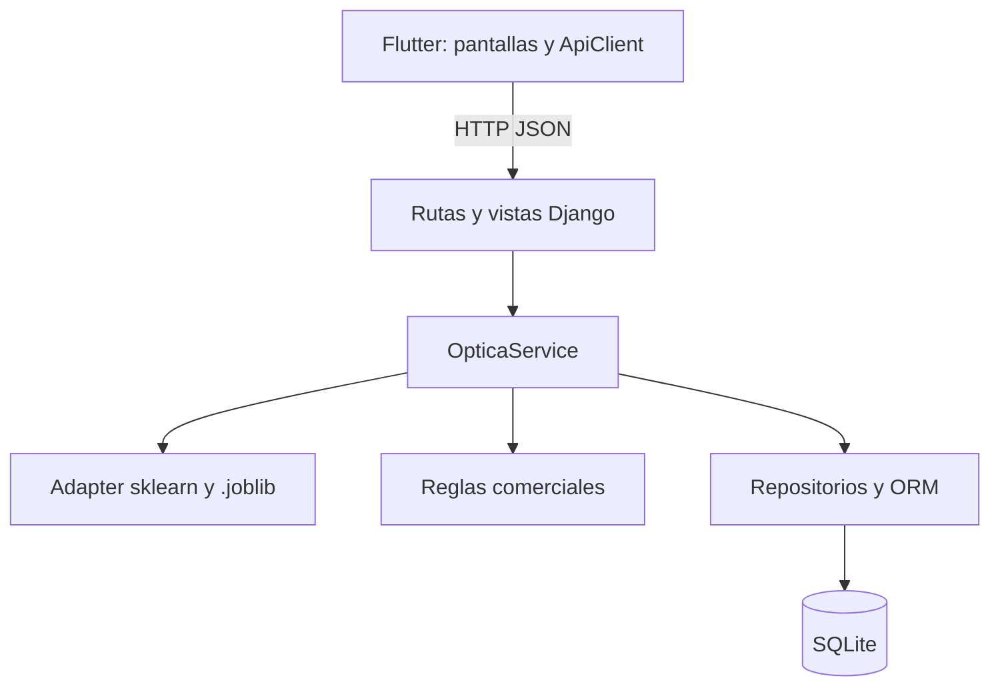
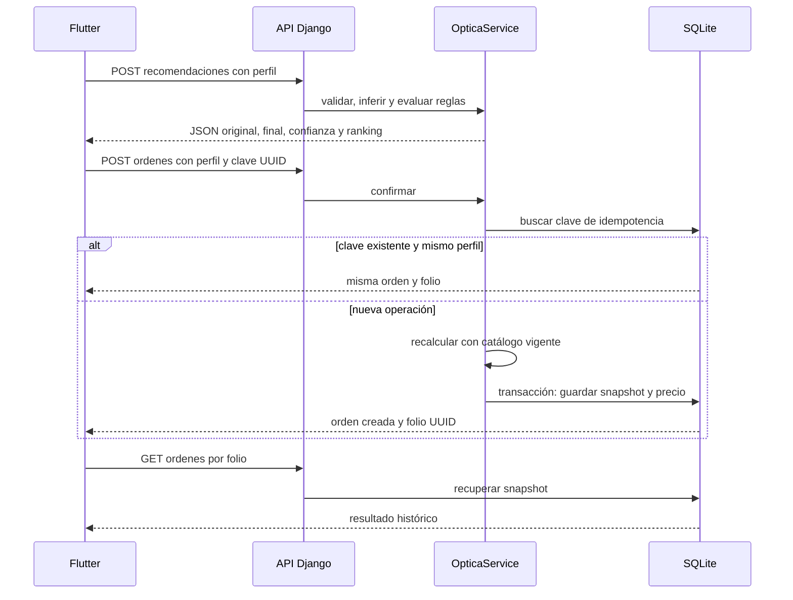
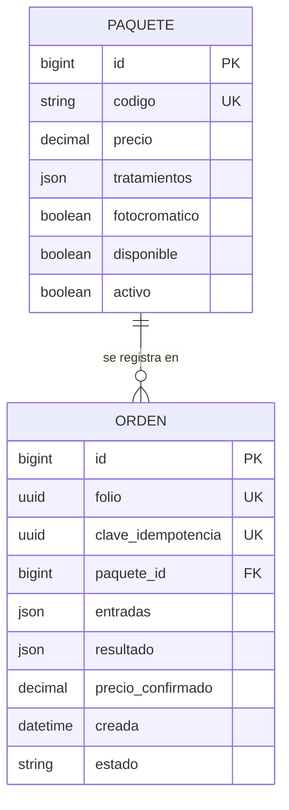

# Diagramas editables

Los PNG y SVG de `diagramas/` se generan desde los archivos `.dot` con Graphviz. Los siguientes Mermaid documentan las mismas relaciones para GitHub o un editor compatible.

## Arquitectura

## Confirmación y recuperación

## Modelo de datos

Los diagramas describen el prototipo actual. El modelo entrenado se guarda como artefacto .joblib; las probabilidades de cada orden forman parte de su snapshot JSON. No son tablas separadas.
