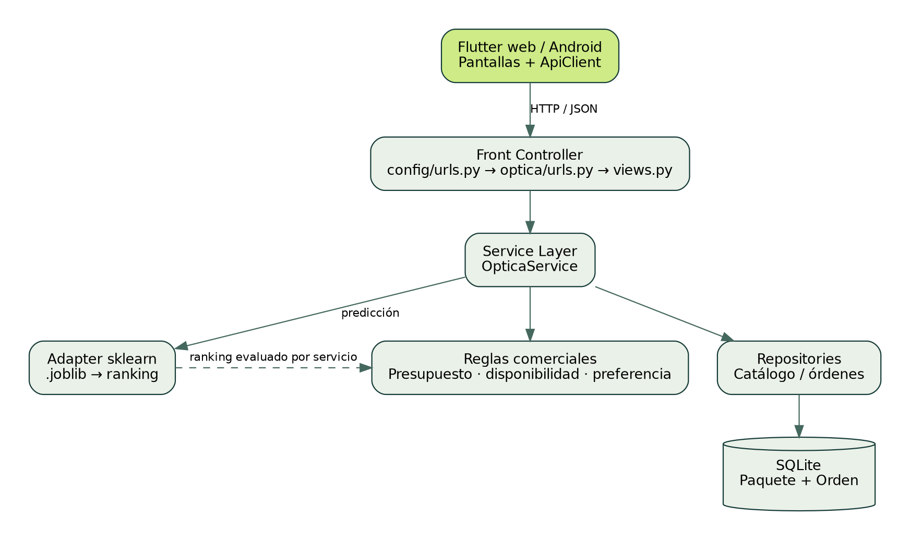
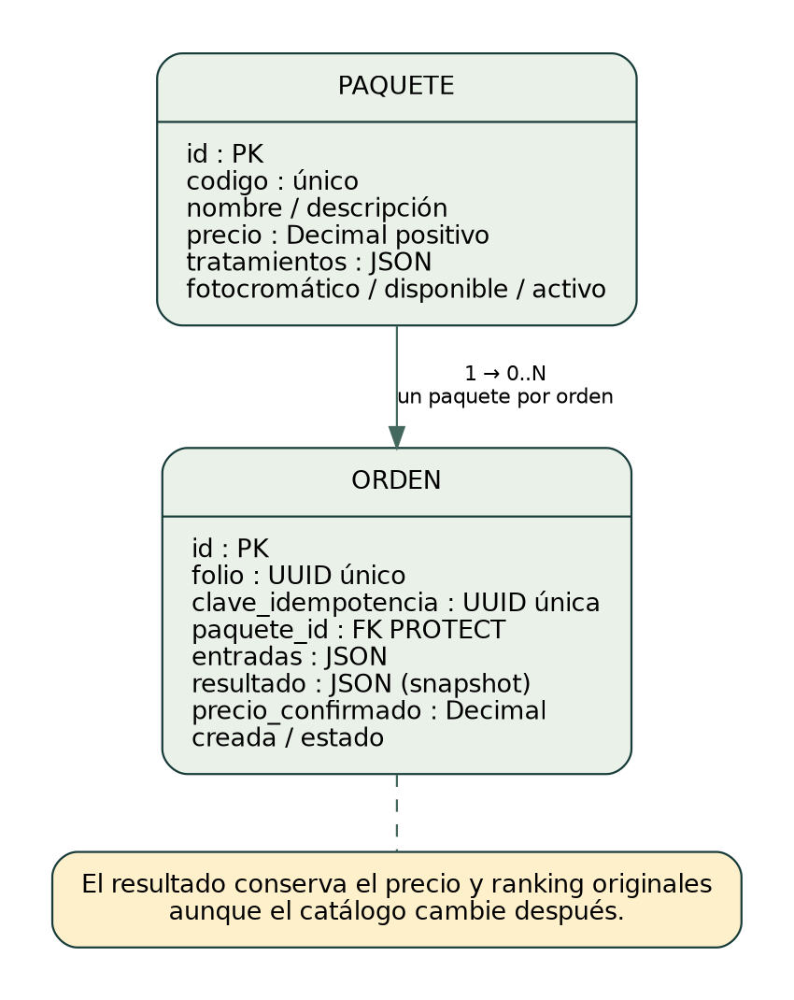

# Guía para entender, construir y defender Lúmina Óptica

> Documento original centrado en P1. Desde la revisión del 17/11/2026, la [guía conjunta P1/P2](DEFENSA_PROYECTOS_1_Y_2.md) amplía y actualiza la explicación del asistente, los entrenamientos, las pruebas y la exposición. El análisis de patrones vigente para ambos proyectos está en [ANALISIS_PATRONES_P1_P2.md](ANALISIS_PATRONES_P1_P2.md).

**Eduardo Osvaldo Rodríguez Gutiérrez · 22121280 · Proyecto 1 individual**

Esta guía explica el código entregado. Empieza ejecutando el inicio rápido del README. Después sigue el recorrido con los archivos abiertos en VS Code.

## 1. El problema y la decisión de diseño

Un comprador necesita comparar paquetes dentro de su presupuesto y sus preferencias. Un árbol aprende patrones de ejemplos de perfiles; sin embargo, una predicción no garantiza que el paquete siga disponible o que respete una restricción actual. Por eso se separa lo aprendido (modelo) de lo obligatorio (reglas).

El sistema conserva estable el contrato HTTP: el cliente manda cinco características y recibe una recomendación comprensible. Pueden cambiar el modelo, las políticas o el almacenamiento sin reescribir las pantallas. Se adapta el flujo de mensajería de los apuntes al dominio óptica, sin reutilizar las etiquetas de transporte.

## 2. Requisitos frente a decisiones propias

| Origen | Elemento |
|---|---|
| Requisito del curso | Django, SQLite, Flutter y recomendador `.joblib` + reglas |
| Requisito del curso | Catálogo, lista/detalle/búsqueda, formulario, confianza, corrección, orden y folio |
| Requisito del curso | Análisis de patrones con archivos propios y caso corregido |
| Decisión de esta solución | Marca ficticia Lúmina, cuatro paquetes y precios en MXN |
| Decisión de esta solución | Cinco variables, árbol de decisión y etiquetas sintéticas |
| Decisión de esta solución | Reglas de presupuesto, disponibilidad y preferencia fotocromática |
| Mejora de ingeniería | Recalcular al confirmar, snapshot histórico, idempotencia, pruebas y admin |
| Alcance posterior | Asistente entrenado (P2); integración de equipo y demo web/móvil (P3) |

## 3. Mapa de conexiones

En Flutter, una pantalla llama a `ApiClient`, que traduce objetos Dart a JSON y realiza HTTP. Django recibe la petición por sus rutas, la vista valida el formato del cuerpo y delega en `OpticaService`. El servicio valida los valores, solicita el ranking al adaptador del árbol, evalúa reglas contra el catálogo y arma una respuesta. Para registrar, también usa una transacción y `OrdenRepository`. El ORM convierte esas operaciones en SQL para SQLite.

El HTTP cruza procesos. Las llamadas de servicio, adaptador, reglas y repositorios ocurren dentro del mismo backend: no son microservicios. SQLite y `.joblib` son archivos distintos con funciones distintas: uno guarda registros que cambian; el otro conserva los parámetros de un modelo ya entrenado.

## 4. Entrenamiento: del CSV al artefacto

1. `ml/generar_datos.py` usa una semilla fija para producir 1,200 perfiles. Las etiquetas simulan decisiones comerciales históricas: exterior frecuente tiende a fotocromático; pantalla frecuente a antirreflejante; la combinación a Integral; el resto a Esencial. Incluye 10% de variación aleatoria en la asignación, que no equivale exactamente a 10% de etiquetas distintas.
2. El presupuesto y la preferencia aparecen como entradas, pero la política de etiquetado simulada no los respeta siempre. Esto representa una limitación explícita del historial. Las reglas actuales deben hacerlos cumplir. No se afirma que exista una base de pacientes o ventas reales.
3. `ml/entrenar.py` separa `X` (cinco entradas) de `y` (código de paquete). No introduce folios ni etiquetas como variables predictoras.
4. `train_test_split` reserva 20% de las filas, estratifica por clase y usa semilla 42. Se ajusta el preprocesamiento únicamente con la partición de entrenamiento.
5. `ColumnTransformer` deja pasar los números y convierte `uso_principal` mediante `OneHotEncoder`. Ejemplo conceptual: `oficina` se representa por una columna indicadora.
6. `Pipeline` combina transformación y árbol. `max_depth=6` y `min_samples_leaf=12` limitan complejidad para no memorizar perfiles aislados.
7. `fit` aprende con 960 filas. Se evalúa con las otras 240. `metricas.json` incluye accuracy, precisión, recall, F1 y matriz de confusión; `arbol.txt` permite leer las preguntas aprendidas.
8. `joblib.dump` guarda el Pipeline y una versión derivada del SHA-256 del CSV. No se entrena durante una petición HTTP.
9. En Django, `obtener_recomendador()` carga el archivo una vez por proceso con `lru_cache`. Al regenerarlo hay que reiniciar el servidor.

La accuracy obtenida fue **0.9375**. Significa que se acertaron **225 de 240 etiquetas sintéticas de prueba**. No mide calidad de atención, eficacia de tratamientos ni comportamiento con clientes reales. Tampoco implica que el paquete predicho cumpla el presupuesto: las reglas operan después.

## 5. Diccionario de entradas

| Campo JSON | Tipo y límites | Para qué se usa |
|---|---|---|
| `horas_pantalla` | Número, 0–16 | Contexto comercial de uso |
| `horas_exterior` | Número, 0–12 | Contexto de uso exterior |
| `presupuesto` | Número, 300–10000, máximo dos decimales | Restricción de precio |
| `uso_principal` | `general`, `estudio`, `oficina`, `exterior` | Categoría para OneHotEncoder |
| `prefiere_fotocromatico` | Booleano JSON real | Al activarse exige paquete fotocromático |

No se capturan datos personales ni graduación. Las horas de pantalla no son un diagnóstico. Precios y políticas son supuestos para una demostración de ingeniería.

## 6. La recomendación paso a paso

Abre `backend/optica/services.py`, método `recomendar`:

1. `validar_entradas` rechaza campos extra, booleanos donde se esperan números, valores fuera de rango, dinero con más de dos decimales, `NaN` y categorías desconocidas.
2. El adaptador construye un DataFrame con nombres de columnas explícitos y llama a `predict_proba` del Pipeline.
3. Cada clase recibe una probabilidad. El ranking se ordena de mayor a menor; para empates se usa el código del paquete.
4. El servicio obtiene del repositorio los paquetes activos. La IA no contiene precios oficiales ni decide disponibilidad.
5. Para cada clase, `motivos_descarte` ejecuta las políticas. Se guardan todos los motivos, incluso si un paquete incumple más de una regla.
6. Se elige la primera alternativa elegible. Se conserva la primera opción estadística como `original`; `corregido` compara su código con el de la elección final.
7. Si ninguna alternativa cumple, se responde 422 y no se inventa una opción de respaldo que viole el presupuesto.
8. La respuesta incluye paquete final, confianza original/final, ranking, motivos, entradas normalizadas y versión del modelo.

La suma de probabilidades se conserva (con redondeo de salida); no se renormaliza el ranking tras descartar opciones. Si la confianza final es 0%, se muestra así. Las reglas resuelven restricciones, no aumentan la certeza del árbol.

## 7. Caso corregido reproducible

| Entrada | Valor |
|---|---|
| Pantalla / exterior | 8 h / 1 h |
| Presupuesto | $700 MXN |
| Uso | Oficina |
| Fotocromático obligatorio | No |

El árbol propone **antirreflejante**, vendido como **Claridad** a $1,100, con **85%**. Presupuesto descarta Claridad y los paquetes de $1,800 y $2,400. La única opción elegible es **Esencial**, $650, cuya probabilidad es **0%**. La salida lleva `corregido: true` y explica el motivo. Revisa el ranking exacto en `evidencias/02_recomendacion.json`.

La baja probabilidad final es una limitación del modelo que se conserva visible. En una implantación real, habría que mejorar datos, evaluar confianza/calibración y definir cuándo remitir a revisión. Este proyecto demuestra la separación entre inferencia y política, no una óptima selección clínica.

## 8. Registrar: por qué hay dos POST

`POST /recomendaciones/` es una vista previa: no crea filas de Orden. El usuario puede cambiar de opinión. `POST /ordenes/` confirma una operación: recibe las mismas entradas, vuelve a calcular el resultado del servidor y lo guarda. Esta distinción evita llenar la base con simples consultas.

Flutter no envía el paquete ganador ni el precio como autoridad. Si alguien modifica el JSON y añade esos campos, se rechazan. La vista `registrar` exige un encabezado `Idempotency-Key` con UUID. La pantalla genera esa clave una vez y la conserva durante los reintentos.

En `OpticaService.registrar`:

1. Se normalizan y validan las entradas.
2. Si la clave ya existe con el mismo perfil, se devuelve la orden previa (200). Si corresponde a otro perfil, se rechaza (409).
3. Dentro de `transaction.atomic`, se recalculan modelo + reglas y se crea la orden (201).
4. La base impone unicidad para clave y folio; la referencia al paquete usa `PROTECT`.
5. Se persisten entradas, paquete, precio confirmado y un snapshot JSON completo del resultado: la consulta no vuelve a predecir con el catálogo de hoy.

La idempotencia funciona para reintentos desde la misma pantalla. Si cierras la pantalla o recargas antes de conocer el folio, el cliente puede perder esa clave: este prototipo no persiste una cola de confirmaciones pendientes. Una futura app con compras reales requeriría recuperación de operaciones y autenticación.

## 9. Datos y relaciones

`Paquete` contiene información comercial actual. `Orden` hace referencia a un paquete y registra la decisión histórica. La relación es 1:N: un paquete puede aparecer en varias órdenes; una orden registra exactamente un paquete. Los JSON guardan el contexto variable y el ranking sin crear tablas por cada probabilidad. El precio de dinero usa Decimal en la base y se serializa como texto; las entradas de presupuesto se validan antes de comparar con Decimal.

La disponibilidad es una bandera del paquete. No se descuentan armazones ni unidades físicas porque ese inventario no forma parte del alcance elegido. El folio UUID es un identificador consultable, no un mecanismo completo de autorización.

## 10. Cómo se construye la app Flutter

`main.dart` configura `MaterialApp`, `ThemeData` y el inicio. `HomeScreen` mantiene la pestaña seleccionada con `StatefulWidget`; `IndexedStack` conserva los estados de catálogo, formulario y consulta al cambiar de sección.

- `CatalogScreen`: usa `FutureBuilder`, carga desde `ApiClient.catalogo`, permite búsqueda explícita con Enter o el botón, muestra vacío, error y reintento. `RefreshIndicator` permite recargar. La cuadrícula usa una o dos columnas según ancho.
- `DetailScreen`: navega con `Navigator` y consulta el endpoint de detalle. Se muestran nombre, precio, tratamientos y disponibilidad.
- `ProfileScreen`: utiliza `Form`, `TextFormField`, controladores, `DropdownButtonFormField` y `SwitchListTile`. El usuario puede corregir campos antes de enviar. Los controladores se liberan en `dispose`.
- `ResultScreen`: muestra `RecommendationView`, abre `AlertDialog` y confirma con la clave UUID. Desactiva el botón mientras espera. Tras guardar reemplaza la ruta por el detalle de la orden.
- `OrderLookupScreen`: valida sintaxis del UUID, consulta el endpoint y presenta errores legibles si no existe.
- `OrderDetailScreen`: muestra lo realmente guardado y permite copiar el folio al portapapeles.
- `common.dart`: composición de widgets para contenedor, error e ilustraciones vectoriales de lentes. No se descargan fotos de terceros.
- `models.dart`: convierte JSON en modelos Dart. El modelo predictivo no está aquí: estos son objetos de datos del cliente.
- `ApiClient`: centraliza URL, codificación UTF-8, GET/POST, timeout y errores. Puede recibir `http.Client` simulado para pruebas.

Las respuestas asíncronas verifican `mounted` antes de actualizar estado. El estado de carga pertenece a cada pantalla; no se introduce una biblioteca de estado global para este tamaño de aplicación. Flutter decide cómo mostrar el resultado, mientras el servidor decide qué paquete es elegible.

## 11. Patrones que sí corresponden al código

Consulta el PDF independiente de dos páginas para la versión lista para entregar.

| Idea | Archivo real | Problema resuelto |
|---|---|---|
| Strategy / políticas intercambiables | `backend/optica/reglas.py` | Cada regla evalúa la misma interfaz; se cambia una política sin mezclarla con el modelo ni la vista |
| Adapter | `backend/optica/recomendador.py` | Traduce Pipeline/clases/arrays de sklearn a pares de código y probabilidad |
| Repository | `backend/optica/repositories.py` | Centraliza ORM; el servicio no construye consultas desde la UI o las vistas |
| Front Controller | `backend/config/urls.py`, `backend/optica/urls.py`, `views.py` | Entrada HTTP y despacho de rutas a casos de uso |
| Service Layer / Facade | `backend/optica/services.py` | Un punto coordina validación, inferencia, reglas y persistencia |
| Transacción / Unit of Work equivalente | `services.py`, `transaction.atomic` | La confirmación delimita una operación atómica con ORM; no es una clase UnitOfWork propia |
| Separación tipo MVC | `flutter_app/lib/screens/`, `models/`, `data/` | Separa presentación, datos y comunicación; Flutter no es un framework MVC estricto |
| Composición y estado local | `widgets/common.dart`, pantallas y `main.dart` | Reutiliza UI, mantiene estados de carga y navegación sin reglas de negocio locales |

No se implementan Factory Method, Abstract Factory, Builder, Prototype o Singleton propios porque no hay una familia de construcción variable que los justifique. La caché del modelo no se presenta como un Singleton GoF. No hay Observer de dominio, colas o notificaciones posteriores. La reconstrucción de widgets Flutter no se utiliza para afirmar que implementamos un bus Observer propio.

## 12. Relación con el conjunto de apuntes

| Bloque del curso | Relación en este proyecto |
|---|---|
| Reconocer estructuras antes de memorizar patrones | Se identifica la variación real: modelo, políticas y almacenamiento; se separa esa variación |
| Catálogo GoF | Se aplican Adapter y políticas equivalentes a Strategy; se justifica la ausencia de otros patrones |
| Plataforma de entregas | Se conserva el caso de uso API/cliente/IA, cambiando la decisión a paquetes ópticos |
| Repository y Service Layer | Acceso ORM separado de la orquestación y de HTTP |
| Front Controller / middleware | URLs de Django; middleware CORS y validación de métodos/formato |
| Unit of Work e idempotencia | `atomic` y clave única de confirmación para reintentos |
| Modelo de IA en plataforma | Mismo Pipeline, partición, `.joblib`, caché, ranking y reglas posteriores |
| Django | Configuración, apps, modelos, migraciones, SQLite, JSON, admin y pruebas |
| Flutter fundamentos | Stateless/Stateful, composición, Form, Navigator, FutureBuilder, tema y UI adaptable |
| Flutter red | Cliente HTTP configurable; diferencia de localhost entre web y emulador; CORS |
| Monolito frente a microservicios | Un backend desplegable. La separación Flutter/Django es cliente-servidor |
| Gateway / BFF / Docker | No necesarios para P1; incorporar por requisitos reales posteriores |
| Asistente entrenado / RAG | Corresponde a P2; no se sustituye el recomendador por respuestas de chat |
| Empaquetado web y móvil | Mismo código Flutter; cambia URL base y empaquetado; la demo dual se pide en P3 |
| Antipatrones e IA | Evita Golden Hammer y lógica de precios en la UI; declara generación asistida y límites de los datos |

## 13. Orden de construcción recomendado para reproducirlo

1. Define el catálogo, entradas, clases objetivo y políticas por separado.
2. Crea Django y la app `optica`; configura SQLite.
3. Crea `Paquete` y `Orden`, genera/aplica migraciones y siembra el catálogo.
4. Genera el CSV, separa datos, entrena y evalúa; guarda el Pipeline.
5. Escribe el adaptador y las reglas; comprueba a mano un caso normal y uno corregido.
6. Crea repositorios y `OpticaService`; conecta vistas y rutas JSON.
7. Añade confirmación con transacción, snapshot, clave y folio; prueba errores y reintentos.
8. Crea Flutter y centraliza la comunicación en `ApiClient`.
9. Construye catálogo, detalle y formulario antes de añadir resultado y confirmación.
10. Añade consulta, estados de carga, errores y diseño adaptable.
11. Ejecuta pruebas, análisis estático y build web; verifica la app contra Django real.
12. Toma capturas del flujo, revisa que el análisis describa esos archivos y entrega.

## 14. Guion para explicar el proyecto sin memorizar

“Mi sistema recomienda paquetes comerciales de una óptica. Flutter recoge cinco entradas y llama a Django. Django valida, carga un árbol previamente entrenado y obtiene un ranking. Después las reglas eliminan paquetes fuera del presupuesto, sin disponibilidad o que no cumplen la preferencia indicada. Devuelve la decisión original y final con sus confianzas. Al confirmar, el servidor vuelve a evaluar y guarda un snapshot con precio, versión e identificador UUID en SQLite. Por eso la app no puede imponer una recomendación ni un precio y el folio recupera lo que se registró realmente.”

Preguntas de defensa:

- **¿Dónde está la IA?** En el Pipeline guardado en `backend/optica/modelo/modelo_optica.joblib`; se consume mediante el adaptador del backend.
- **¿Por qué reglas además del modelo?** La predicción aprende ejemplos; precio y disponibilidad actuales son restricciones obligatorias.
- **¿Por qué no microservicios?** P1 lo indica dentro del monolito y no tenemos necesidades de escalamiento/equipos separados que justifiquen esa infraestructura.
- **¿Por qué dos confianzas?** Para no atribuir a la decisión corregida la probabilidad de otra clase.
- **¿Qué falla con datos sintéticos?** La evaluación solo refleja la política simulada y puede heredar sus sesgos; faltan datos reales y validación externa.
- **¿Qué pasa sin paquetes válidos?** Se devuelve 422, se explica el conflicto y no se crea una orden.
- **¿Qué evita duplicados?** Una clave UUID por confirmación y unicidad en la base; los reintentos con el mismo perfil devuelven el mismo folio.
- **¿Por qué la consulta conserva el precio anterior?** La orden guarda precio y resultado históricos; no vuelve a calcular con el catálogo actual.

## 15. Fuentes y uso de IA

- Eduardo Alcaraz, [apuntes de Tópicos Selectos de Tecnologías Web y Móvil](https://ealcaraz85.github.io/topicoswebmobil/), apartados de proyectos progresivos, modelo de IA, patrones, Django y Flutter. Consulta: 10/11/2026.
- [Django: transacciones](https://docs.djangoproject.com/en/5.2/topics/db/transactions/), [modelos](https://docs.djangoproject.com/en/5.2/topics/db/models/).
- [Flutter: HTTP](https://docs.flutter.dev/cookbook/networking/send-data), [formularios](https://docs.flutter.dev/cookbook/forms/validation).
- [scikit-learn: persistencia](https://scikit-learn.org/stable/model_persistence.html), [árboles de decisión](https://scikit-learn.org/stable/modules/tree.html).
- README de referencia suministrado por el estudiante: se tomó la organización documental, no el código ni la evidencia de ese proyecto.

Se usó ChatGPT/Codex para generar y revisar esta implementación y sus materiales. El estudiante debe ejecutar la aplicación, contrastar el código con los apuntes y asumir la explicación final. No se afirma que ya realizó esa revisión ni que los datos proceden de una óptica real.

## 16. Lectura de las evidencias visuales

Las capturas originales 00–09 proceden de widgets renderizados con flutter_tester y conectados por HTTP al backend real. Las nuevas 10–17 proceden de Chrome ejecutando Flutter web compilado con esa misma API real; se regeneran mediante `scripts/capturar_navegador.py`. Ninguna de estas herramientas sustituye la API por MockClient. El viewport móvil comprueba el diseño adaptable, sin implicar ejecución en Android. El README y `evidencias/VALIDACION_LOCAL_2026-11-11.md` explican cómo repetir cada comprobación.

Para estudiar el recorrido archivo por archivo y localizar cada bloque del curso, continúa con [RELACION_APUNTES.md](RELACION_APUNTES.md). Para editar el informe completo utiliza [AVANCE_ANALISIS.md](AVANCE_ANALISIS.md) o su generador Python.
