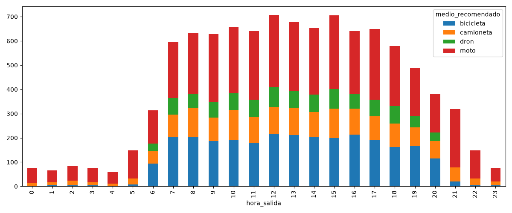

# Análisis de las ocho actividades del dataset

Predicciones previas: [PREDICCIONES.md](PREDICCIONES.md). Código propio: `../../laboratorio/analisis.py`. Datos sintéticos y generador originales del profesor. Resultados calculados en esta computadora; no se copian los de otro alumno. Las proporciones se expresan de 0 a 1 salvo donde se indica %. Semilla 42, prueba estratificada 20 %.

## Actividad 1 — El retrato del dataset

**Resultado: porcentajes por clima.**

| clima | bicicleta | camioneta | dron | moto |
| --- | --- | --- | --- | --- |
| despejado | 32.8390 | 16.5692 | 13.5178 | 37.0740 |
| lluvia | 8.4910 | 16.6752 | 0.0000 | 74.8338 |
| viento_fuerte | 31.6860 | 18.4109 | 0.0000 | 49.9031 |

**Porcentajes por zona.**

| zona_destino | bicicleta | camioneta | dron | moto |
| --- | --- | --- | --- | --- |
| centro | 58.4486 | 13.5245 | 0.0000 | 28.0270 |
| periferia | 0.8798 | 13.9785 | 12.6100 | 72.5318 |
| residencial | 26.1970 | 14.6152 | 17.2976 | 41.8902 |
| rural | 0.0000 | 40.8000 | 0.0000 | 59.2000 |

| medio_recomendado | distancia_km_min | distancia_km_median | distancia_km_max | peso_kg_min | peso_kg_median | peso_kg_max | volumen_l_min | volumen_l_median | volumen_l_max |
| --- | --- | --- | --- | --- | --- | --- | --- | --- | --- |
| bicicleta | 0.3700 | 3.4200 | 7.0000 | 0.1000 | 1.7600 | 7.9900 | 0.3000 | 7.7800 | 39.7000 |
| camioneta | 0.4300 | 8.9900 | 59.1200 | 0.1000 | 6.7250 | 80.0000 | 0.3000 | 31.3650 | 400.5700 |
| dron | 2.0700 | 9.5350 | 14.9900 | 0.1000 | 1.0450 | 2.5000 | 0.3000 | 4.2900 | 11.9800 |
| moto | 0.3400 | 10.6300 | 39.9000 | 0.1000 | 2.5800 | 24.9300 | 0.3000 | 11.2750 | 89.9900 |

**Comparación y preguntas.** Hay 0 etiquetas imposibles de 10000. En periferia aparecen 18 bicicletas; las distancias de esas filas están entre 5.38 y 6.93 km. La distancia explica la asociación sin inventar una prohibición por zona. Hay 107 camionetas a menos de 2 km y 95 no tienen otra alternativa factible. Las restantes pueden deberse a refrigeración, riesgos, costo/tiempo o ruido: se examinan las filas, no se atribuye todo al azar. Dron está prohibido con lluvia, viento fuerte y en el centro; en rural la distancia puede excluirlo aunque no haya prohibición por zona. Los máximos sugieren límites, pero observar un máximo menor no prueba una restricción contractual. **Decisión:** reconstruir reglas solo del CSV confunde ausencia de ejemplos con imposibilidad. Conservar restricciones explícitas y verificarlas antes de operar.

## Actividad 2 — La hora y el dron

| hora_salida | bicicleta | camioneta | dron | moto |
| --- | --- | --- | --- | --- |
| 0 | 2 | 12 | 0 | 63 |
| 1 | 6 | 11 | 0 | 49 |
| 2 | 5 | 19 | 0 | 59 |
| 3 | 4 | 13 | 0 | 60 |
| 4 | 2 | 10 | 0 | 47 |
| 5 | 8 | 25 | 0 | 116 |
| 6 | 94 | 50 | 33 | 136 |
| 7 | 204 | 92 | 68 | 233 |
| 8 | 205 | 118 | 57 | 252 |
| 9 | 187 | 97 | 65 | 279 |
| 10 | 192 | 123 | 68 | 273 |
| 11 | 178 | 107 | 72 | 283 |
| 12 | 217 | 111 | 82 | 297 |
| 13 | 211 | 112 | 70 | 284 |
| 14 | 204 | 103 | 72 | 274 |
| 15 | 199 | 122 | 81 | 303 |
| 16 | 213 | 108 | 59 | 260 |
| 17 | 192 | 97 | 69 | 292 |
| 18 | 162 | 97 | 72 | 248 |
| 19 | 166 | 78 | 45 | 199 |
| 20 | 115 | 72 | 35 | 160 |
| 21 | 20 | 58 | 0 | 240 |
| 22 | 5 | 28 | 0 | 116 |
| 23 | 5 | 15 | 0 | 55 |

| version | exactitud | precision_dron | recall_dron | predice_dron | imposibles |
| --- | --- | --- | --- | --- | --- |
| sin columna | 0.9210 | 0.8390 | 0.9053 | 205 | 31 |
| es_de_noche | 0.9295 | 0.9101 | 0.9053 | 189 | 14 |

**Conteo del ejercicio sobre las 10 000 filas (no es una métrica de generalización):** sin columna 121; con es_de_noche 89. La tabla anterior usa exclusivamente la prueba de 2 000 filas.

**Comparación.** La noche representa 10.53%: 1053 filas frente a 8947 diurnas. La tabla permite contrastar las horas sin dron con el intervalo legal 6–20. El generador penaliza a la bicicleta de noche y modifica el tráfico por hora; no es una prohibición absoluta de bicicleta. Representar noche con umbrales requiere separar hora < 6 de hora >= 21, al menos dos comparaciones. **Decisión:** conservar es_de_noche si mejora los imposibles y métricas en prueba, no solo exactitud. La predicción previa se contrasta con la fila calculada; si no mejora, no se fuerza la conclusión.

## Actividad 3 — Anatomía de los errores

| real | predicho | cantidad |
| --- | --- | --- |
| moto | bicicleta | 46 |
| camioneta | moto | 32 |
| moto | dron | 29 |
| bicicleta | moto | 20 |
| dron | bicicleta | 18 |
| camioneta | bicicleta | 9 |
| camioneta | dron | 4 |

**Motos que pasan a dron y no corrigen las reglas:**

| index | distancia_km | peso_kg | volumen_l | hora_salida | prioridad | clima | trafico | zona_destino | fragil |
| --- | --- | --- | --- | --- | --- | --- | --- | --- | --- |
| 2484 | 7.3500 | 1.6700 | 5.7200 | 17 | express | despejado | alto | residencial | 0 |
| 3722 | 12.1400 | 0.9000 | 3.6800 | 13 | normal | despejado | alto | residencial | 0 |
| 677 | 7.5500 | 1.0500 | 6.6000 | 18 | normal | despejado | alto | residencial | 0 |

**Diferencias en prioridad, proporciones:**

| prioridad | moto_a_bicicleta | bicicleta_correcta |
| --- | --- | --- |
| mismo_dia | 0.4783 | 0.1187 |
| express | 0.3043 | 0.2987 |
| normal | 0.2174 | 0.5826 |

**Diferencias en clima, proporciones:**

| clima | moto_a_bicicleta | bicicleta_correcta |
| --- | --- | --- |
| despejado | 0.5217 | 0.8479 |
| lluvia | 0.2391 | 0.0204 |
| viento_fuerte | 0.2391 | 0.1317 |

**Diferencias en fragil, proporciones:**

| fragil | moto_a_bicicleta | bicicleta_correcta |
| --- | --- | --- |
| 0 | 0.6522 | 0.7143 |
| 1 | 0.3478 | 0.2857 |

**Resultado y comparación.** 158 errores de 2000; las tres confusiones principales aparecen arriba. De 29 motos enviadas a dron, 26 son nocturnas; las otras necesitan inspeccionar clima, zona y capacidad, no solo la hora. Las 46 motos enviadas a bicicleta tienen distancia mediana 3.88 km; 5 están a 6 km o más. Se conservan filas, prioridades, clima y riesgos en los CSV para explicar las diferencias. Cambiar random_state cambia los ejemplos de entrenamiento/prueba y ya no permite evaluar el archivo guardado como si fuera el mismo holdout. **Decisión:** priorizar recomendaciones físicamente inviables mediante reglas; los errores entre medios posibles se evalúan por costo y riesgo, sin confundir etiqueta con verdad absoluta.

## Actividad 4 — ¿Qué columnas usa de verdad el modelo?

| index | feature | importancia |
| --- | --- | --- |
| 0 | numericas__distancia_km | 0.3220 |
| 5 | numericas__volumen_l | 0.1929 |
| 7 | numericas__refrigerado | 0.1313 |
| 1 | numericas__peso_kg | 0.1263 |
| 18 | categoricas__clima_lluvia | 0.0805 |
| 17 | categoricas__clima_despejado | 0.0633 |
| 9 | numericas__hora_salida | 0.0587 |
| 6 | numericas__fragil | 0.0199 |
| 11 | categoricas__prioridad_mismo_dia | 0.0020 |
| 12 | categoricas__prioridad_normal | 0.0011 |
| 8 | numericas__valor_declarado_mxn | 0.0007 |
| 3 | numericas__ancho_cm | 0.0007 |
| 2 | numericas__largo_cm | 0.0003 |
| 4 | numericas__alto_cm | 0.0003 |
| 20 | categoricas__trafico_alto | 0.0002 |
| 14 | categoricas__zona_destino_periferia | 0.0000 |
| 13 | categoricas__zona_destino_centro | 0.0000 |
| 10 | categoricas__prioridad_express | 0.0000 |
| 16 | categoricas__zona_destino_rural | 0.0000 |
| 15 | categoricas__zona_destino_residencial | 0.0000 |
| 19 | categoricas__clima_viento_fuerte | 0.0000 |
| 21 | categoricas__trafico_bajo | 0.0000 |
| 22 | categoricas__trafico_medio | 0.0000 |

**Importancia agrupada de las catorce columnas originales:**

| index | importancia |
| --- | --- |
| distancia_km | 0.3220 |
| volumen_l | 0.1929 |
| clima | 0.1438 |
| refrigerado | 0.1313 |
| peso_kg | 0.1263 |
| hora_salida | 0.0587 |
| fragil | 0.0199 |
| prioridad | 0.0031 |
| valor_declarado_mxn | 0.0007 |
| ancho_cm | 0.0007 |
| largo_cm | 0.0003 |
| alto_cm | 0.0003 |
| trafico | 0.0002 |
| zona_destino | 0.0000 |

| index | sin | exactitud | cambio_pp |
| --- | --- | --- | --- |
| 0 | distancia_km | 0.7930 | -12.8000 |
| 12 | clima | 0.8445 | -7.6500 |
| 7 | refrigerado | 0.8785 | -4.2500 |
| 9 | hora_salida | 0.8910 | -3.0000 |
| 1 | peso_kg | 0.9040 | -1.7000 |
| 5 | volumen_l | 0.9060 | -1.5000 |
| 6 | fragil | 0.9155 | -0.5500 |
| 2 | largo_cm | 0.9205 | -0.0500 |
| 4 | alto_cm | 0.9205 | -0.0500 |
| 3 | ancho_cm | 0.9205 | -0.0500 |
| 11 | zona_destino | 0.9210 | 0.0000 |
| 8 | valor_declarado_mxn | 0.9210 | 0.0000 |
| 13 | trafico | 0.9210 | 0.0000 |
| 10 | prioridad | 0.9215 | 0.0500 |

Las cuatro columnas de origen más importantes fueron distancia_km, volumen_l, clima, refrigerado. El inicio del árbol se conserva en `resultados/04_inicio_arbol.txt` para contrastar nodos y el orden previo. La mayor caída al quitar una columna fue distancia_km: -12.80 puntos. Columnas sin cambio en esta partición: zona_destino, valor_declarado_mxn, trafico. La predicción previa puso peso/volumen antes que clima; los datos permiten identificar ese desacuerdo sin reescribir la hipótesis.

**Comparación y decisión.** Las cuatro primeras filas muestran las entradas usadas por el árbol; las variables one-hot deben agruparse por columna de origen antes de compararlas con el orden previo. Quitar una columna y reentrenar no equivale a ponerla en cero en inferencia. Una importancia cero de zona no evita que reglas.py prohíba un dron al centro: son responsabilidades distintas. Se mantienen datos necesarios para restricciones, cálculo de volumen, auditoría o seguimiento aunque no mejoren este árbol. Retirar campos de la app exige analizar ese uso y versionar el contrato.

## Actividad 5 — El dron es minoría: ¿hay que balancear?

**Parte A.** Un sistema que nunca acierta drones y acierta todo lo demás tendría 90.52%; siempre responder la clase mayoritaria daría 45.78%. Ninguno basta para juzgar drones: se necesitan precisión, recall, matriz y costo. Su rareza proviene de capacidades, clima, horario y zonas. Separar primero y balancear solo entrenamiento; la prueba debe conservar la distribución objetivo.

**Parte B: misma prueba intacta para todas las estrategias.**

| estrategia | entrenamiento | exactitud | precision_dron | recall_dron | predice_dron | imposibles |
| --- | --- | --- | --- | --- | --- | --- |
| sin_balancear | 8000 | 0.9210 | 0.8390 | 0.9053 | 205 | 31 |
| submuestreo | 3032 | 0.8975 | 0.8894 | 0.9316 | 199 | 29 |
| sobremuestreo | 14652 | 0.9065 | 0.7661 | 1.0000 | 248 | 35 |
| class_weight_balanced | 8000 | 0.9025 | 0.7661 | 1.0000 | 248 | 35 |
| drones_nuevos | 9942 | 0.9005 | 0.7224 | 1.0000 | 263 | 56 |

**Trampa explícita, no válida como resultado comparable:** 728 IDs aparecen a ambos lados después de duplicar antes de separar. Métricas de esa prueba contaminada: `{"exactitud": 0.9428125, "precision_dron": 0.9583911234396671, "recall_dron": 0.9949604031677466, "predice_dron": 1442, "imposibles": 36}`. El resultado no mide generalización y cambia la prevalencia. **Parte C.** Mayor recall puede comprar falsos positivos; el submuestreo pierde ejemplos de regiones raras. Duplicar y ponderar pueden parecerse porque alteran el peso efectivo, aunque no garantizan el mismo árbol. Después de cambiar prevalencias, predict_proba no es confianza calibrada para la población original. **Parte D.** No desplegaría balanceo solo por recall: evaluaría costo y precisión del dron y conservaría las reglas. Comprar más drones requiere datos nuevos y revisar restricciones; duplicar filas viejas no representa mayor capacidad.

## Actividad 6 — ¿Quién se equivoca: el modelo o los datos?

| decision | costo_total | exceso_porcentaje |
| --- | --- | --- |
| optimo | 242269.9333 | 0.0000 |
| etiquetas | 247788.5543 | 2.2779 |
| modelo_con_reglas | 242689.0522 | 0.1730 |
| entrenado_con_optimo | 242631.9267 | 0.1494 |

**Desacuerdos con la etiqueta que recuperan el óptimo, por confusión:**

| etiqueta | modelo | cantidad |
| --- | --- | --- |
| bicicleta | moto | 18 |
| camioneta | bicicleta | 9 |
| camioneta | dron | 4 |
| camioneta | moto | 29 |
| dron | bicicleta | 7 |
| moto | bicicleta | 37 |
| moto | dron | 3 |

**Preguntas.** Óptimo/etiqueta coinciden 93.65%; el modelo sin reglas coincide con etiqueta 92.10% y con reglas 93.65%. Modelo con reglas/óptimo: 98.10%. De 127 desacuerdos con etiqueta, 107 recuperan el óptimo. El CSV de rescates indica cuáles confusiones de la actividad 3 no son peores decisiones según costo. El supuesto techo describe ruido difícil de predecir, no un límite estadístico probado. Comparar el costo con la última fila indica cuánto ayuda limpiar etiquetas; su costo humano debe compararse con ese ahorro. El alumno puede superar el costo de las etiquetas porque una hoja con varios ejemplos suaviza decisiones ruidosas; no aprende necesariamente cada error individual del operador. **Decisión:** si la fórmula ya es exacta y barata, usarla directamente. Con decisiones humanas sin fórmula, revisar resultados operativos y adjudicar una muestra; accuracy solo mide acuerdo con quien etiquetó.
