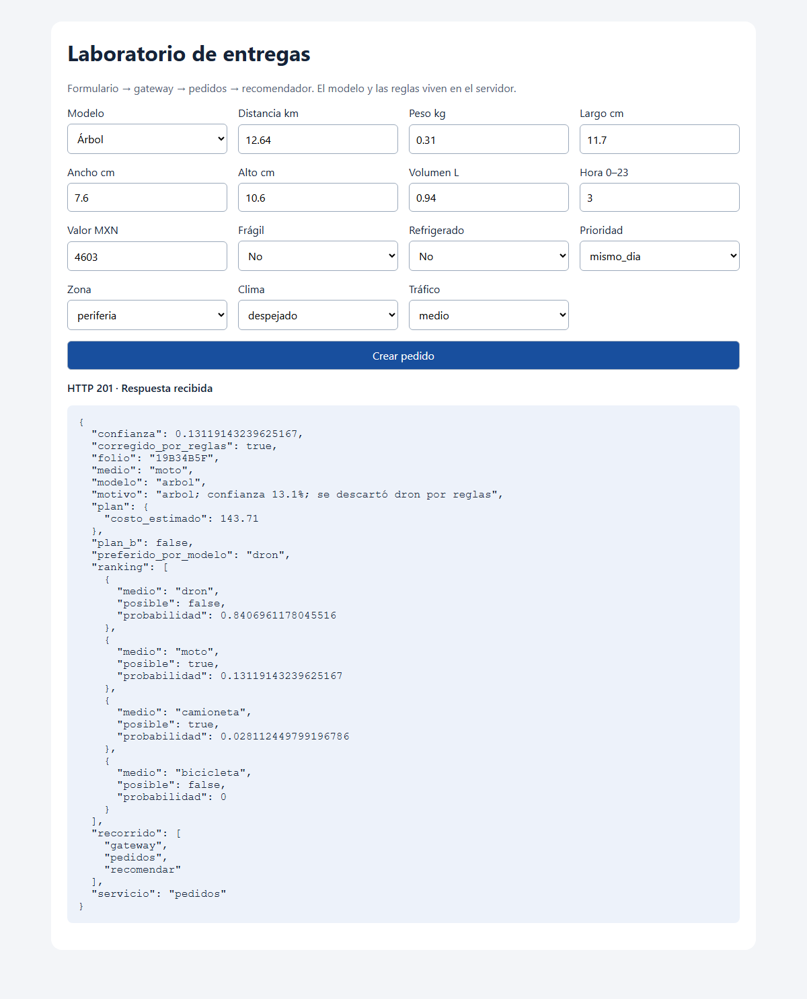
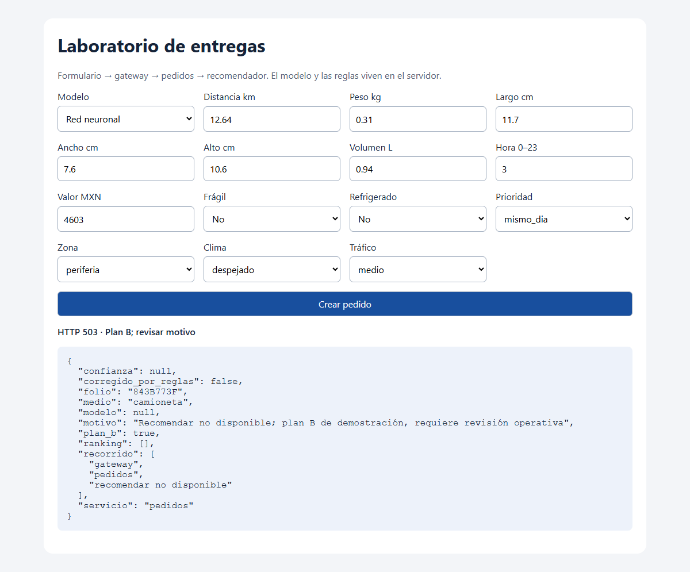

# Microservicios con Docker — informe individual

Nombre: Eduardo Osvaldo Rodríguez Gutiérrez. Matrícula: 22121280.
Equipo: Eduardo Rodríguez, Rodrigo Vega Espinoza, Diego Rivera Cisneros, Diego Soria Magos y Gonzalo García Chávez.

**Estado real:** código Compose/Docker preparado. La ejecución disponible es de procesos Python separados y proxy local; Docker no está instalado. No se presenta esta evidencia como contenedores, nginx ni compose ps.

## 1. Predicción a las 3:00 y resultado

La hipótesis de restricciones del archivo PREDICCIONES.md anticipa que dron no debe salir de noche; el segundo medio del ranking determina el resultado final. Para el paquete del formulario se esperaba un medio terrestre viable. No se presenta la cifra de un modelo como una deducción física.

Resultado HTTP real: folio 46A3FACA, medio moto. Motivo: arbol; confianza 13.1%; se descartó dron por reglas. La preferencia original fue dron; corregido_por_reglas=True.



## 2. docker compose ps: qué hay en cada contenedor

**Pendiente de ejecución real.** No hay una salida inventada de compose ps. La definición contiene gateway (nginx, único puerto 8080 publicado), pedidos (Flask/requests, sin sklearn) y recomendar (Flask/modelos/reglas). Cuando exista Docker, ejecutar docker compose up --build y guardar docker compose ps. La comprobación actual usa los procesos que crea scripts/capturar_evidencias.py en puertos locales 18080/18081/18082.

## 3. Fallo al apagar Recomendar

Se terminó únicamente el proceso Recomendar. Pedidos y el gateway local siguieron respondiendo: HTTP 503, plan_b=True, medio camioneta. La página mostró el motivo y no quedó en blanco. El plan B es una demostración, no autorización para enviar un paquete real.



## 4. Réplicas de la etapa 5 frente a esto

Las réplicas repiten la misma imagen y todas pueden ejecutar todas sus funciones. Aquí Pedidos no tiene el modelo: debe solicitar por HTTP la sugerencia a otro proceso con ciclo de vida propio. Esa separación, no contar rutas o puertos, distingue el diseño. La demostración Docker de ambos casos sigue pendiente.

## 5. Camino navegador → modelo

```text
Navegador --HTTP--> Gateway --HTTP--> Pedidos --HTTP--> Recomendar
                                                     └--memoria--> Pipeline + reglas
```

El salto de Pedidos a Recomendar puede agotar tiempo, fallar conexión o devolver errores. Dentro de Recomendar, cargar/predecir es una llamada local. En el monolito Django solo había HTTP hasta la vista; modelo y reglas se importaban dentro de su despliegue.

## 6. Cambia solo el .joblib

Se reconstruye la imagen Recomendar y se recrea ese servicio: docker compose build recomendar y docker compose up -d recomendar. Como cargar_artefacto mantiene caché por proceso, reemplazar el archivo sin reiniciar no garantiza que se cargue la nueva versión. Pedidos y Gateway no requieren cambiar si se conserva el contrato. En el monolito, un redepliegue afecta su unidad común.

## 7. Dos límites antes de producción

Los pedidos se guardan en memoria y desaparecen al reiniciar; falta persistencia e idempotencia. Además, la práctica no autentica usuarios ni autoriza acceso por folio; requiere credenciales, TLS y controles de operación. El 503 con folio obliga a definir semántica de reintentos antes de usar pagos reales.

## 8. HTML frente al monolito

Se parecen en el formulario, selector y JSON mostrado. Cambia el propietario del HTML y el recorrido: nginx/gateway en vez de plantilla Django, fetch relativo a /pedidos en vez de /entregas/recomendar/. El navegador no conoce nombres internos de servicios. En ambos las reglas quedan en el servidor.

## 9. Misma hora con árbol, bosque y red

| Modelo | Medio | Confianza | Preferido | Corregido | HTTP |
|---|---|---|---|---|---|
| arbol | moto | 0.1312 | dron | True | 201 |
| bosque | moto | 0.8100 | moto | False | 201 |
| red | moto | 0.7440 | moto | False | 201 |

Los medios finales se comparan con el ranking: pueden coincidir aunque las probabilidades y la intervención de las reglas cambien. Confianza no equivale a probabilidad calibrada de que la decisión sea óptima. La exactitud global no se infiere de este único paquete.

Evidencia reproducible: ../../evidencias/verificacion/http.json; scripts/capturar_evidencias.py. El informe se genera leyendo esas respuestas reales con scripts/documentar_verificacion.py.
